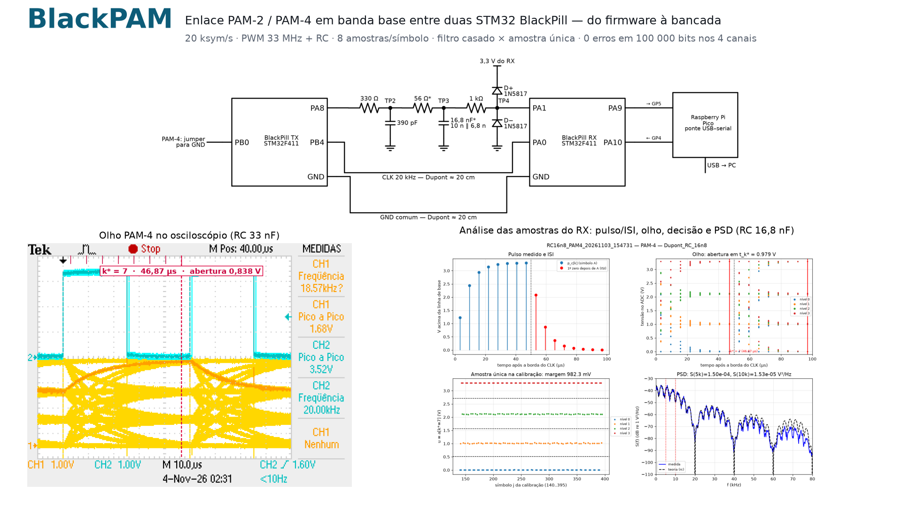

# BlackPAM

**Enlace PAM-2 / PAM-4 em banda base entre duas STM32 BlackPill, do firmware à bancada.**

Projeto da disciplina de Telecomunicações (Eng. Eletrônica, UTFPR, 2026/2). Uma placa transmite símbolos PAM por PWM + filtro RC, um canal (fio Dupont, modelo RC de 300 m de CAT5e ou 200 m de cabo real) leva o sinal, e a outra placa amostra 8 vezes por símbolo, treina o próprio detector e conta os erros. Junto com o firmware vão o app de bancada que automatiza o osciloscópio e a serial, as análises em Python e MATLAB, os modelos Simulink, todos os dados medidos e o material de estudo.



> *English summary.* BlackPAM is a baseband PAM-2/PAM-4 link between two STM32F411 "BlackPill" boards: PWM-based DAC at 33 MHz + RC filter on TX, 20 ksym/s, a clock line for symbol timing, 8 ADC samples per symbol via TIM2→ADC→DMA on RX, PRBS-15 payload, self-training of pulse shape and thresholds, and two detectors (single sample at k\* and a digital matched filter). Tested on four channels with a Tektronix TDS2002B driven over USB from a Python bench app: 0 errors in 100 000 bits on every channel, with measured τ, eye openings and PSD matching theory. Docs are in Portuguese.

## Resultados (medidos na bancada)

| Canal | PAM | τ medido | Abertura do olho em k\* | Erros (amostra única) | Erros (filtro casado) |
|---|---|---|---|---|---|
| Dupont direto | 2 / 4 | 0,22 µs | 3,291 V / 0,965 V | 0 / 100 000 | 0 / 100 000 |
| RC 56 Ω + 16,8 nF (≈ 300 m de CAT5e) | 2 / 4 | 7,3 µs | 3,273 V / 0,979 V | 0 / 100 000 | 0 / 100 000 |
| RC 56 Ω + 33 nF (banda reduzida) | 2 / 4 | 13,0–13,2 µs | 2,989 V / 0,838 V | 0 / 100 000 | 0 / 100 000 |
| Cabo manga 200 m (exploratório) | 2 / 4 | ≈ 7,3 µs | 3,262 V / 0,970 V | 0 / 100 000 | 0 / 100 000 |

- **τ previsto × medido:** 7,1 µs × 7,30 µs (16,8 nF) e 13,9 µs × 13,0 µs (33 nF).
- **PSD:** a razão S_RC(f)/S_Dupont(f) segue |H(f)|² do τ medido (0,945 em 5 kHz e 0,81 em 10 kHz para 16,8 nF; 0,55 em 10 kHz para 33 nF).
- **Conclusão principal:** nesta bancada o limite foi a ISI, não o ruído; por isso a amostra única no fim do símbolo teve mais margem que o filtro casado. Zero erros em 100 000 bits só garante BER < 3·10⁻⁵ (95 %); somando os 25 quadros válidos dos canais Dupont e RC, BER < 1,2·10⁻⁶.

Relatório completo: [`relatorio/Relatorio_Projeto_PAM/Relatorio_Projeto_PAM.pdf`](relatorio/Relatorio_Projeto_PAM/Relatorio_Projeto_PAM.pdf).

## Como funciona

```
 BlackPill TX                   canal                     BlackPill RX                 PC
┌──────────────┐  PA8  ┌─────────────────────┐  PA1  ┌────────────────────┐ UART ┌──────────┐
│ PRBS-15 →    │──PWM──│ 330 Ω/390 pF (DAC)  │──────▶│ TIM2 → ADC → DMA   │─────▶│ Pico     │──USB──▶ pam_app.py
│ quadro, Gray │ 33MHz │ + Dupont / RC / cabo│       │ 8 amostras/símbolo │      │ (ponte)  │        bancada.py
│ → TIM1 CCR1  │       └─────────────────────┘       │ treino, k*, filtro │      └──────────┘          │
│ TIM3: CLK    │────────────── CLK 20 kHz ──────────▶│ casado, BER/SER    │                     TDS2002B (USBTMC)
└──────────────┘  PB4                          PA0   └────────────────────┘
```

- **TX:** TIM1 gera PWM de 33,333 MHz (ARR = 2) e o filtro RC tira a média, virando um DAC de 4 níveis. TIM3 gera o CLK de 20 kHz; na ISR de cada borda, a primeira instrução escreve o nível do símbolo novo em `CCR1`.
- **Quadro:** 140 símbolos de pulso isolado (para medir o formato do pulso), 256 de treinamento de níveis, 48 bits de sincronismo e 100 000 bits PRBS-15. Em PAM-2 são 100 444 símbolos e em PAM-4, 50 420.
- **RX:** a borda do CLK reinicia o TIM2 (slave reset); o TIM2_CC2 dispara o ADC 8 vezes por símbolo e o DMA circular guarda as amostras. O RX mede o pulso p_c[k], escolhe o melhor instante k\*, calibra centros e limiares para os dois detectores, confere o sincronismo e conta os erros de bit e de símbolo. Também calcula a PSD do sinal recebido.
- **Integridade:** cada quadro confere bordas de CLK, número de amostras, overrun e perdas. Um quadro com falha é descartado e não recebe BER. Assim, 29 quadros ruins foram detectados e repetidos, e nenhum gerou BER falsa.

## O que tem aqui

| Pasta | Conteúdo |
|---|---|
| [`firmware/common`](firmware/common), [`tx`](firmware/tx), [`rx`](firmware/rx) | módulos portáveis: parâmetros, PRBS-15, quadro e Gray; TX; RX (aquisição, detectores, BER, relatório serial) |
| [`firmware/fir_tx`](firmware/fir_tx) | os dois projetos STM32CubeIDE usados na bancada (`TX/` e `RX/`, com `.ioc`). Abra o `.ioc` e use *Generate Code* para recriar `Drivers/` |
| [`firmware/build_referencia`](firmware/build_referencia) | build com Makefile + HAL oficial da ST (sem CubeIDE); `tx.bin`/`rx.bin` prontos |
| [`firmware/teste_host`](firmware/teste_host) | roda TX + canal + RX no PC e gera logs no mesmo formato da placa |
| [`python/pam_app.py`](python/pam_app.py) | **app de bancada** (GUI Tk + CLI): captura pela serial, análise, olho, PSD, τ e tabela de resultados |
| [`python/bancada.py`](python/bancada.py) | automação do osciloscópio Tektronix TDS2002B pela USB (USBTMC): presets de pontas, captura de tela e CSV, medidas e caderno de bancada |
| [`matlab/`](matlab) | as mesmas análises em MATLAB e a simulação completa do enlace (`simula_enlace.m`) |
| [`simulink/`](simulink) | modelo A (enlace completo) e modelo B (circuito físico com PWM, Simscape Electrical) |
| [`entrega/`](entrega) | **dados reais**: logs do RX, capturas do osciloscópio (PNG + CSV), figuras e o [caderno de bancada](entrega/CADERNO_BANCADA.md) |
| [`relatorio/`](relatorio/Relatorio_Projeto_PAM) | relatório final em LaTeX + PDF |
| [`docs/`](docs) | guias de estudo e de montagem (ver abaixo) |

## Rodar sem placa

```bash
# 1) firmware no PC: TX + canal RC + RX, PAM-4
cd firmware/teste_host && make && ./sim_host 4 1

# 2) app de bancada em modo simulado
python3 -m venv .venv && .venv/bin/pip install -r python/requirements.txt
.venv/bin/python python/pam_app.py capturar --simular --mod 4 --canal c
.venv/bin/python python/pam_app.py analisar entrega/logs/RC16n8_PAM4_20261103_154731.txt --vref 3.297
.venv/bin/python python/pam_app.py            # interface gráfica

# 3) build do firmware sem CubeIDE (precisa de arm-none-eabi-gcc)
cd firmware/build_referencia && ./baixar_hal.sh && make
```

No MATLAB, `matlab/simula_enlace.m` prevê τ, k\*, p_c, margens, PSD e BER × ruído, e `matlab/analisa_ensaio.m` analisa um log real.

## Com placa

Material: 2× BlackPill STM32F411CEU6, 1× Raspberry Pi Pico com [pico-uart-bridge](https://github.com/Noltari/pico-uart-bridge) como ponte serial, resistores de 330 Ω, 56 Ω e 1 kΩ, capacitores de 390 pF, 10 nF + 6,8 nF (e 33 nF), 2× 1N5817 e protoboard. A ligação pino a pino está em [`docs/06_MONTAGEM_PROTOBOARD.md`](docs/06_MONTAGEM_PROTOBOARD.md) e a configuração do CubeMX em [`docs/04_HARDWARE_E_CUBEMX.md`](docs/04_HARDWARE_E_CUBEMX.md).

```bash
.venv/bin/python python/pam_app.py capturar --porta /dev/ttyACM1 --mod 4 --canal c --vref 3.297
.venv/bin/python python/bancada.py ensaio --canal c --mod 4     # serial + olho no osciloscópio no mesmo RESET
```

## Material de estudo

| Arquivo | Para quê |
|---|---|
| [`docs/GUIA_PASSO_A_PASSO.html`](docs/GUIA_PASSO_A_PASSO.html) | guia completo em HTML: fases, CubeMX, código, montagem, ensaios, defesa |
| [`docs/estudo_defesa/index.html`](docs/estudo_defesa/index.html) | estudo para a defesa com guias de osciloscópio e glossário |
| [`docs/estudo_defesa/detectores_pam2.html`](docs/estudo_defesa/detectores_pam2.html) | detectores e sincronismo animados passo a passo, com amostras reais |
| [`docs/estudo_defesa/demonstracao_pam2.html`](docs/estudo_defesa/demonstracao_pam2.html) | demonstração PAM-2: FFT, olho, filtro casado, limiares, τ |
| [`docs/01_ROTEIRO.md`](docs/01_ROTEIRO.md) … [`07_CODIGO_CUBEIDE.md`](docs/07_CODIGO_CUBEIDE.md) | roteiro, teoria ligada ao projeto, Simulink, hardware, perguntas da defesa, protoboard e código no CubeIDE |

As páginas HTML funcionam abrindo o arquivo no navegador ou pelo GitHub Pages (pasta `docs/`).

## Uso de IA

Este projeto foi feito com a ajuda do Claude (Anthropic), pelo Claude Code: versões iniciais dos módulos de firmware, scripts de análise, automação do osciloscópio, modelos Simulink, material de estudo e organização do relatório. A configuração das placas, a montagem, a gravação e a depuração, todos os ensaios, a verificação dos resultados e as conclusões são do autor. Os detalhes estão na Seção 6 do relatório.

## Licença

Código sob [MIT](LICENSE). Textos, figuras e dados podem ser reutilizados com atribuição (CC BY 4.0). O enunciado e o material das aulas não fazem parte deste repositório.
