# Caderno de bancada — Projeto PAM em banda base

Gerado por `python/bancada.py`. Capturas em `entrega/capturas/`, logs em `entrega/logs/`, figuras do RX em `entrega/figuras/`.

## TX CLK 50us — canal RC16n8, TX em PAM-4  ·  03/11/2026 15:43

- **Pontas:** CH1 = TP2 · CH2 = CLK (PB4)
- **O que é:** Período e duty do CLK (previsto 50,0 µs / 20 kHz / 50 %).
- **Aquisições:** 119

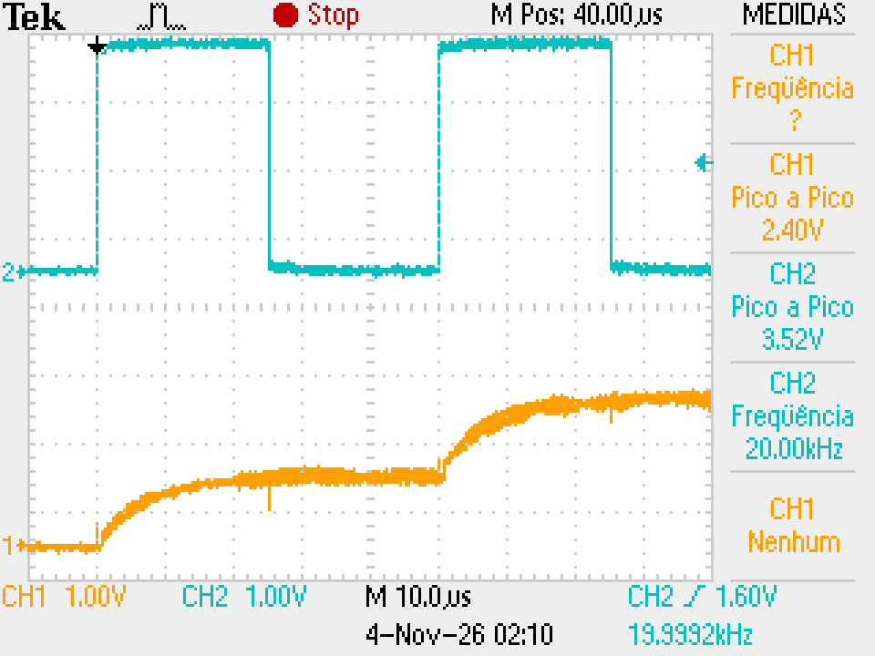

- CLK: f = 20.0008 kHz, T = 49.998 µs, largura alta = 25.002 µs → duty = 50.0 %, Vpp = 3.56 V
- Log do RX: `logs/RC16n8_PAM4_20261103_154256.txt`
- RX: BER_amostra=0/100000
- RX: BER_filtro=0/100000
- RX: Modulação PAM-4 | canal: Dupont_RC_16n8 | aquisição válida = 1 | sincronismo = 1
- RX: amostra única: Ne = 0 em 100000 bits -> BER = 0.00e+00 ; Ns = 0 em 50000 -> SER = 0.00e+00

Arquivos: `capturas/TX_CLK_50us_tela.png`, `TX_CLK_50us_CH1.csv`, `TX_CLK_50us_CH2.csv`

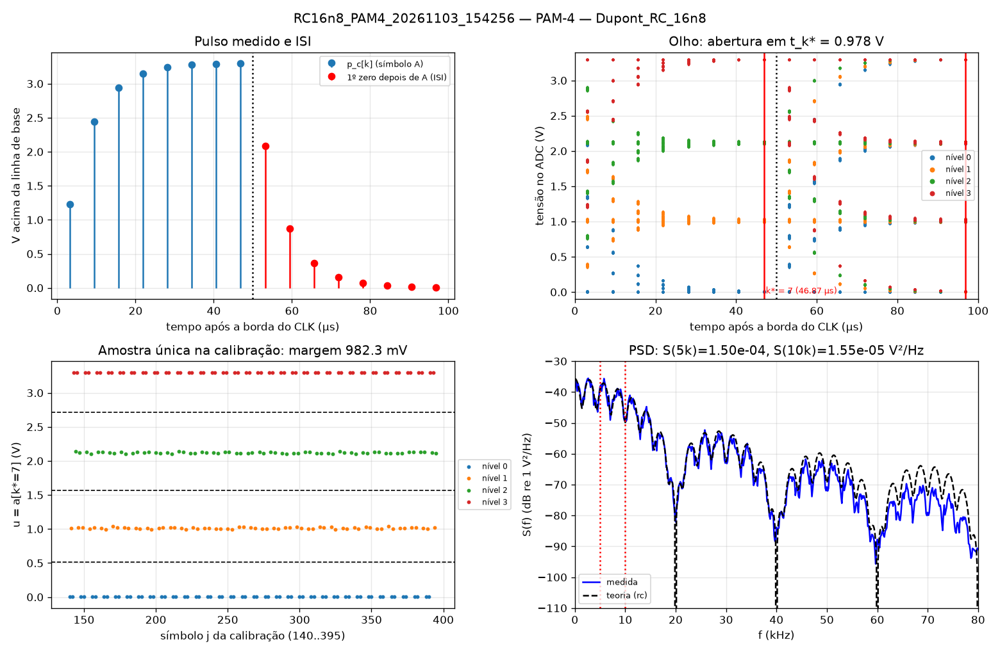

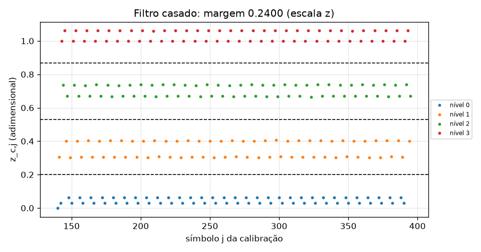

<details><summary>Saída completa do RX</summary>

```
Aguardando... quando aparecer #ARMADO, aperte RESET no TX.
#ARMADO PAM-4 canal=Dupont_RC_16n8 : reinicie o TX (ou aperte KEY no TX)
#ARMADO PAM-4 canal=Dupont_RC_16n8 : reinicie o TX (ou aperte KEY no TX)
>> recebendo relatório...
modulacao=PAM-4
canal=Dupont_RC_16n8
Rs_sym_s=20000
fa_amostras_s=160000
bordas_CLK=50420
simbolos_esperados=50420
simbolos_processados=50420
amostras_processadas=403360
posicao_DMA_1a_borda=285
amostras_descartadas_antes_CLK=8552221
bordas_com_contagem_errada=0
overrun_processamento=0
erro_ADC_overrun=0
perda_CLK=0
aquisicao_valida=1
b_c=4.20
E_c=106189952.0
p_c[0]=1522.30
p_c[1]=3031.30
p_c[2]=3650.85
p_c[3]=3908.45
p_c[4]=4017.40
p_c[5]=4064.50
p_c[6]=4084.70
p_c[7]=4090.80
ISI_zero_apos_A[0]=2589.85
ISI_zero_apos_A[1]=1078.30
ISI_zero_apos_A[2]=455.85
ISI_zero_apos_A[3]=196.05
ISI_zero_apos_A[4]=85.55
ISI_zero_apos_A[5]=38.65
ISI_zero_apos_A[6]=18.00
ISI_zero_apos_A[7]=8.50
separacao_k[0]=-2095
separacao_k[1]=-21
separacao_k[2]=789
separacao_k[3]=1042
separacao_k[4]=1147
separacao_k[5]=1191
separacao_k[6]=1215
separacao_k[7]=1219
k_estrela=7
t_k_estrela_us=46.87
centro_u[0]=8.69
centro_z[0]=0.04506
centro_u[1]=1257.53
centro_z[1]=0.35366
centro_u[2]=2631.66
centro_z[2]=0.70312
centro_u[3]=4095.00
centro_z[3]=1.03033
limiar_u[0]=633.11
limiar_z[0]=0.19936
limiar_u[1]=1944.59
limiar_z[1]=0.52839
limiar_u[2]=3363.33
limiar_z[2]=0.86673
margem_u_ADC=1219
margem_u_mV_nominal=982.3
margem_u_par=0-1
margem_z=0.23995
margem_z_par=0-1
calibracao_ok=1
media8_nivel[0]=0.05 (simbolo j=140, z=0.00001)
media8_nivel[1]=1079.42 (simbolo j=141, z=0.30396)
media8_nivel[2]=2832.93 (simbolo j=144, z=0.73747)
media8_nivel[3]=3543.30 (simbolo j=143, z=0.99946)
inicio_quadro_erros_u=0
inicio_quadro_erros_z=0
sincronismo_ok=1
payload_bits=100000
payload_simbolos=50000
amostra_unica_Ne=0
amostra_unica_Ns=0
filtro_casado_Ne=0
filtro_casado_Ns=0
BER_amostra=0/100000
BER_filtro=0/100000
SER_amostra=0/50000
SER_filtro=0/50000
janela_exemplo_j=427
janela_exemplo_nivel_TX=3
janela a[0]=3187 x[0]=3182.80 p_c[0]=1522.30
janela a[1]=3726 x[1]=3721.80 p_c[1]=3031.30
janela a[2]=3944 x[2]=3939.80 p_c[2]=3650.85
janela a[3]=4039 x[3]=4034.80 p_c[3]=3908.45
janela a[4]=4079 x[4]=4074.80 p_c[4]=4017.40
janela a[5]=4095 x[5]=4090.80 p_c[5]=4064.50
janela a[6]=4095 x[6]=4090.80 p_c[6]=4084.70
janela a[7]=4095 x[7]=4090.80 p_c[7]=4090.80
janela_z=1.06151
#END_REPORT
#BEGIN_TRAIN j,nivel,a0,a1,a2,a3,a4,a5,a6,a7,z
#END_TRAIN
#BEGIN_PSD simbolo,nivel,a0,a1,a2,a3,a4,a5,a6,a7
>> log gravado em entrega/logs/RC16n8_PAM4_20261103_154256.txt
================ RC16n8_PAM4_20261103_154256 ================
Modulação PAM-4 | canal: Dupont_RC_16n8 | aquisição válida = 1 | sincronismo = 1
Bordas de CLK = 50420 de 50420 ; amostras = 403360 (= 8 x 50420) ; descartadas antes do CLK = 8552221

-- Filtro casado (Seção 4.5.1) --
b_c = 4.20 códigos (3.4 mV)
p_c[k] = [1522.3 3031.3 3650.9 3908.5 4017.4 4064.5 4084.7 4090.8] códigos
E_c = 1.062e+08
ISI no 1º zero depois de A = [2589.9 1078.3 455.9 196.1 85.5 38.6 18.0 8.5] códigos
conferência com o firmware: max|Δp_c| = 4.55e-13, k* firmware = 7, k* Python = 7

-- Escolha de k* (Seção 4.3) --
  k=0  t= 3.12 us  menor separação = -2095 códigos (-1688.3 mV)
  k=1  t= 9.37 us  menor separação =   -21 códigos (  -16.9 mV)
  k=2  t=15.62 us  menor separação =   789 códigos (  635.8 mV)
  k=3  t=21.87 us  menor separação =  1042 códigos (  839.7 mV)
  k=4  t=28.12 us  menor separação =  1147 códigos (  924.3 mV)
  k=5  t=34.37 us  menor separação =  1191 códigos (  959.8 mV)
  k=6  t=40.62 us  menor separação =  1215 códigos (  979.1 mV)
  k=7  t=46.87 us  menor separação =  1219 códigos (  982.3 mV)  <== k*

-- Centros, limiares, margens (Seção 4.5.2) --
centros u (códigos) = [8.7, 1257.5, 2631.7, 4095.0] ; em V = [0.007, 1.013, 2.121, 3.3]
limiares u (códigos) = [633.1, 1944.6, 3363.3] ; em V = [0.51, 1.567, 2.71]
centros z = [0.0451, 0.3537, 0.7031, 1.0303] ; limiares z = [0.1994, 0.5284, 0.8667]
margem amostra única = 1219 códigos = 982.3 mV (par de níveis 0-1, Gray 00/01)
margem filtro casado = 0.2400 (escala z; par 0-1)
margem relativa (margem / distância média entre centros): u = 0.89 , z = 0.73

-- Olho (1024 símbolos do payload) --
abertura vertical em t_k* = 46.87 us: 0.978 V (menor entre níveis vizinhos)
abertura por k (V) = [-1.776, -0.161, 0.501, 0.779, 0.896, 0.947, 0.968, 0.978]

-- PSD (fa = 160 kHz, Vref = 3.3000 V, média retirada, Hann, N = 1024, 50%, 15 blocos) --
resolução = 156.25 Hz ; duração do registro = 51.2 ms ; potência AC = 1.2318 V^2 (var = 1.2507)
S(5 kHz)  = 1.500e-04 V^2/Hz (média de 5 bins 1.125e-04; teoria 1.171e-04)
S(10 kHz) = 1.546e-05 V^2/Hz (média de 5 bins 1.332e-05; teoria 1.035e-05)

-- Contagem de erros (firmware, mesmas amostras do payload) --
amostra única: Ne = 0 em 100000 bits -> BER = 0.00e+00 ; Ns = 0 em 50000 -> SER = 0.00e+00
filtro casado: Ne = 0 em 100000 bits -> BER = 0.00e+00 ; Ns = 0 em 50000 -> SER = 0.00e+00
  -> escrever "0 erros em 100.000 bits" (BER observada = 0, NÃO prova BER física nula;
     com 0 erros, limite superior de 95% ~ 3/100000 = 3e-5).

-- Janela real (símbolo j = 427, nível TX = 3) --
  k   a[k]    x[k]=a-b_c    p_c[k]       p_c*x
  0   3187     3182.80     1522.30     4845176.4
  1   3726     3721.80     3031.30    11281892.3
  2   3944     3939.80     3650.85    14383618.8
  3   4039     4034.80     3908.45    15769814.1
  4   4079     4074.80     4017.40    16370101.5
  5   4095     4090.80     4064.50    16627056.6
  6   4095     4090.80     4084.70    16709690.8
  7   4095     4090.80     4090.80    16734644.6
  soma = 112721995.2 ; E_c = 106189945.8 ; z = soma/E_c = 1.06151 (firmware: 1.06151)

  [OK] Log completo até #END_PSD
  [OK] bordas_CLK = símbolos esperados (50420 = 50420)
  [OK] amostras = 8 × símbolos (403360 = 8 × 50420)
  [OK] bordas_com_contagem_errada = 0
  [OK] overrun_processamento = 0 e erro_ADC_overrun = 0
  [OK] perda_CLK = 0
  [OK] aquisicao_valida = 1
  [OK] calibracao_ok = 1 (centros em ordem crescente)
  [OK] sincronismo_ok = 1 (48 bits de início corretos)
figura: entrega/figuras/RC16n8_PAM4_20261103_154256.png
figura: entrega/figuras/RC16n8_PAM4_20261103_154256_z.png
```
</details>

## Observação de montagem — TP2 com o canal RC ligado  ·  03/11/2026

Com o canal RC montado, TP2 **não** mostra degraus retos: o resistor de 330 Ω do TX fica em série
com os 56 Ω + 16,8 nF do canal. Em cada transição TP2 dá um salto de ≈ 56/(330+56) ≈ 15 % do degrau
(divisor resistivo enquanto o capacitor ainda está "em curto") e depois sobe em exponencial com
τ ≈ (330 + 56) Ω × 16,8 nF ≈ 6,5 µs — que é exatamente o τ nominal do enunciado. Ou seja, **o
330 Ω do TX faz parte do RC do canal**. Por isso a verificação do TX (níveis, Gray, ripple,
alinhamento) é feita com o canal Dupont (sem o capacitor do canal).

## RC16n8 PAM4 olho osc — canal RC16n8, TX em PAM-4  ·  03/11/2026 15:47

- **Pontas:** CH1 = TP3 · CH2 = CLK
- **O que é:** Diagrama de olho em TP3, disparo na subida do CLK, persistência infinita. k* = 7 ↔ 46,87 µs depois da borda.
- **Aquisições:** 246

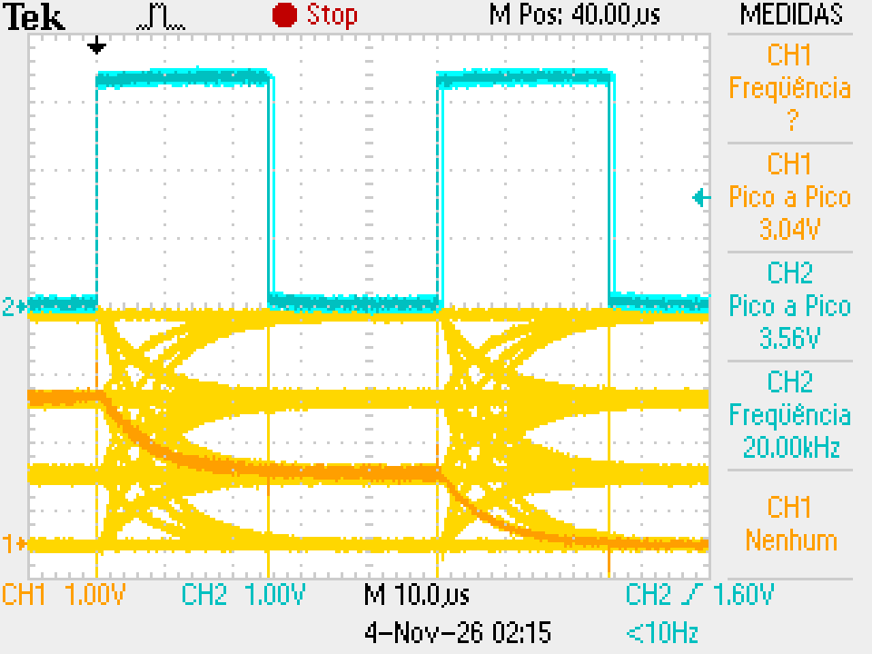

- Persistência infinita: ver a tela. A abertura em k* sai do log do RX (ensaio).
- Log do RX: `logs/RC16n8_PAM4_20261103_154731.txt`
- RX: BER_amostra=0/100000
- RX: BER_filtro=0/100000
- RX: Modulação PAM-4 | canal: Dupont_RC_16n8 | aquisição válida = 1 | sincronismo = 1
- RX: amostra única: Ne = 0 em 100000 bits -> BER = 0.00e+00 ; Ns = 0 em 50000 -> SER = 0.00e+00

Arquivos: `capturas/RC16n8_PAM4_olho_osc_tela.png`, `RC16n8_PAM4_olho_osc_CH1.csv`, `RC16n8_PAM4_olho_osc_CH2.csv`


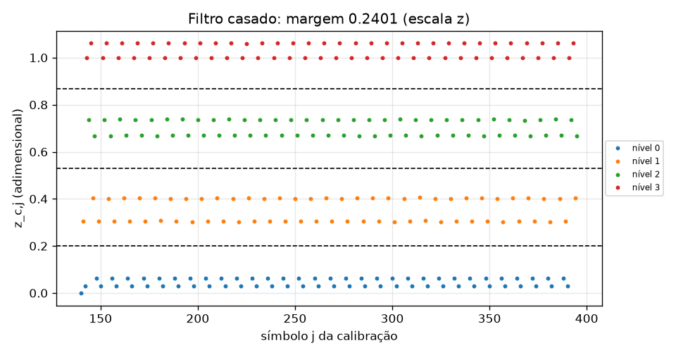

<details><summary>Saída completa do RX</summary>

```
Aguardando... quando aparecer #ARMADO, aperte RESET no TX.
#ARMADO PAM-4 canal=Dupont_RC_16n8 : reinicie o TX (ou aperte KEY no TX)
#ARMADO PAM-4 canal=Dupont_RC_16n8 : reinicie o TX (ou aperte KEY no TX)
>> recebendo relatório...
modulacao=PAM-4
canal=Dupont_RC_16n8
Rs_sym_s=20000
fa_amostras_s=160000
bordas_CLK=50420
simbolos_esperados=50420
simbolos_processados=50420
amostras_processadas=403360
posicao_DMA_1a_borda=335
amostras_descartadas_antes_CLK=11179343
bordas_com_contagem_errada=0
overrun_processamento=0
erro_ADC_overrun=0
perda_CLK=0
aquisicao_valida=1
b_c=4.45
E_c=106178096.0
p_c[0]=1524.90
p_c[1]=3031.55
p_c[2]=3650.15
p_c[3]=3908.40
p_c[4]=4016.55
p_c[5]=4063.95
p_c[6]=4084.50
p_c[7]=4090.45
ISI_zero_apos_A[0]=2585.35
ISI_zero_apos_A[1]=1078.15
ISI_zero_apos_A[2]=455.45
ISI_zero_apos_A[3]=195.30
ISI_zero_apos_A[4]=85.55
ISI_zero_apos_A[5]=38.75
ISI_zero_apos_A[6]=17.90
ISI_zero_apos_A[7]=8.75
separacao_k[0]=-2086
separacao_k[1]=-16
separacao_k[2]=794
separacao_k[3]=1043
separacao_k[4]=1148
separacao_k[5]=1193
separacao_k[6]=1212
separacao_k[7]=1220
k_estrela=7
t_k_estrela_us=46.87
centro_u[0]=8.69
centro_z[0]=0.04497
centro_u[1]=1259.11
centro_z[1]=0.35378
centro_u[2]=2630.88
centro_z[2]=0.70312
centro_u[3]=4094.78
centro_z[3]=1.03039
limiar_u[0]=633.90
limiar_z[0]=0.19937
limiar_u[1]=1944.99
limiar_z[1]=0.52845
limiar_u[2]=3362.83
limiar_z[2]=0.86676
margem_u_ADC=1220
margem_u_mV_nominal=983.2
margem_u_par=0-1
margem_z=0.24008
margem_z_par=0-1
calibracao_ok=1
media8_nivel[0]=-0.70 (simbolo j=140, z=-0.00018)
media8_nivel[1]=1078.67 (simbolo j=141, z=0.30449)
media8_nivel[2]=2828.05 (simbolo j=144, z=0.73609)
media8_nivel[3]=3545.18 (simbolo j=143, z=0.99985)
inicio_quadro_erros_u=0
inicio_quadro_erros_z=0
sincronismo_ok=1
payload_bits=100000
payload_simbolos=50000
amostra_unica_Ne=0
amostra_unica_Ns=0
filtro_casado_Ne=0
filtro_casado_Ns=0
BER_amostra=0/100000
BER_filtro=0/100000
SER_amostra=0/50000
SER_filtro=0/50000
janela_exemplo_j=427
janela_exemplo_nivel_TX=3
janela a[0]=3188 x[0]=3183.55 p_c[0]=1524.90
janela a[1]=3718 x[1]=3713.55 p_c[1]=3031.55
janela a[2]=3947 x[2]=3942.55 p_c[2]=3650.15
janela a[3]=4038 x[3]=4033.55 p_c[3]=3908.40
janela a[4]=4063 x[4]=4058.55 p_c[4]=4016.55
janela a[5]=4095 x[5]=4090.55 p_c[5]=4063.95
janela a[6]=4095 x[6]=4090.55 p_c[6]=4084.50
janela a[7]=4095 x[7]=4090.55 p_c[7]=4090.45
janela_z=1.06080
#END_REPORT
#BEGIN_TRAIN j,nivel,a0,a1,a2,a3,a4,a5,a6,a7,z
#END_TRAIN
#BEGIN_PSD simbolo,nivel,a0,a1,a2,a3,a4,a5,a6,a7
>> log gravado em entrega/logs/RC16n8_PAM4_20261103_154731.txt
================ RC16n8_PAM4_20261103_154731 ================
Modulação PAM-4 | canal: Dupont_RC_16n8 | aquisição válida = 1 | sincronismo = 1
Bordas de CLK = 50420 de 50420 ; amostras = 403360 (= 8 x 50420) ; descartadas antes do CLK = 11179343

-- Filtro casado (Seção 4.5.1) --
b_c = 4.45 códigos (3.6 mV)
p_c[k] = [1524.9 3031.6 3650.2 3908.4 4016.6 4064.0 4084.5 4090.5] códigos
E_c = 1.062e+08
ISI no 1º zero depois de A = [2585.4 1078.1 455.4 195.3 85.5 38.8 17.9 8.8] códigos
conferência com o firmware: max|Δp_c| = 4.55e-13, k* firmware = 7, k* Python = 7

-- Escolha de k* (Seção 4.3) --
  k=0  t= 3.12 us  menor separação = -2086 códigos (-1681.0 mV)
  k=1  t= 9.37 us  menor separação =   -16 códigos (  -12.9 mV)
  k=2  t=15.62 us  menor separação =   794 códigos (  639.9 mV)
  k=3  t=21.87 us  menor separação =  1043 códigos (  840.5 mV)
  k=4  t=28.12 us  menor separação =  1148 códigos (  925.1 mV)
  k=5  t=34.37 us  menor separação =  1193 códigos (  961.4 mV)
  k=6  t=40.62 us  menor separação =  1212 códigos (  976.7 mV)
  k=7  t=46.87 us  menor separação =  1220 códigos (  983.2 mV)  <== k*

-- Centros, limiares, margens (Seção 4.5.2) --
centros u (códigos) = [8.7, 1259.1, 2630.9, 4094.8] ; em V = [0.007, 1.015, 2.12, 3.3]
limiares u (códigos) = [633.9, 1945.0, 3362.8] ; em V = [0.511, 1.567, 2.71]
centros z = [0.045, 0.3538, 0.7031, 1.0304] ; limiares z = [0.1994, 0.5284, 0.8668]
margem amostra única = 1220 códigos = 983.2 mV (par de níveis 0-1, Gray 00/01)
margem filtro casado = 0.2401 (escala z; par 0-1)
margem relativa (margem / distância média entre centros): u = 0.90 , z = 0.73

-- Olho (1024 símbolos do payload) --
abertura vertical em t_k* = 46.87 us: 0.980 V (menor entre níveis vizinhos)
abertura por k (V) = [-1.758, -0.16, 0.504, 0.779, 0.896, 0.948, 0.969, 0.98]

-- PSD (fa = 160 kHz, Vref = 3.3000 V, média retirada, Hann, N = 1024, 50%, 15 blocos) --
resolução = 156.25 Hz ; duração do registro = 51.2 ms ; potência AC = 1.2314 V^2 (var = 1.2503)
S(5 kHz)  = 1.499e-04 V^2/Hz (média de 5 bins 1.125e-04; teoria 1.171e-04)
S(10 kHz) = 1.537e-05 V^2/Hz (média de 5 bins 1.327e-05; teoria 1.035e-05)

-- Contagem de erros (firmware, mesmas amostras do payload) --
amostra única: Ne = 0 em 100000 bits -> BER = 0.00e+00 ; Ns = 0 em 50000 -> SER = 0.00e+00
filtro casado: Ne = 0 em 100000 bits -> BER = 0.00e+00 ; Ns = 0 em 50000 -> SER = 0.00e+00
  -> escrever "0 erros em 100.000 bits" (BER observada = 0, NÃO prova BER física nula;
     com 0 erros, limite superior de 95% ~ 3/100000 = 3e-5).

-- Janela real (símbolo j = 427, nível TX = 3) --
  k   a[k]    x[k]=a-b_c    p_c[k]       p_c*x
  0   3188     3183.55     1524.90     4854595.4
  1   3718     3713.55     3031.55    11257812.5
  2   3947     3942.55     3650.15    14390898.9
  3   4038     4033.55     3908.40    15764726.8
  4   4063     4058.55     4016.55    16301369.0
  5   4095     4090.55     4063.95    16623790.7
  6   4095     4090.55     4084.50    16707851.5
  7   4095     4090.55     4090.45    16732190.2
  soma = 112633235.0 ; E_c = 106178086.0 ; z = soma/E_c = 1.06080 (firmware: 1.0608)

  [OK] Log completo até #END_PSD
  [OK] bordas_CLK = símbolos esperados (50420 = 50420)
  [OK] amostras = 8 × símbolos (403360 = 8 × 50420)
  [OK] bordas_com_contagem_errada = 0
  [OK] overrun_processamento = 0 e erro_ADC_overrun = 0
  [OK] perda_CLK = 0
  [OK] aquisicao_valida = 1
  [OK] calibracao_ok = 1 (centros em ordem crescente)
  [OK] sincronismo_ok = 1 (48 bits de início corretos)
figura: entrega/figuras/RC16n8_PAM4_20261103_154731.png
figura: entrega/figuras/RC16n8_PAM4_20261103_154731_z.png
```
</details>

## RC16n8 PAM2 olho osc — canal RC16n8, TX em PAM-2  ·  03/11/2026 15:49

- **Pontas:** CH1 = TP3 · CH2 = CLK
- **O que é:** Diagrama de olho em TP3, disparo na subida do CLK, persistência infinita. k* = 7 ↔ 46,87 µs depois da borda.
- **Aquisições:** 483

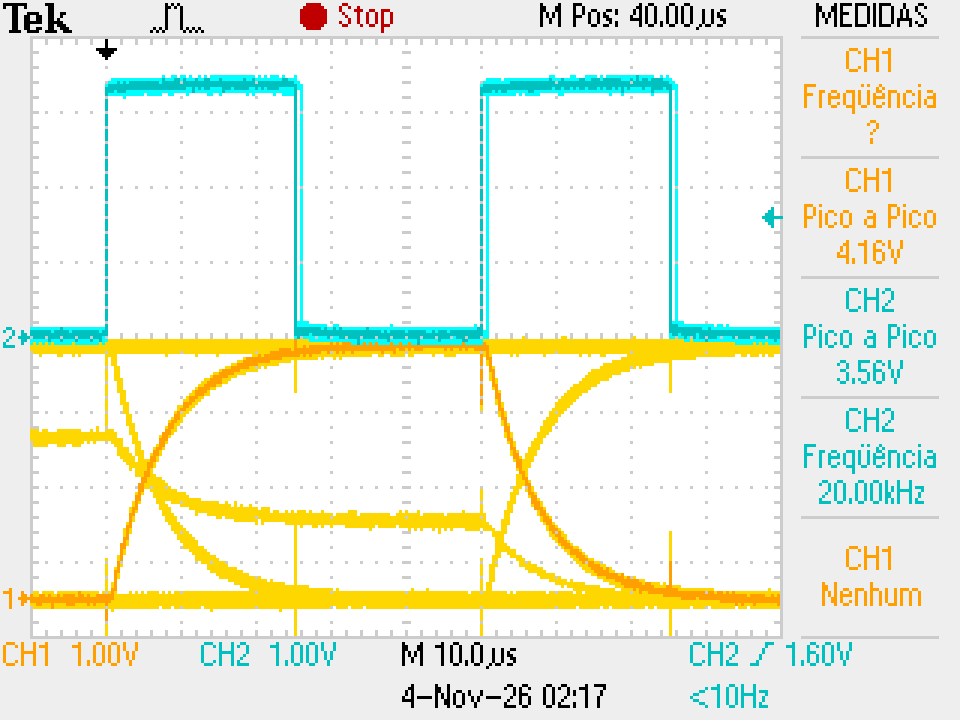

- Persistência infinita: ver a tela. A abertura em k* sai do log do RX (ensaio).
- Log do RX: `logs/RC16n8_PAM2_20261103_154922.txt`
- RX: BER_amostra=0/100000
- RX: BER_filtro=0/100000
- RX: Modulação PAM-2 | canal: Dupont_RC_16n8 | aquisição válida = 1 | sincronismo = 1
- RX: amostra única: Ne = 0 em 100000 bits -> BER = 0.00e+00 ; Ns = 0 em 100000 -> SER = 0.00e+00

Arquivos: `capturas/RC16n8_PAM2_olho_osc_tela.png`, `RC16n8_PAM2_olho_osc_CH1.csv`, `RC16n8_PAM2_olho_osc_CH2.csv`

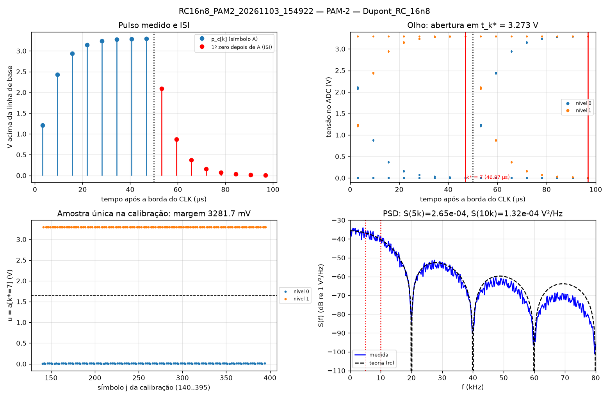

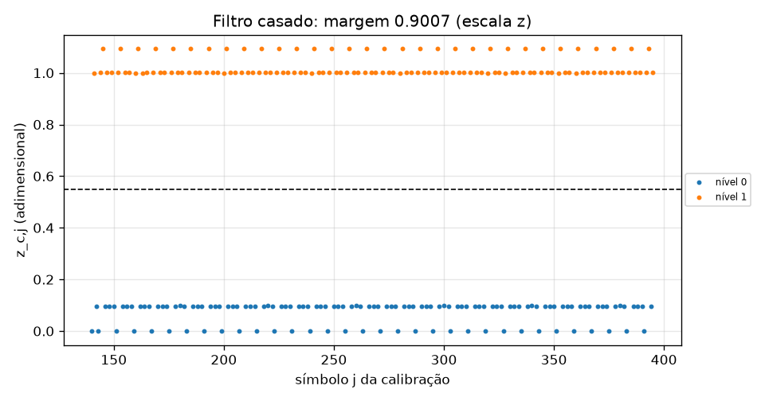

<details><summary>Saída completa do RX</summary>

```
Aguardando... quando aparecer #ARMADO, aperte RESET no TX.
#ARMADO PAM-2 canal=Dupont_RC_16n8 : reinicie o TX (ou aperte KEY no TX)
#ARMADO PAM-2 canal=Dupont_RC_16n8 : reinicie o TX (ou aperte KEY no TX)
>> recebendo relatório...
modulacao=PAM-2
canal=Dupont_RC_16n8
Rs_sym_s=20000
fa_amostras_s=160000
bordas_CLK=100444
simbolos_esperados=100444
simbolos_processados=100444
amostras_processadas=803552
posicao_DMA_1a_borda=497
amostras_descartadas_antes_CLK=13823473
bordas_com_contagem_errada=0
overrun_processamento=0
erro_ADC_overrun=0
perda_CLK=0
aquisicao_valida=1
b_c=4.68
E_c=105983952.0
p_c[0]=1501.38
p_c[1]=3021.52
p_c[2]=3645.72
p_c[3]=3906.22
p_c[4]=4016.07
p_c[5]=4063.38
p_c[6]=4084.13
p_c[7]=4090.27
ISI_zero_apos_A[0]=2601.82
ISI_zero_apos_A[1]=1084.52
ISI_zero_apos_A[2]=457.88
ISI_zero_apos_A[3]=196.93
ISI_zero_apos_A[4]=86.47
ISI_zero_apos_A[5]=38.88
ISI_zero_apos_A[6]=18.28
ISI_zero_apos_A[7]=8.82
separacao_k[0]=-1193
separacao_k[1]=1898
separacao_k[2]=3170
separacao_k[3]=3700
separacao_k[4]=3926
separacao_k[5]=4019
separacao_k[6]=4058
separacao_k[7]=4076
k_estrela=7
t_k_estrela_us=46.87
centro_u[0]=10.83
centro_z[0]=0.07181
centro_u[1]=4094.94
centro_z[1]=1.02381
limiar_u[0]=2052.88
limiar_z[0]=0.54781
margem_u_ADC=4076
margem_u_mV_nominal=3284.7
margem_u_par=0-1
margem_z=0.90065
margem_z_par=0-1
calibracao_ok=1
media8_nivel[0]=-0.05 (simbolo j=140, z=0.00000)
media8_nivel[1]=3542.95 (simbolo j=141, z=1.00028)
inicio_quadro_erros_u=0
inicio_quadro_erros_z=0
sincronismo_ok=1
payload_bits=100000
payload_simbolos=100000
amostra_unica_Ne=0
amostra_unica_Ns=0
filtro_casado_Ne=0
filtro_casado_Ns=0
BER_amostra=0/100000
BER_filtro=0/100000
SER_amostra=0/100000
SER_filtro=0/100000
janela_exemplo_j=451
janela_exemplo_nivel_TX=1
janela a[0]=4095 x[0]=4090.32 p_c[0]=1501.38
janela a[1]=4095 x[1]=4090.32 p_c[1]=3021.52
janela a[2]=4095 x[2]=4090.32 p_c[2]=3645.72
janela a[3]=4095 x[3]=4090.32 p_c[3]=3906.22
janela a[4]=4095 x[4]=4090.32 p_c[4]=4016.07
janela a[5]=4095 x[5]=4090.32 p_c[5]=4063.38
janela a[6]=4095 x[6]=4090.32 p_c[6]=4084.13
janela a[7]=4095 x[7]=4090.32 p_c[7]=4090.27
janela_z=1.09331
#END_REPORT
#BEGIN_TRAIN j,nivel,a0,a1,a2,a3,a4,a5,a6,a7,z
#END_TRAIN
#BEGIN_PSD simbolo,nivel,a0,a1,a2,a3,a4,a5,a6,a7
>> log gravado em entrega/logs/RC16n8_PAM2_20261103_154922.txt
================ RC16n8_PAM2_20261103_154922 ================
Modulação PAM-2 | canal: Dupont_RC_16n8 | aquisição válida = 1 | sincronismo = 1
Bordas de CLK = 100444 de 100444 ; amostras = 803552 (= 8 x 100444) ; descartadas antes do CLK = 13823473

-- Filtro casado (Seção 4.5.1) --
b_c = 4.67 códigos (3.8 mV)
p_c[k] = [1501.4 3021.5 3645.7 3906.2 4016.1 4063.4 4084.1 4090.3] códigos
E_c = 1.06e+08
ISI no 1º zero depois de A = [2601.8 1084.5 457.9 196.9 86.5 38.9 18.3 8.8] códigos
conferência com o firmware: max|Δp_c| = 0.005, k* firmware = 7, k* Python = 7

-- Escolha de k* (Seção 4.3) --
  k=0  t= 3.12 us  menor separação = -1193 códigos ( -961.4 mV)
  k=1  t= 9.37 us  menor separação =  1898 códigos ( 1529.5 mV)
  k=2  t=15.62 us  menor separação =  3170 códigos ( 2554.6 mV)
  k=3  t=21.87 us  menor separação =  3700 códigos ( 2981.7 mV)
  k=4  t=28.12 us  menor separação =  3926 códigos ( 3163.8 mV)
  k=5  t=34.37 us  menor separação =  4019 códigos ( 3238.8 mV)
  k=6  t=40.62 us  menor separação =  4058 códigos ( 3270.2 mV)
  k=7  t=46.87 us  menor separação =  4076 códigos ( 3284.7 mV)  <== k*

-- Centros, limiares, margens (Seção 4.5.2) --
centros u (códigos) = [10.8, 4094.9] ; em V = [0.009, 3.3]
limiares u (códigos) = [2052.9] ; em V = [1.654]
centros z = [0.0718, 1.0238] ; limiares z = [0.5478]
margem amostra única = 4076 códigos = 3284.7 mV (par de níveis 0-1)
margem filtro casado = 0.9007 (escala z; par 0-1)
margem relativa (margem / distância média entre centros): u = 1.00 , z = 0.95

-- Olho (1024 símbolos do payload) --
abertura vertical em t_k* = 46.87 us: 3.276 V (menor entre níveis vizinhos)
abertura por k (V) = [-0.917, 1.54, 2.561, 2.98, 3.157, 3.236, 3.267, 3.276]

-- PSD (fa = 160 kHz, Vref = 3.3000 V, média retirada, Hann, N = 1024, 50%, 15 blocos) --
resolução = 156.25 Hz ; duração do registro = 51.2 ms ; potência AC = 2.3116 V^2 (var = 2.3157)
S(5 kHz)  = 2.651e-04 V^2/Hz (média de 5 bins 1.988e-04; teoria 2.109e-04)
S(10 kHz) = 1.327e-04 V^2/Hz (média de 5 bins 8.632e-05; teoria 9.317e-05)

-- Contagem de erros (firmware, mesmas amostras do payload) --
amostra única: Ne = 0 em 100000 bits -> BER = 0.00e+00 ; Ns = 0 em 100000 -> SER = 0.00e+00
filtro casado: Ne = 0 em 100000 bits -> BER = 0.00e+00 ; Ns = 0 em 100000 -> SER = 0.00e+00
  -> escrever "0 erros em 100.000 bits" (BER observada = 0, NÃO prova BER física nula;
     com 0 erros, limite superior de 95% ~ 3/100000 = 3e-5).

-- Janela real (símbolo j = 451, nível TX = 1) --
  k   a[k]    x[k]=a-b_c    p_c[k]       p_c*x
  0   4095     4090.32     1501.38     6141111.7
  1   4095     4090.32     3021.52    12359019.2
  2   4095     4090.32     3645.72    14912200.1
  3   4095     4090.32     3906.22    15977729.8
  4   4095     4090.32     4016.07    16427052.0
  5   4095     4090.32     4063.38    16620524.3
  6   4095     4090.32     4084.12    16705398.6
  7   4095     4090.32     4090.27    16730554.1
  soma = 115873589.8 ; E_c = 105983946.1 ; z = soma/E_c = 1.09331 (firmware: 1.09331)

  [OK] Log completo até #END_PSD
  [OK] bordas_CLK = símbolos esperados (100444 = 100444)
  [OK] amostras = 8 × símbolos (803552 = 8 × 100444)
  [OK] bordas_com_contagem_errada = 0
  [OK] overrun_processamento = 0 e erro_ADC_overrun = 0
  [OK] perda_CLK = 0
  [OK] aquisicao_valida = 1
  [OK] calibracao_ok = 1 (centros em ordem crescente)
  [OK] sincronismo_ok = 1 (48 bits de início corretos)
figura: entrega/figuras/RC16n8_PAM2_20261103_154922.png
figura: entrega/figuras/RC16n8_PAM2_20261103_154922_z.png
```
</details>

## RC16n8 PAM2 TP2 TP3 degrau — canal RC16n8, TX em PAM-2  ·  03/11/2026 15:53

- **Pontas:** CH1 = TP2 · CH2 = TP3
- **O que é:** 1º pulso 0→A do treinamento (A dura 1 símbolo): entrada (TP2) × saída (TP3). τ por t63 e t10-90; resíduo no zero seguinte = ISI.
- **Aquisições:** 1

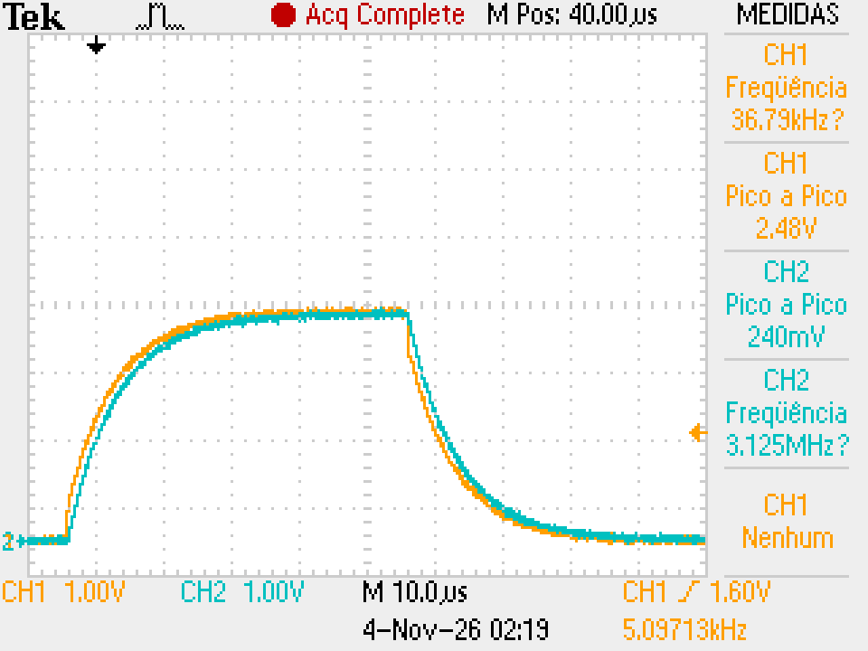

- t0 = início da transição do TX (TP2 sai da linha de base) = -4.04 µs na tela
- TP2: 0.000 → 3.375 V; **salto instantâneo em TP2 = 0.68 V (20 % do degrau)** — divisor 56/(330+56+R_GPIO) ≈ 14 % no RC; ≈ 100 % no Dupont
- TP3: V0 = 0.000 V, Vf (=TP2 final) = 3.375 V, no instante k* (46,9 µs após t0) = 3.341 V (99.0 % do degrau)
- t10 = 0.76 µs · t63 = 7.32 µs · t90 = 17.44 µs (medidos a partir de t0)
- **τ = t63 − t0 = 7.32 µs** · **t10-90 = 16.68 µs** (→ τ = t10-90/2,197 = 7.59 µs) · f_c = 1/(2πτ) = 21.7 kHz
- Rise Time automático do osciloscópio em TP3: 14,36 µs (usa min/max da tela — só referência)
- Log do RX deste RESET: **inválido** (`perda_CLK=1`, 27 446 de 100 444 bordas) — o TX foi resetado de novo no meio do quadro (o 1º disparo do osciloscópio foi falso e pedi outro RESET). Movido para `logs/invalidos/`. Os logs válidos do RC 16,8 nF são os dos ensaios do olho.

Arquivos: `capturas/RC16n8_PAM2_TP2_TP3_degrau_tela.png`, `RC16n8_PAM2_TP2_TP3_degrau_CH1.csv`, `RC16n8_PAM2_TP2_TP3_degrau_CH2.csv`

## RC16n8 PAM4 TP2 TP3 degrau — canal RC16n8, TX em PAM-4  ·  03/11/2026 15:54

- **Pontas:** CH1 = TP2 · CH2 = TP3
- **O que é:** 1º pulso 0→A do treinamento (A dura 1 símbolo): entrada (TP2) × saída (TP3). τ por t63 e t10-90; resíduo no zero seguinte = ISI.
- **Aquisições:** 1

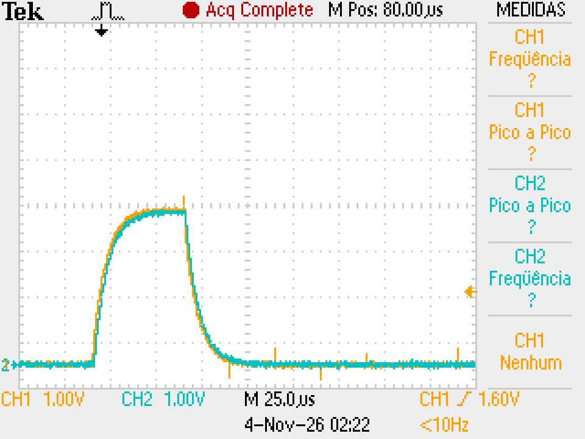

- t0 = início da transição do TX (TP2 sai da linha de base) = -3.70 µs na tela
- TP2: 0.000 → 3.377 V; **salto instantâneo em TP2 = 0.68 V (20 % do degrau)** — divisor 56/(330+56+R_GPIO) ≈ 14 % no RC; ≈ 100 % no Dupont
- TP3: V0 = 0.000 V, Vf (=TP2 final) = 3.377 V, no instante k* (46,9 µs após t0) = 3.332 V (98.7 % do degrau)
- t10 = 0.90 µs · t63 = 7.30 µs · t90 = 17.10 µs (medidos a partir de t0)
- **τ = t63 − t0 = 7.30 µs** · **t10-90 = 16.20 µs** (→ τ = t10-90/2,197 = 7.37 µs) · f_c = 1/(2πτ) = 21.8 kHz
- ISI: resíduo em TP3 no fim do 1º zero depois de A = +22 mV (previsto A·(1−e^(−Ts/τ))·e^(−Ts/τ) = 4 mV; resolução do osciloscópio ≈ 40 mV a 1 V/div)
- Rise Time automático do osciloscópio em TP3: 14.70 µs (usa min/max da tela inteira — só referência)
- Log do RX: `logs/RC16n8_PAM4_20261103_155428.txt`
- RX: BER_amostra=0/100000
- RX: BER_filtro=0/100000
- RX: Modulação PAM-4 | canal: Dupont_RC_16n8 | aquisição válida = 1 | sincronismo = 1
- RX: amostra única: Ne = 0 em 100000 bits -> BER = 0.00e+00 ; Ns = 0 em 50000 -> SER = 0.00e+00

Arquivos: `capturas/RC16n8_PAM4_TP2_TP3_degrau_tela.png`, `RC16n8_PAM4_TP2_TP3_degrau_CH1.csv`, `RC16n8_PAM4_TP2_TP3_degrau_CH2.csv`


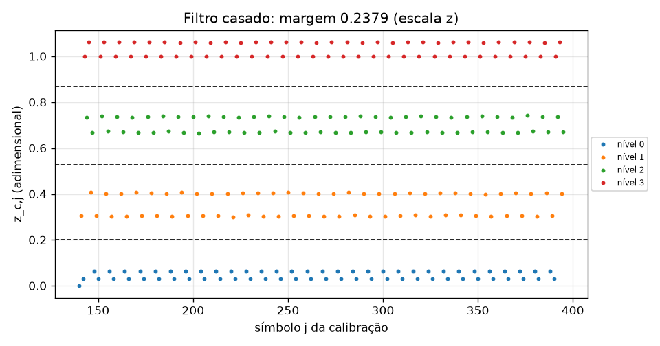

<details><summary>Saída completa do RX</summary>

```
Aguardando... quando aparecer #ARMADO, aperte RESET no TX.
#ARMADO PAM-4 canal=Dupont_RC_16n8 : reinicie o TX (ou aperte KEY no TX)
#ARMADO PAM-4 canal=Dupont_RC_16n8 : reinicie o TX (ou aperte KEY no TX)
>> recebendo relatório...
modulacao=PAM-4
canal=Dupont_RC_16n8
Rs_sym_s=20000
fa_amostras_s=160000
bordas_CLK=50420
simbolos_esperados=50420
simbolos_processados=50420
amostras_processadas=403360
posicao_DMA_1a_borda=503
amostras_descartadas_antes_CLK=2832887
bordas_com_contagem_errada=0
overrun_processamento=0
erro_ADC_overrun=0
perda_CLK=0
aquisicao_valida=1
b_c=4.23
E_c=105987856.0
p_c[0]=1520.37
p_c[1]=3023.32
p_c[2]=3644.27
p_c[3]=3903.37
p_c[4]=4014.77
p_c[5]=4061.92
p_c[6]=4082.77
p_c[7]=4090.52
ISI_zero_apos_A[0]=2590.02
ISI_zero_apos_A[1]=1085.07
ISI_zero_apos_A[2]=461.22
ISI_zero_apos_A[3]=198.32
ISI_zero_apos_A[4]=87.02
ISI_zero_apos_A[5]=39.12
ISI_zero_apos_A[6]=18.82
ISI_zero_apos_A[7]=9.27
separacao_k[0]=-2099
separacao_k[1]=-33
separacao_k[2]=780
separacao_k[3]=1033
separacao_k[4]=1140
separacao_k[5]=1188
separacao_k[6]=1208
separacao_k[7]=1215
k_estrela=7
t_k_estrela_us=46.87
centro_u[0]=9.02
centro_z[0]=0.04532
centro_u[1]=1259.56
centro_z[1]=0.35417
centro_u[2]=2630.36
centro_z[2]=0.70314
centro_u[3]=4094.94
centro_z[3]=1.03061
limiar_u[0]=634.29
limiar_z[0]=0.19975
limiar_u[1]=1944.96
limiar_z[1]=0.52866
limiar_u[2]=3362.65
limiar_z[2]=0.86688
margem_u_ADC=1215
margem_u_mV_nominal=979.1
margem_u_par=0-1
margem_z=0.23793
margem_z_par=0-1
calibracao_ok=1
media8_nivel[0]=1.14 (simbolo j=140, z=0.00034)
media8_nivel[1]=1078.14 (simbolo j=141, z=0.30510)
media8_nivel[2]=2822.14 (simbolo j=144, z=0.73505)
media8_nivel[3]=3539.52 (simbolo j=143, z=0.99959)
inicio_quadro_erros_u=0
inicio_quadro_erros_z=0
sincronismo_ok=1
payload_bits=100000
payload_simbolos=50000
amostra_unica_Ne=0
amostra_unica_Ns=0
filtro_casado_Ne=0
filtro_casado_Ns=0
BER_amostra=0/100000
BER_filtro=0/100000
SER_amostra=0/50000
SER_filtro=0/50000
janela_exemplo_j=427
janela_exemplo_nivel_TX=3
janela a[0]=3185 x[0]=3180.77 p_c[0]=1520.37
janela a[1]=3716 x[1]=3711.77 p_c[1]=3023.32
janela a[2]=3942 x[2]=3937.77 p_c[2]=3644.27
janela a[3]=4037 x[3]=4032.77 p_c[3]=3903.37
janela a[4]=4075 x[4]=4070.77 p_c[4]=4014.77
janela a[5]=4093 x[5]=4088.77 p_c[5]=4061.92
janela a[6]=4095 x[6]=4090.77 p_c[6]=4082.77
janela a[7]=4095 x[7]=4090.77 p_c[7]=4090.52
janela_z=1.06178
#END_REPORT
#BEGIN_TRAIN j,nivel,a0,a1,a2,a3,a4,a5,a6,a7,z
#END_TRAIN
#BEGIN_PSD simbolo,nivel,a0,a1,a2,a3,a4,a5,a6,a7
>> log gravado em entrega/logs/RC16n8_PAM4_20261103_155428.txt
================ RC16n8_PAM4_20261103_155428 ================
Modulação PAM-4 | canal: Dupont_RC_16n8 | aquisição válida = 1 | sincronismo = 1
Bordas de CLK = 50420 de 50420 ; amostras = 403360 (= 8 x 50420) ; descartadas antes do CLK = 2832887

-- Filtro casado (Seção 4.5.1) --
b_c = 4.23 códigos (3.4 mV)
p_c[k] = [1520.4 3023.3 3644.3 3903.4 4014.8 4061.9 4082.8 4090.5] códigos
E_c = 1.06e+08
ISI no 1º zero depois de A = [2590.0 1085.1 461.2 198.3 87.0 39.1 18.8 9.3] códigos
conferência com o firmware: max|Δp_c| = 0.00125, k* firmware = 7, k* Python = 7

-- Escolha de k* (Seção 4.3) --
  k=0  t= 3.12 us  menor separação = -2099 códigos (-1691.5 mV)
  k=1  t= 9.37 us  menor separação =   -33 códigos (  -26.6 mV)
  k=2  t=15.62 us  menor separação =   780 códigos (  628.6 mV)
  k=3  t=21.87 us  menor separação =  1033 códigos (  832.5 mV)
  k=4  t=28.12 us  menor separação =  1140 códigos (  918.7 mV)
  k=5  t=34.37 us  menor separação =  1188 códigos (  957.4 mV)
  k=6  t=40.62 us  menor separação =  1208 códigos (  973.5 mV)
  k=7  t=46.87 us  menor separação =  1215 códigos (  979.1 mV)  <== k*

-- Centros, limiares, margens (Seção 4.5.2) --
centros u (códigos) = [9.0, 1259.6, 2630.4, 4094.9] ; em V = [0.007, 1.015, 2.12, 3.3]
limiares u (códigos) = [634.3, 1945.0, 3362.6] ; em V = [0.511, 1.567, 2.71]
centros z = [0.0453, 0.3542, 0.7031, 1.0306] ; limiares z = [0.1997, 0.5287, 0.8669]
margem amostra única = 1215 códigos = 979.1 mV (par de níveis 0-1, Gray 00/01)
margem filtro casado = 0.2379 (escala z; par 0-1)
margem relativa (margem / distância média entre centros): u = 0.89 , z = 0.72

-- Olho (1024 símbolos do payload) --
abertura vertical em t_k* = 46.87 us: 0.973 V (menor entre níveis vizinhos)
abertura por k (V) = [-1.775, -0.17, 0.492, 0.77, 0.89, 0.94, 0.963, 0.973]

-- PSD (fa = 160 kHz, Vref = 3.3000 V, média retirada, Hann, N = 1024, 50%, 15 blocos) --
resolução = 156.25 Hz ; duração do registro = 51.2 ms ; potência AC = 1.2296 V^2 (var = 1.2486)
S(5 kHz)  = 1.495e-04 V^2/Hz (média de 5 bins 1.123e-04; teoria 1.171e-04)
S(10 kHz) = 1.528e-05 V^2/Hz (média de 5 bins 1.319e-05; teoria 1.035e-05)

-- Contagem de erros (firmware, mesmas amostras do payload) --
amostra única: Ne = 0 em 100000 bits -> BER = 0.00e+00 ; Ns = 0 em 50000 -> SER = 0.00e+00
filtro casado: Ne = 0 em 100000 bits -> BER = 0.00e+00 ; Ns = 0 em 50000 -> SER = 0.00e+00
  -> escrever "0 erros em 100.000 bits" (BER observada = 0, NÃO prova BER física nula;
     com 0 erros, limite superior de 95% ~ 3/100000 = 3e-5).

-- Janela real (símbolo j = 427, nível TX = 3) --
  k   a[k]    x[k]=a-b_c    p_c[k]       p_c*x
  0   3185     3180.77     1520.37     4835941.4
  1   3716     3711.77     3023.32    11221860.1
  2   3942     3937.77     3644.27    14350287.6
  3   4037     4032.77     3903.37    15741383.5
  4   4075     4070.77     4014.77    16343195.2
  5   4093     4088.77     4061.92    16608246.5
  6   4095     4090.77     4082.77    16701662.8
  7   4095     4090.77     4090.52    16733366.3
  soma = 112535943.3 ; E_c = 105987856.1 ; z = soma/E_c = 1.06178 (firmware: 1.06178)

  [OK] Log completo até #END_PSD
  [OK] bordas_CLK = símbolos esperados (50420 = 50420)
  [OK] amostras = 8 × símbolos (403360 = 8 × 50420)
  [OK] bordas_com_contagem_errada = 0
  [OK] overrun_processamento = 0 e erro_ADC_overrun = 0
  [OK] perda_CLK = 0
  [OK] aquisicao_valida = 1
  [OK] calibracao_ok = 1 (centros em ordem crescente)
  [OK] sincronismo_ok = 1 (48 bits de início corretos)
figura: entrega/figuras/RC16n8_PAM4_20261103_155428.png
figura: entrega/figuras/RC16n8_PAM4_20261103_155428_z.png
```
</details>

## RC33n PAM4 TP2 TP3 degrau — canal RC33n, TX em PAM-4  ·  03/11/2026 15:56

- **Pontas:** CH1 = TP2 · CH2 = TP3
- **O que é:** 1º pulso 0→A do treinamento (A dura 1 símbolo): entrada (TP2) × saída (TP3). τ por t63 e t10-90; resíduo no zero seguinte = ISI.
- **Aquisições:** 1

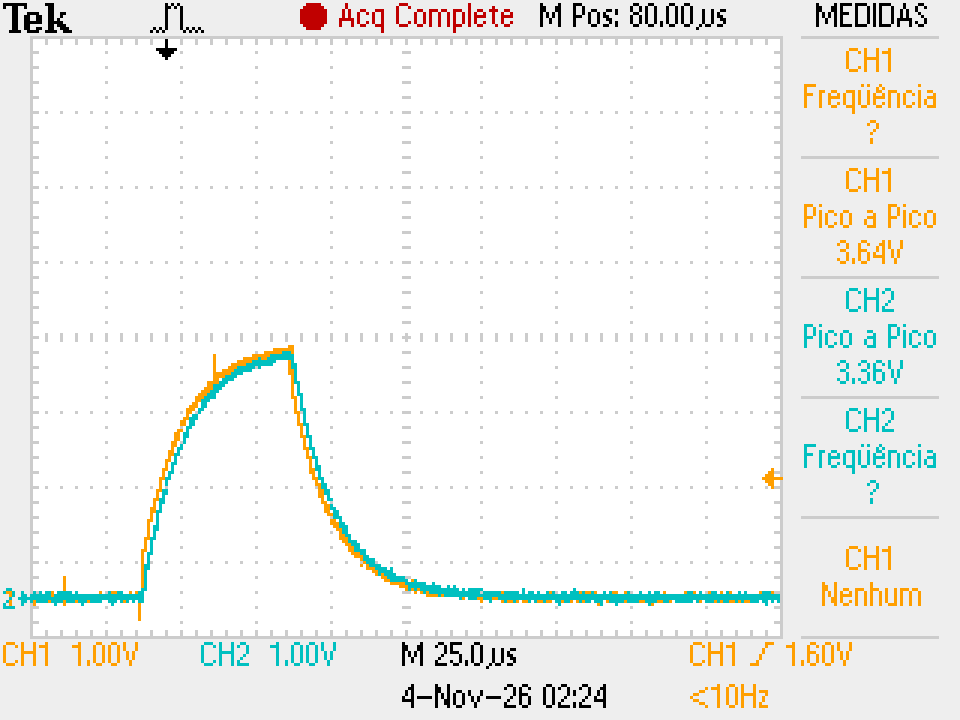

- t0 = início da transição do TX (TP2 sai da linha de base) = -7.70 µs na tela
- TP2: 0.000 → 3.257 V; **salto instantâneo em TP2 = 0.60 V (18 % do degrau)** — divisor 56/(330+56+R_GPIO) ≈ 14 % no RC; ≈ 100 % no Dupont
- TP3: V0 = 0.000 V, Vf (=TP2 final) = 3.257 V, no instante k* (46,9 µs após t0) = 3.230 V (99.2 % do degrau)
- t10 = 1.40 µs · t63 = 13.00 µs · t90 = 28.80 µs (medidos a partir de t0)
- **τ = t63 − t0 = 13.00 µs** · **t10-90 = 27.40 µs** (→ τ = t10-90/2,197 = 12.47 µs) · f_c = 1/(2πτ) = 12.2 kHz
- ISI: resíduo em TP3 no fim do 1º zero depois de A = +120 mV (previsto A·(1−e^(−Ts/τ))·e^(−Ts/τ) = 68 mV; resolução do osciloscópio ≈ 40 mV a 1 V/div)
- Com 33 nF, TP2 ainda não estabilizou no fim do símbolo A (3,257 V), então Vf fica subestimado. Usando o nível real do TX medido no RC 16,8 nF (3,377 V): **τ = 14,1 µs, t10-90 = 30,8 µs**. Faixa honesta: **τ = 13,0–14,1 µs** (previsto 12,74 µs nominal, 13,9 µs no modelo de 2 polos); t10-90 = 27–31 µs (previsto ≈ 28 µs).
- Rise Time automático do osciloscópio em TP3: 26,30 µs (min/max da tela — só referência)
- Log do RX: `logs/RC33n_PAM4_20261103_155652.txt`
- RX: BER_amostra=0/100000
- RX: BER_filtro=0/100000
- RX: Modulação PAM-4 | canal: Dupont_RC_33n | aquisição válida = 1 | sincronismo = 1
- RX: amostra única: Ne = 0 em 100000 bits -> BER = 0.00e+00 ; Ns = 0 em 50000 -> SER = 0.00e+00

Arquivos: `capturas/RC33n_PAM4_TP2_TP3_degrau_tela.png`, `RC33n_PAM4_TP2_TP3_degrau_CH1.csv`, `RC33n_PAM4_TP2_TP3_degrau_CH2.csv`

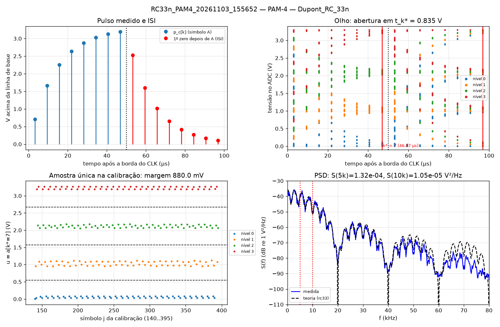

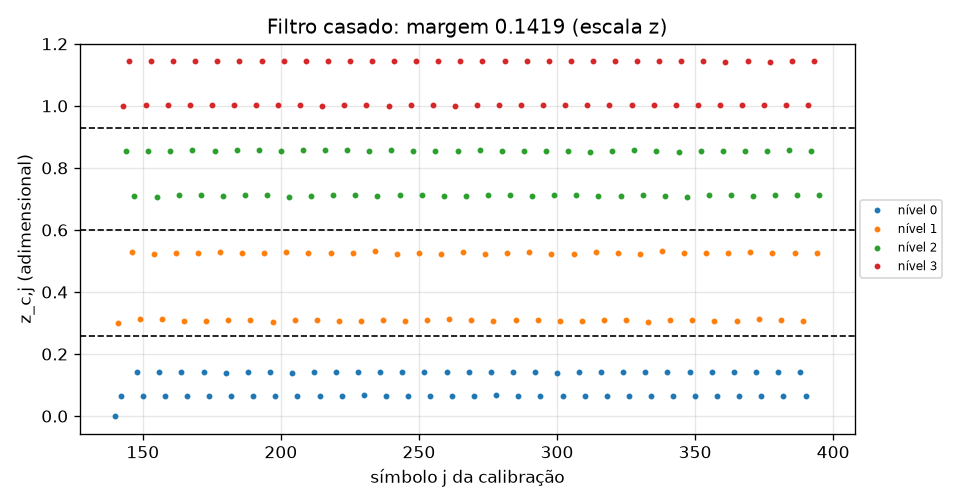

<details><summary>Saída completa do RX</summary>

```
Aguardando... quando aparecer #ARMADO, aperte RESET no TX.
#ARMADO PAM-4 canal=Dupont_RC_16n8 : reinicie o TX (ou aperte KEY no TX)
#ARMADO PAM-4 canal=Dupont_RC_33n : reinicie o TX (ou aperte KEY no TX)
>> recebendo relatório...
modulacao=PAM-4
canal=Dupont_RC_33n
Rs_sym_s=20000
fa_amostras_s=160000
bordas_CLK=50420
simbolos_esperados=50420
simbolos_processados=50420
amostras_processadas=403360
posicao_DMA_1a_borda=460
amostras_descartadas_antes_CLK=18701260
bordas_com_contagem_errada=0
overrun_processamento=0
erro_ADC_overrun=0
perda_CLK=0
aquisicao_valida=1
b_c=4.46
E_c=81269608.0
p_c[0]=878.24
p_c[1]=2061.34
p_c[2]=2803.84
p_c[3]=3273.74
p_c[4]=3571.04
p_c[5]=3761.64
p_c[6]=3883.64
p_c[7]=3960.49
ISI_zero_apos_A[0]=3140.29
ISI_zero_apos_A[1]=1990.19
ISI_zero_apos_A[2]=1265.54
ISI_zero_apos_A[3]=807.09
ISI_zero_apos_A[4]=516.44
ISI_zero_apos_A[5]=331.49
ISI_zero_apos_A[6]=213.34
ISI_zero_apos_A[7]=137.24
separacao_k[0]=-2844
separacao_k[1]=-1272
separacao_k[2]=-283
separacao_k[3]=348
separacao_k[4]=731
separacao_k[5]=909
separacao_k[6]=1019
separacao_k[7]=1092
k_estrela=7
t_k_estrela_us=46.87
centro_u[0]=70.06
centro_z[0]=0.10126
centro_u[1]=1284.05
centro_z[1]=0.41727
centro_u[2]=2626.91
centro_z[2]=0.78305
centro_u[3]=4010.95
centro_z[3]=1.07240
limiar_u[0]=677.05
limiar_z[0]=0.25926
limiar_u[1]=1955.48
limiar_z[1]=0.60016
limiar_u[2]=3318.93
limiar_z[2]=0.92772
margem_u_ADC=1092
margem_u_mV_nominal=880.0
margem_u_par=0-1
margem_z=0.14185
margem_z_par=2-3
calibracao_ok=1
media8_nivel[0]=0.41 (simbolo j=140, z=0.00011)
media8_nivel[1]=904.66 (simbolo j=141, z=0.30001)
media8_nivel[2]=2984.16 (simbolo j=144, z=0.85374)
media8_nivel[3]=3029.29 (simbolo j=143, z=1.00092)
inicio_quadro_erros_u=0
inicio_quadro_erros_z=0
sincronismo_ok=1
payload_bits=100000
payload_simbolos=50000
amostra_unica_Ne=0
amostra_unica_Ns=0
filtro_casado_Ne=0
filtro_casado_Ns=0
BER_amostra=0/100000
BER_filtro=0/100000
SER_amostra=0/50000
SER_filtro=0/50000
janela_exemplo_j=427
janela_exemplo_nivel_TX=3
janela a[0]=2949 x[0]=2944.54 p_c[0]=878.24
janela a[1]=3370 x[1]=3365.54 p_c[1]=2061.34
janela a[2]=3639 x[2]=3634.54 p_c[2]=2803.84
janela a[3]=3807 x[3]=3802.54 p_c[3]=3273.74
janela a[4]=3914 x[4]=3909.54 p_c[4]=3571.04
janela a[5]=3985 x[5]=3980.54 p_c[5]=3761.64
janela a[6]=4028 x[6]=4023.54 p_c[6]=3883.64
janela a[7]=4054 x[7]=4049.54 p_c[7]=3960.49
janela_z=1.14140
#END_REPORT
#BEGIN_TRAIN j,nivel,a0,a1,a2,a3,a4,a5,a6,a7,z
#END_TRAIN
#BEGIN_PSD simbolo,nivel,a0,a1,a2,a3,a4,a5,a6,a7
>> log gravado em entrega/logs/RC33n_PAM4_20261103_155652.txt
================ RC33n_PAM4_20261103_155652 ================
Modulação PAM-4 | canal: Dupont_RC_33n | aquisição válida = 1 | sincronismo = 1
Bordas de CLK = 50420 de 50420 ; amostras = 403360 (= 8 x 50420) ; descartadas antes do CLK = 18701260

-- Filtro casado (Seção 4.5.1) --
b_c = 4.46 códigos (3.6 mV)
p_c[k] = [878.2 2061.3 2803.8 3273.7 3571.0 3761.6 3883.6 3960.5] códigos
E_c = 8.127e+07
ISI no 1º zero depois de A = [3140.3 1990.2 1265.5 807.1 516.4 331.5 213.3 137.2] códigos
conferência com o firmware: max|Δp_c| = 0.0025, k* firmware = 7, k* Python = 7

-- Escolha de k* (Seção 4.3) --
  k=0  t= 3.12 us  menor separação = -2844 códigos (-2291.9 mV)
  k=1  t= 9.37 us  menor separação = -1272 códigos (-1025.1 mV)
  k=2  t=15.62 us  menor separação =  -283 códigos ( -228.1 mV)
  k=3  t=21.87 us  menor separação =   348 códigos (  280.4 mV)
  k=4  t=28.12 us  menor separação =   731 códigos (  589.1 mV)
  k=5  t=34.37 us  menor separação =   909 códigos (  732.5 mV)
  k=6  t=40.62 us  menor separação =  1019 códigos (  821.2 mV)
  k=7  t=46.87 us  menor separação =  1092 códigos (  880.0 mV)  <== k*

-- Centros, limiares, margens (Seção 4.5.2) --
centros u (códigos) = [70.1, 1284.0, 2626.9, 4011.0] ; em V = [0.056, 1.035, 2.117, 3.232]
limiares u (códigos) = [677.1, 1955.5, 3318.9] ; em V = [0.546, 1.576, 2.675]
centros z = [0.1013, 0.4173, 0.783, 1.0724] ; limiares z = [0.2593, 0.6002, 0.9277]
margem amostra única = 1092 códigos = 880.0 mV (par de níveis 0-1, Gray 00/01)
margem filtro casado = 0.1419 (escala z; par 2-3)
margem relativa (margem / distância média entre centros): u = 0.83 , z = 0.44

-- Olho (1024 símbolos do payload) --
abertura vertical em t_k* = 46.87 us: 0.835 V (menor entre níveis vizinhos)
abertura por k (V) = [-2.432, -1.167, -0.388, 0.107, 0.423, 0.625, 0.753, 0.835]

-- PSD (fa = 160 kHz, Vref = 3.3000 V, média retirada, Hann, N = 1024, 50%, 15 blocos) --
resolução = 156.25 Hz ; duração do registro = 51.2 ms ; potência AC = 1.0540 V^2 (var = 1.0716)
S(5 kHz)  = 1.325e-04 V^2/Hz (média de 5 bins 9.922e-05; teoria 1.034e-04)
S(10 kHz) = 1.054e-05 V^2/Hz (média de 5 bins 9.105e-06; teoria 7.067e-06)

-- Contagem de erros (firmware, mesmas amostras do payload) --
amostra única: Ne = 0 em 100000 bits -> BER = 0.00e+00 ; Ns = 0 em 50000 -> SER = 0.00e+00
filtro casado: Ne = 0 em 100000 bits -> BER = 0.00e+00 ; Ns = 0 em 50000 -> SER = 0.00e+00
  -> escrever "0 erros em 100.000 bits" (BER observada = 0, NÃO prova BER física nula;
     com 0 erros, limite superior de 95% ~ 3/100000 = 3e-5).

-- Janela real (símbolo j = 427, nível TX = 3) --
  k   a[k]    x[k]=a-b_c    p_c[k]       p_c*x
  0   2949     2944.54      878.24     2586003.3
  1   3370     3365.54     2061.34     6937508.7
  2   3639     3634.54     2803.84    10190652.5
  3   3807     3802.54     3273.74    12448509.6
  4   3914     3909.54     3571.04    13961105.0
  5   3985     3980.54     3761.64    14973339.1
  6   4028     4023.54     3883.64    15625961.1
  7   4054     4049.54     3960.49    16038142.6
  soma = 92761222.0 ; E_c = 81269602.3 ; z = soma/E_c = 1.14140 (firmware: 1.1414)

  [OK] Log completo até #END_PSD
  [OK] bordas_CLK = símbolos esperados (50420 = 50420)
  [OK] amostras = 8 × símbolos (403360 = 8 × 50420)
  [OK] bordas_com_contagem_errada = 0
  [OK] overrun_processamento = 0 e erro_ADC_overrun = 0
  [OK] perda_CLK = 0
  [OK] aquisicao_valida = 1
  [OK] calibracao_ok = 1 (centros em ordem crescente)
  [OK] sincronismo_ok = 1 (48 bits de início corretos)
figura: entrega/figuras/RC33n_PAM4_20261103_155652.png
figura: entrega/figuras/RC33n_PAM4_20261103_155652_z.png
```
</details>

## RC33n PAM2 TP2 TP3 degrau — canal RC33n, TX em PAM-2  ·  03/11/2026 15:58

- **Pontas:** CH1 = TP2 · CH2 = TP3
- **O que é:** 1º pulso 0→A do treinamento (A dura 1 símbolo): entrada (TP2) × saída (TP3). τ por t63 e t10-90; resíduo no zero seguinte = ISI.
- **Aquisições:** 1

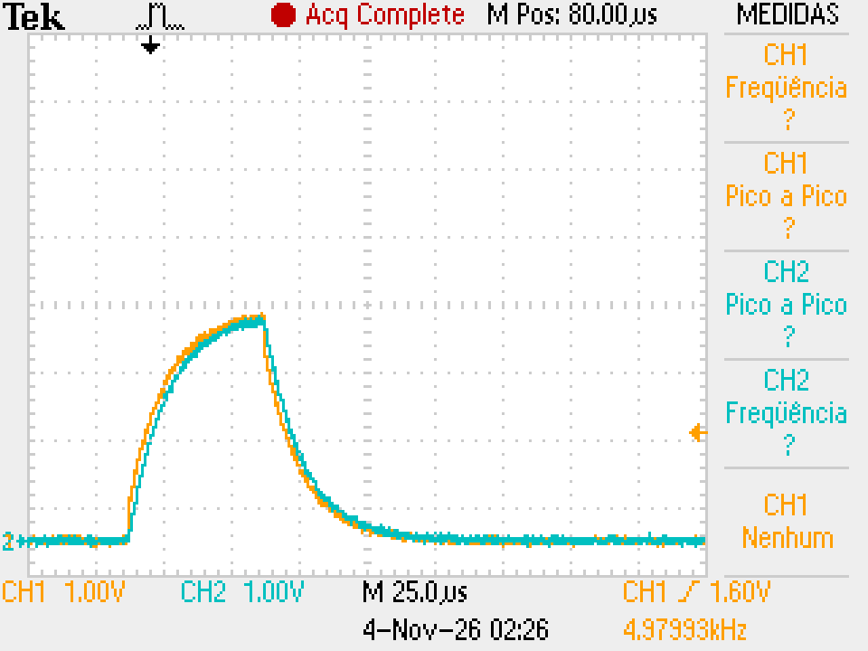

- t0 = início da transição do TX (TP2 sai da linha de base) = -7.70 µs na tela
- TP2: 0.000 → 3.257 V; **salto instantâneo em TP2 = 0.56 V (17 % do degrau)** — divisor 56/(330+56+R_GPIO) ≈ 14 % no RC; ≈ 100 % no Dupont
- TP3: V0 = 0.000 V, Vf (=TP2 final) = 3.257 V, no instante k* (46,9 µs após t0) = 3.225 V (99.0 % do degrau)
- t10 = 1.40 µs · t63 = 13.20 µs · t90 = 28.50 µs (medidos a partir de t0)
- **τ = t63 − t0 = 13.20 µs** · **t10-90 = 27.10 µs** (→ τ = t10-90/2,197 = 12.34 µs) · f_c = 1/(2πτ) = 12.1 kHz
- ISI: resíduo em TP3 no fim do 1º zero depois de A = +123 mV (previsto A·(1−e^(−Ts/τ))·e^(−Ts/τ) = 72 mV; resolução do osciloscópio ≈ 40 mV a 1 V/div)
- Rise Time automático do osciloscópio em TP3: 27.30 µs (usa min/max da tela inteira — só referência)
- Log do RX: **inválido** (`perda_CLK=1`, 20 186 de 100 444 bordas — o CLK parou ~1 s depois do início: RESET repetido ou fio de CLK mexido). Movido para `logs/invalidos/`. O log do RC 33 nF PAM-2 vem do ensaio do olho.
- RX: BER=NAO_ATRIBUIDA (quadro invalido ou sem sincronismo: repita o ensaio)
- RX: Modulação PAM-2 | canal: Dupont_RC_33n | aquisição válida = 0 | sincronismo = 1
- RX: SEM BER: quadro inválido ou sem sincronismo -> repetir o ensaio.

Arquivos: `capturas/RC33n_PAM2_TP2_TP3_degrau_tela.png`, `RC33n_PAM2_TP2_TP3_degrau_CH1.csv`, `RC33n_PAM2_TP2_TP3_degrau_CH2.csv`

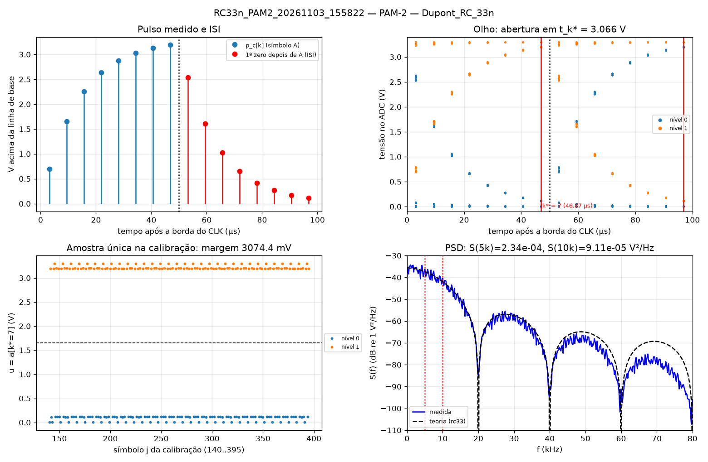


<details><summary>Saída completa do RX</summary>

```
Aguardando... quando aparecer #ARMADO, aperte RESET no TX.
#ARMADO PAM-2 canal=Dupont_RC_33n : reinicie o TX (ou aperte KEY no TX)
#ARMADO PAM-2 canal=Dupont_RC_33n : reinicie o TX (ou aperte KEY no TX)
>> recebendo relatório...
modulacao=PAM-2
canal=Dupont_RC_33n
Rs_sym_s=20000
fa_amostras_s=160000
bordas_CLK=20186
simbolos_esperados=100444
simbolos_processados=20163
amostras_processadas=161304
posicao_DMA_1a_borda=231
amostras_descartadas_antes_CLK=4164327
bordas_com_contagem_errada=0
overrun_processamento=0
erro_ADC_overrun=0
perda_CLK=1
aquisicao_valida=0
b_c=4.72
E_c=81093312.0
p_c[0]=861.48
p_c[1]=2051.17
p_c[2]=2797.13
p_c[3]=3269.52
p_c[4]=3569.22
p_c[5]=3760.27
p_c[6]=3882.07
p_c[7]=3959.88
ISI_zero_apos_A[0]=3151.52
ISI_zero_apos_A[1]=1996.63
ISI_zero_apos_A[2]=1269.93
ISI_zero_apos_A[3]=809.83
ISI_zero_apos_A[4]=518.38
ISI_zero_apos_A[5]=333.02
ISI_zero_apos_A[6]=214.07
ISI_zero_apos_A[7]=138.17
separacao_k[0]=-2405
separacao_k[1]=-19
separacao_k[2]=1477
separacao_k[3]=2430
separacao_k[4]=3031
separacao_k[5]=3412
separacao_k[6]=3658
separacao_k[7]=3815
k_estrela=7
t_k_estrela_us=46.87
centro_u[0]=109.67
centro_z[0]=0.16353
centro_u[1]=3999.91
centro_z[1]=1.05731
limiar_u[0]=2054.79
limiar_z[0]=0.61042
margem_u_ADC=3815
margem_u_mV_nominal=3074.4
margem_u_par=0-1
margem_z=0.77663
margem_z_par=0-1
calibracao_ok=1
media8_nivel[0]=0.90 (simbolo j=140, z=0.00027)
media8_nivel[1]=3021.40 (simbolo j=141, z=1.00044)
inicio_quadro_erros_u=0
inicio_quadro_erros_z=0
sincronismo_ok=1
payload_bits=19719
payload_simbolos=19719
BER=NAO_ATRIBUIDA (quadro invalido ou sem sincronismo: repita o ensaio)
janela_exemplo_j=451
janela_exemplo_nivel_TX=1
janela a[0]=4095 x[0]=4090.27 p_c[0]=861.48
janela a[1]=4095 x[1]=4090.27 p_c[1]=2051.17
janela a[2]=4095 x[2]=4090.27 p_c[2]=2797.13
janela a[3]=4095 x[3]=4090.27 p_c[3]=3269.52
janela a[4]=4095 x[4]=4090.27 p_c[4]=3569.22
janela a[5]=4095 x[5]=4090.27 p_c[5]=3760.27
janela a[6]=4095 x[6]=4090.27 p_c[6]=3882.07
janela a[7]=4095 x[7]=4090.27 p_c[7]=3959.88
janela_z=1.21814
#END_REPORT
#BEGIN_TRAIN j,nivel,a0,a1,a2,a3,a4,a5,a6,a7,z
#END_TRAIN
#BEGIN_PSD simbolo,nivel,a0,a1,a2,a3,a4,a5,a6,a7
>> log gravado em entrega/logs/RC33n_PAM2_20261103_155822.txt
================ RC33n_PAM2_20261103_155822 ================
Modulação PAM-2 | canal: Dupont_RC_33n | aquisição válida = 0 | sincronismo = 1
Bordas de CLK = 20186 de 100444 ; amostras = 161304 (= 8 x 20163) ; descartadas antes do CLK = 4164327

-- Filtro casado (Seção 4.5.1) --
b_c = 4.72 códigos (3.8 mV)
p_c[k] = [861.5 2051.2 2797.1 3269.5 3569.2 3760.3 3882.1 3959.9] códigos
E_c = 8.109e+07
ISI no 1º zero depois de A = [3151.5 1996.6 1269.9 809.8 518.4 333.0 214.1 138.2] códigos
conferência com o firmware: max|Δp_c| = 0.005, k* firmware = 7, k* Python = 7

-- Escolha de k* (Seção 4.3) --
  k=0  t= 3.12 us  menor separação = -2405 códigos (-1938.1 mV)
  k=1  t= 9.37 us  menor separação =   -19 códigos (  -15.3 mV)
  k=2  t=15.62 us  menor separação =  1477 códigos ( 1190.3 mV)
  k=3  t=21.87 us  menor separação =  2430 códigos ( 1958.2 mV)
  k=4  t=28.12 us  menor separação =  3031 códigos ( 2442.6 mV)
  k=5  t=34.37 us  menor separação =  3412 códigos ( 2749.6 mV)
  k=6  t=40.62 us  menor separação =  3658 códigos ( 2947.8 mV)
  k=7  t=46.87 us  menor separação =  3815 códigos ( 3074.4 mV)  <== k*

-- Centros, limiares, margens (Seção 4.5.2) --
centros u (códigos) = [109.7, 3999.9] ; em V = [0.088, 3.223]
limiares u (códigos) = [2054.8] ; em V = [1.656]
centros z = [0.1635, 1.0573] ; limiares z = [0.6104]
margem amostra única = 3815 códigos = 3074.4 mV (par de níveis 0-1)
margem filtro casado = 0.7766 (escala z; par 0-1)
margem relativa (margem / distância média entre centros): u = 0.98 , z = 0.87

-- Olho (1024 símbolos do payload) --
abertura vertical em t_k* = 46.87 us: 3.066 V (menor entre níveis vizinhos)
abertura por k (V) = [-1.941, -0.016, 1.19, 1.951, 2.436, 2.742, 2.943, 3.066]

-- PSD (fa = 160 kHz, Vref = 3.3000 V, média retirada, Hann, N = 1024, 50%, 15 blocos) --
resolução = 156.25 Hz ; duração do registro = 51.2 ms ; potência AC = 1.9815 V^2 (var = 1.9892)
S(5 kHz)  = 2.343e-04 V^2/Hz (média de 5 bins 1.758e-04; teoria 1.861e-04)
S(10 kHz) = 9.114e-05 V^2/Hz (média de 5 bins 5.927e-05; teoria 6.360e-05)

-- Contagem de erros (firmware, mesmas amostras do payload) --
SEM BER: quadro inválido ou sem sincronismo -> repetir o ensaio.

-- Janela real (símbolo j = 451, nível TX = 1) --
  k   a[k]    x[k]=a-b_c    p_c[k]       p_c*x
  0   4095     4090.28      861.48     3523669.7
  1   4095     4090.28     2051.18     8389869.8
  2   4095     4090.28     2797.12    11441010.5
  3   4095     4090.28     3269.53    13373256.4
  4   4095     4090.28     3569.22    14599111.8
  5   4095     4090.28     3760.28    15380558.8
  6   4095     4090.28     3882.08    15878754.3
  7   4095     4090.28     3959.88    16196977.7
  soma = 98783209.0 ; E_c = 81093311.5 ; z = soma/E_c = 1.21814 (firmware: 1.21814)

  [OK] Log completo até #END_PSD
  [FALHOU] bordas_CLK = símbolos esperados (20186 = 100444)
  [OK] amostras = 8 × símbolos (161304 = 8 × 20163)
  [OK] bordas_com_contagem_errada = 0
  [OK] overrun_processamento = 0 e erro_ADC_overrun = 0
  [FALHOU] perda_CLK = 0
  [FALHOU] aquisicao_valida = 1
  [OK] calibracao_ok = 1 (centros em ordem crescente)
  [OK] sincronismo_ok = 1 (48 bits de início corretos)
figura: entrega/figuras/RC33n_PAM2_20261103_155822.png
figura: entrega/figuras/RC33n_PAM2_20261103_155822_z.png
```
</details>

## RC33n PAM2 olho osc — canal RC33n, TX em PAM-2  ·  03/11/2026 16:01

- **Pontas:** CH1 = TP3 · CH2 = CLK
- **O que é:** Diagrama de olho em TP3, disparo na subida do CLK, persistência infinita. k* = 7 ↔ 46,87 µs depois da borda.
- **Aquisições:** 483

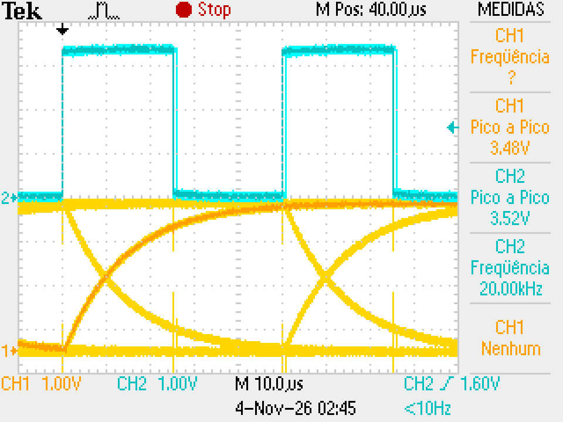

- Persistência infinita: ver a tela. A abertura em k* sai do log do RX (ensaio).
- Log do RX: `logs/RC33n_PAM2_20261103_160133.txt`
- RX: BER_amostra=0/100000
- RX: BER_filtro=0/100000
- RX: Modulação PAM-2 | canal: Dupont_RC_33n | aquisição válida = 1 | sincronismo = 1
- RX: amostra única: Ne = 0 em 100000 bits -> BER = 0.00e+00 ; Ns = 0 em 100000 -> SER = 0.00e+00

Arquivos: `capturas/RC33n_PAM2_olho_osc_tela.png`, `RC33n_PAM2_olho_osc_CH1.csv`, `RC33n_PAM2_olho_osc_CH2.csv`


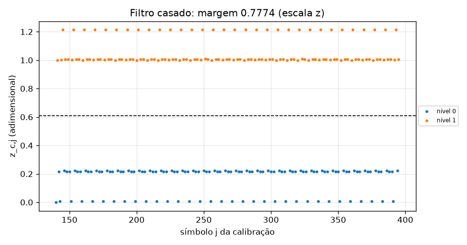

<details><summary>Saída completa do RX</summary>

```
Aguardando... quando aparecer #ARMADO, aperte RESET no TX.
#ARMADO PAM-2 canal=Dupont_RC_33n : reinicie o TX (ou aperte KEY no TX)
#ARMADO PAM-2 canal=Dupont_RC_33n : reinicie o TX (ou aperte KEY no TX)
>> recebendo relatório...
modulacao=PAM-2
canal=Dupont_RC_33n
Rs_sym_s=20000
fa_amostras_s=160000
bordas_CLK=100444
simbolos_esperados=100444
simbolos_processados=100444
amostras_processadas=803552
posicao_DMA_1a_borda=340
amostras_descartadas_antes_CLK=17188692
bordas_com_contagem_errada=0
overrun_processamento=0
erro_ADC_overrun=0
perda_CLK=0
aquisicao_valida=1
b_c=4.69
E_c=81242368.0
p_c[0]=860.06
p_c[1]=2053.71
p_c[2]=2802.81
p_c[3]=3273.56
p_c[4]=3573.01
p_c[5]=3763.01
p_c[6]=3884.51
p_c[7]=3961.96
ISI_zero_apos_A[0]=3156.51
ISI_zero_apos_A[1]=1995.01
ISI_zero_apos_A[2]=1267.76
ISI_zero_apos_A[3]=808.76
ISI_zero_apos_A[4]=516.61
ISI_zero_apos_A[5]=331.16
ISI_zero_apos_A[6]=212.81
ISI_zero_apos_A[7]=137.16
separacao_k[0]=-2409
separacao_k[1]=-16
separacao_k[2]=1486
separacao_k[3]=2432
separacao_k[4]=3035
separacao_k[5]=3416
separacao_k[6]=3659
separacao_k[7]=3816
k_estrela=7
t_k_estrela_us=46.87
centro_u[0]=108.87
centro_z[0]=0.16305
centro_u[1]=4001.91
centro_z[1]=1.05713
limiar_u[0]=2055.39
limiar_z[0]=0.61009
margem_u_ADC=3816
margem_u_mV_nominal=3075.2
margem_u_par=0-1
margem_z=0.77736
margem_z_par=0-1
calibracao_ok=1
media8_nivel[0]=0.18 (simbolo j=140, z=0.00002)
media8_nivel[1]=3023.93 (simbolo j=141, z=1.00042)
inicio_quadro_erros_u=0
inicio_quadro_erros_z=0
sincronismo_ok=1
payload_bits=100000
payload_simbolos=100000
amostra_unica_Ne=0
amostra_unica_Ns=0
filtro_casado_Ne=0
filtro_casado_Ns=0
BER_amostra=0/100000
BER_filtro=0/100000
SER_amostra=0/100000
SER_filtro=0/100000
janela_exemplo_j=451
janela_exemplo_nivel_TX=1
janela a[0]=4095 x[0]=4090.31 p_c[0]=860.06
janela a[1]=4095 x[1]=4090.31 p_c[1]=2053.71
janela a[2]=4095 x[2]=4090.31 p_c[2]=2802.81
janela a[3]=4095 x[3]=4090.31 p_c[3]=3273.56
janela a[4]=4095 x[4]=4090.31 p_c[4]=3573.01
janela a[5]=4095 x[5]=4090.31 p_c[5]=3763.01
janela a[6]=4095 x[6]=4090.31 p_c[6]=3884.51
janela a[7]=4095 x[7]=4090.31 p_c[7]=3961.96
janela_z=1.21702
#END_REPORT
#BEGIN_TRAIN j,nivel,a0,a1,a2,a3,a4,a5,a6,a7,z
#END_TRAIN
#BEGIN_PSD simbolo,nivel,a0,a1,a2,a3,a4,a5,a6,a7
>> log gravado em entrega/logs/RC33n_PAM2_20261103_160133.txt
================ RC33n_PAM2_20261103_160133 ================
Modulação PAM-2 | canal: Dupont_RC_33n | aquisição válida = 1 | sincronismo = 1
Bordas de CLK = 100444 de 100444 ; amostras = 803552 (= 8 x 100444) ; descartadas antes do CLK = 17188692

-- Filtro casado (Seção 4.5.1) --
b_c = 4.69 códigos (3.8 mV)
p_c[k] = [860.1 2053.7 2802.8 3273.6 3573.0 3763.0 3884.5 3962.0] códigos
E_c = 8.124e+07
ISI no 1º zero depois de A = [3156.5 1995.0 1267.8 808.8 516.6 331.2 212.8 137.2] códigos
conferência com o firmware: max|Δp_c| = 0.00375, k* firmware = 7, k* Python = 7

-- Escolha de k* (Seção 4.3) --
  k=0  t= 3.12 us  menor separação = -2409 códigos (-1941.3 mV)
  k=1  t= 9.37 us  menor separação =   -16 códigos (  -12.9 mV)
  k=2  t=15.62 us  menor separação =  1486 códigos ( 1197.5 mV)
  k=3  t=21.87 us  menor separação =  2432 códigos ( 1959.9 mV)
  k=4  t=28.12 us  menor separação =  3035 códigos ( 2445.8 mV)
  k=5  t=34.37 us  menor separação =  3416 códigos ( 2752.8 mV)
  k=6  t=40.62 us  menor separação =  3659 códigos ( 2948.6 mV)
  k=7  t=46.87 us  menor separação =  3816 códigos ( 3075.2 mV)  <== k*

-- Centros, limiares, margens (Seção 4.5.2) --
centros u (códigos) = [108.9, 4001.9] ; em V = [0.088, 3.225]
limiares u (códigos) = [2055.4] ; em V = [1.656]
centros z = [0.1631, 1.0571] ; limiares z = [0.6101]
margem amostra única = 3816 códigos = 3075.2 mV (par de níveis 0-1)
margem filtro casado = 0.7774 (escala z; par 0-1)
margem relativa (margem / distância média entre centros): u = 0.98 , z = 0.87

-- Olho (1024 símbolos do payload) --
abertura vertical em t_k* = 46.87 us: 3.068 V (menor entre níveis vizinhos)
abertura por k (V) = [-1.933, -0.013, 1.193, 1.959, 2.442, 2.746, 2.948, 3.068]

-- PSD (fa = 160 kHz, Vref = 3.3000 V, média retirada, Hann, N = 1024, 50%, 15 blocos) --
resolução = 156.25 Hz ; duração do registro = 51.2 ms ; potência AC = 1.9840 V^2 (var = 1.9916)
S(5 kHz)  = 2.346e-04 V^2/Hz (média de 5 bins 1.760e-04; teoria 1.861e-04)
S(10 kHz) = 9.140e-05 V^2/Hz (média de 5 bins 5.942e-05; teoria 6.360e-05)

-- Contagem de erros (firmware, mesmas amostras do payload) --
amostra única: Ne = 0 em 100000 bits -> BER = 0.00e+00 ; Ns = 0 em 100000 -> SER = 0.00e+00
filtro casado: Ne = 0 em 100000 bits -> BER = 0.00e+00 ; Ns = 0 em 100000 -> SER = 0.00e+00
  -> escrever "0 erros em 100.000 bits" (BER observada = 0, NÃO prova BER física nula;
     com 0 erros, limite superior de 95% ~ 3/100000 = 3e-5).

-- Janela real (símbolo j = 451, nível TX = 1) --
  k   a[k]    x[k]=a-b_c    p_c[k]       p_c*x
  0   4095     4090.31      860.06     3517893.5
  1   4095     4090.31     2053.71     8400287.5
  2   4095     4090.31     2802.81    11464335.9
  3   4095     4090.31     3273.56    13389847.6
  4   4095     4090.31     3573.01    14614689.8
  5   4095     4090.31     3763.01    15391848.0
  6   4095     4090.31     3884.51    15888820.2
  7   4095     4090.31     3961.96    16205614.4
  soma = 98873336.9 ; E_c = 81242375.3 ; z = soma/E_c = 1.21702 (firmware: 1.21702)

  [OK] Log completo até #END_PSD
  [OK] bordas_CLK = símbolos esperados (100444 = 100444)
  [OK] amostras = 8 × símbolos (803552 = 8 × 100444)
  [OK] bordas_com_contagem_errada = 0
  [OK] overrun_processamento = 0 e erro_ADC_overrun = 0
  [OK] perda_CLK = 0
  [OK] aquisicao_valida = 1
  [OK] calibracao_ok = 1 (centros em ordem crescente)
  [OK] sincronismo_ok = 1 (48 bits de início corretos)
figura: entrega/figuras/RC33n_PAM2_20261103_160133.png
figura: entrega/figuras/RC33n_PAM2_20261103_160133_z.png
```
</details>

## RC33n PAM4 olho osc — canal RC33n, TX em PAM-4  ·  03/11/2026 16:03

- **Pontas:** CH1 = TP3 · CH2 = CLK
- **O que é:** Diagrama de olho em TP3, disparo na subida do CLK, persistência infinita. k* = 7 ↔ 46,87 µs depois da borda.
- **Aquisições:** 244

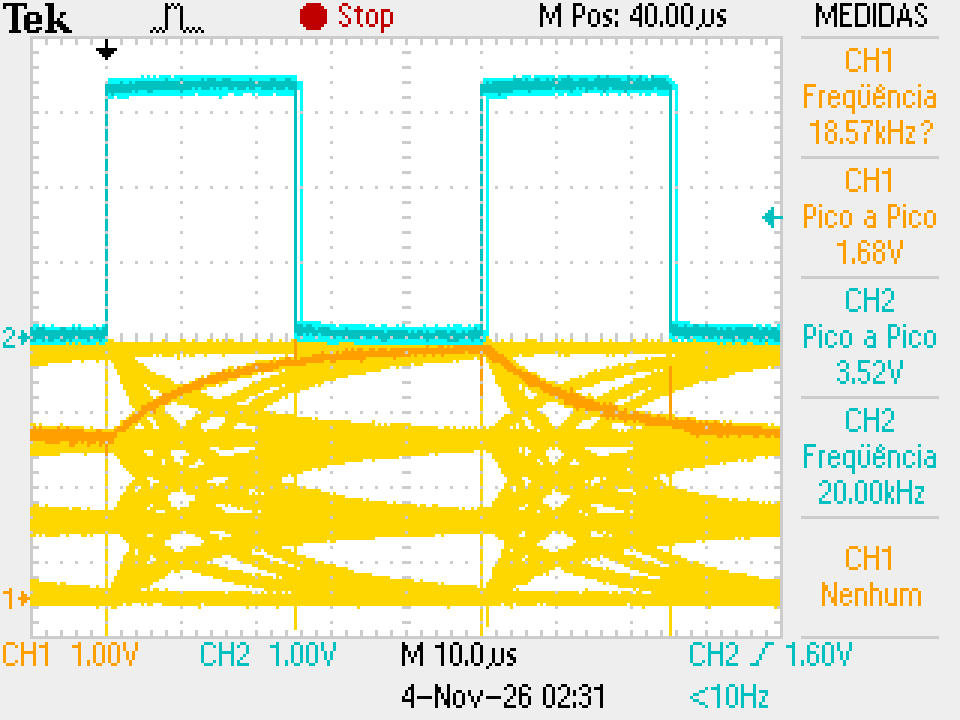

- Persistência infinita: ver a tela. A abertura em k* sai do log do RX (ensaio).
- Log do RX: `logs/RC33n_PAM4_20261103_160314.txt`
- RX: BER_amostra=0/100000
- RX: BER_filtro=0/100000
- RX: Modulação PAM-4 | canal: Dupont_RC_33n | aquisição válida = 1 | sincronismo = 1
- RX: amostra única: Ne = 0 em 100000 bits -> BER = 0.00e+00 ; Ns = 0 em 50000 -> SER = 0.00e+00

Arquivos: `capturas/RC33n_PAM4_olho_osc_tela.png`, `RC33n_PAM4_olho_osc_CH1.csv`, `RC33n_PAM4_olho_osc_CH2.csv`


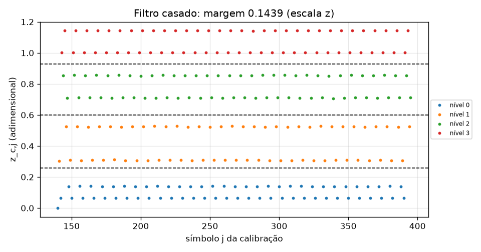

<details><summary>Saída completa do RX</summary>

```
Aguardando... quando aparecer #ARMADO, aperte RESET no TX.
#ARMADO PAM-4 canal=Dupont_RC_33n : reinicie o TX (ou aperte KEY no TX)
#ARMADO PAM-4 canal=Dupont_RC_33n : reinicie o TX (ou aperte KEY no TX)
>> recebendo relatório...
modulacao=PAM-4
canal=Dupont_RC_33n
Rs_sym_s=20000
fa_amostras_s=160000
bordas_CLK=50420
simbolos_esperados=50420
simbolos_processados=50420
amostras_processadas=403360
posicao_DMA_1a_borda=176
amostras_descartadas_antes_CLK=11584688
bordas_com_contagem_errada=0
overrun_processamento=0
erro_ADC_overrun=0
perda_CLK=0
aquisicao_valida=1
b_c=4.38
E_c=81443920.0
p_c[0]=877.97
p_c[1]=2064.48
p_c[2]=2808.77
p_c[3]=3278.82
p_c[4]=3575.52
p_c[5]=3765.27
p_c[6]=3886.63
p_c[7]=3962.77
ISI_zero_apos_A[0]=3145.57
ISI_zero_apos_A[1]=1989.97
ISI_zero_apos_A[2]=1263.78
ISI_zero_apos_A[3]=805.38
ISI_zero_apos_A[4]=514.88
ISI_zero_apos_A[5]=330.33
ISI_zero_apos_A[6]=212.13
ISI_zero_apos_A[7]=136.88
separacao_k[0]=-2843
separacao_k[1]=-1259
separacao_k[2]=-267
separacao_k[3]=357
separacao_k[4]=734
separacao_k[5]=915
separacao_k[6]=1025
separacao_k[7]=1099
k_estrela=7
t_k_estrela_us=46.87
centro_u[0]=69.67
centro_z[0]=0.10099
centro_u[1]=1284.06
centro_z[1]=0.41655
centro_u[2]=2631.61
centro_z[2]=0.78287
centro_u[3]=4013.11
centro_z[3]=1.07216
limiar_u[0]=676.87
limiar_z[0]=0.25877
limiar_u[1]=1957.84
limiar_z[1]=0.59971
limiar_u[2]=3322.36
limiar_z[2]=0.92752
margem_u_ADC=1099
margem_u_mV_nominal=885.6
margem_u_par=0-1
margem_z=0.14393
margem_z_par=2-3
calibracao_ok=1
media8_nivel[0]=0.13 (simbolo j=140, z=0.00004)
media8_nivel[1]=914.50 (simbolo j=141, z=0.30243)
media8_nivel[2]=2983.38 (simbolo j=144, z=0.85341)
media8_nivel[3]=3032.13 (simbolo j=143, z=1.00098)
inicio_quadro_erros_u=0
inicio_quadro_erros_z=0
sincronismo_ok=1
payload_bits=100000
payload_simbolos=50000
amostra_unica_Ne=0
amostra_unica_Ns=0
filtro_casado_Ne=0
filtro_casado_Ns=0
BER_amostra=0/100000
BER_filtro=0/100000
SER_amostra=0/50000
SER_filtro=0/50000
janela_exemplo_j=427
janela_exemplo_nivel_TX=3
janela a[0]=2947 x[0]=2942.63 p_c[0]=877.97
janela a[1]=3371 x[1]=3366.63 p_c[1]=2064.48
janela a[2]=3640 x[2]=3635.63 p_c[2]=2808.77
janela a[3]=3811 x[3]=3806.63 p_c[3]=3278.82
janela a[4]=3919 x[4]=3914.63 p_c[4]=3575.52
janela a[5]=3985 x[5]=3980.63 p_c[5]=3765.27
janela a[6]=4030 x[6]=4025.63 p_c[6]=3886.63
janela a[7]=4059 x[7]=4054.63 p_c[7]=3962.77
janela_z=1.14097
#END_REPORT
#BEGIN_TRAIN j,nivel,a0,a1,a2,a3,a4,a5,a6,a7,z
#END_TRAIN
#BEGIN_PSD simbolo,nivel,a0,a1,a2,a3,a4,a5,a6,a7
>> log gravado em entrega/logs/RC33n_PAM4_20261103_160314.txt
================ RC33n_PAM4_20261103_160314 ================
Modulação PAM-4 | canal: Dupont_RC_33n | aquisição válida = 1 | sincronismo = 1
Bordas de CLK = 50420 de 50420 ; amostras = 403360 (= 8 x 50420) ; descartadas antes do CLK = 11584688

-- Filtro casado (Seção 4.5.1) --
b_c = 4.38 códigos (3.5 mV)
p_c[k] = [878.0 2064.5 2808.8 3278.8 3575.5 3765.3 3886.6 3962.8] códigos
E_c = 8.144e+07
ISI no 1º zero depois de A = [3145.6 1990.0 1263.8 805.4 514.9 330.3 212.1 136.9] códigos
conferência com o firmware: max|Δp_c| = 0.005, k* firmware = 7, k* Python = 7

-- Escolha de k* (Seção 4.3) --
  k=0  t= 3.12 us  menor separação = -2843 códigos (-2291.1 mV)
  k=1  t= 9.37 us  menor separação = -1259 códigos (-1014.6 mV)
  k=2  t=15.62 us  menor separação =  -267 códigos ( -215.2 mV)
  k=3  t=21.87 us  menor separação =   357 códigos (  287.7 mV)
  k=4  t=28.12 us  menor separação =   734 códigos (  591.5 mV)
  k=5  t=34.37 us  menor separação =   915 códigos (  737.4 mV)
  k=6  t=40.62 us  menor separação =  1025 códigos (  826.0 mV)
  k=7  t=46.87 us  menor separação =  1099 códigos (  885.6 mV)  <== k*

-- Centros, limiares, margens (Seção 4.5.2) --
centros u (códigos) = [69.7, 1284.1, 2631.6, 4013.1] ; em V = [0.056, 1.035, 2.121, 3.234]
limiares u (códigos) = [676.9, 1957.8, 3322.4] ; em V = [0.545, 1.578, 2.677]
centros z = [0.101, 0.4165, 0.7829, 1.0722] ; limiares z = [0.2588, 0.5997, 0.9275]
margem amostra única = 1099 códigos = 885.6 mV (par de níveis 0-1, Gray 00/01)
margem filtro casado = 0.1439 (escala z; par 2-3)
margem relativa (margem / distância média entre centros): u = 0.84 , z = 0.44

-- Olho (1024 símbolos do payload) --
abertura vertical em t_k* = 46.87 us: 0.839 V (menor entre níveis vizinhos)
abertura por k (V) = [-2.41, -1.166, -0.383, 0.117, 0.432, 0.629, 0.76, 0.839]

-- PSD (fa = 160 kHz, Vref = 3.3000 V, média retirada, Hann, N = 1024, 50%, 15 blocos) --
resolução = 156.25 Hz ; duração do registro = 51.2 ms ; potência AC = 1.0556 V^2 (var = 1.0733)
S(5 kHz)  = 1.323e-04 V^2/Hz (média de 5 bins 9.922e-05; teoria 1.034e-04)
S(10 kHz) = 1.056e-05 V^2/Hz (média de 5 bins 9.128e-06; teoria 7.067e-06)

-- Contagem de erros (firmware, mesmas amostras do payload) --
amostra única: Ne = 0 em 100000 bits -> BER = 0.00e+00 ; Ns = 0 em 50000 -> SER = 0.00e+00
filtro casado: Ne = 0 em 100000 bits -> BER = 0.00e+00 ; Ns = 0 em 50000 -> SER = 0.00e+00
  -> escrever "0 erros em 100.000 bits" (BER observada = 0, NÃO prova BER física nula;
     com 0 erros, limite superior de 95% ~ 3/100000 = 3e-5).

-- Janela real (símbolo j = 427, nível TX = 3) --
  k   a[k]    x[k]=a-b_c    p_c[k]       p_c*x
  0   2947     2942.62      877.98     2583551.2
  1   3371     3366.62     2064.47     6950313.1
  2   3640     3635.62     2808.78    10211652.6
  3   3811     3806.62     3278.82    12481257.2
  4   3919     3914.62     3575.53    13996839.6
  5   3985     3980.62     3765.28    14988147.8
  6   4030     4025.62     3886.62    15646094.8
  7   4059     4054.62     3962.78    16067566.6
  soma = 92925422.9 ; E_c = 81443922.0 ; z = soma/E_c = 1.14097 (firmware: 1.14097)

  [OK] Log completo até #END_PSD
  [OK] bordas_CLK = símbolos esperados (50420 = 50420)
  [OK] amostras = 8 × símbolos (403360 = 8 × 50420)
  [OK] bordas_com_contagem_errada = 0
  [OK] overrun_processamento = 0 e erro_ADC_overrun = 0
  [OK] perda_CLK = 0
  [OK] aquisicao_valida = 1
  [OK] calibracao_ok = 1 (centros em ordem crescente)
  [OK] sincronismo_ok = 1 (48 bits de início corretos)
figura: entrega/figuras/RC33n_PAM4_20261103_160314.png
figura: entrega/figuras/RC33n_PAM4_20261103_160314_z.png
```
</details>

## RC33n PAM2 olho osc — canal RC33n, TX em PAM-2  ·  03/11/2026 16:05


> ⚠️ **Captura com problema de montagem.** O RX validou o quadro (0 erros), mas os níveis mudaram em relação ao ensaio anterior (RC33n_PAM2_20261103_160133): linha de base b_c = 427 códigos (era 5), centro do nível 0 = 553 (era 109), nível 1 = 3293 (era 4002) → abertura 1,91 V em vez de 3,07 V; o osciloscópio viu TP3 até 3,8 V (> 3,3 V). Sintoma típico de **GND comum ruim/deslocado** ou fio solto encostando num nó, logo depois de tirar o jumper do PB0. Log movido para `logs/invalidos/`. O log válido do RC 33 nF PAM-2 é o `RC33n_PAM2_20261103_160133.txt`.


- **Pontas:** CH1 = TP3 · CH2 = CLK
- **O que é:** Diagrama de olho em TP3, disparo na subida do CLK, persistência infinita. k* = 7 ↔ 46,87 µs depois da borda.
- **Aquisições:** 484

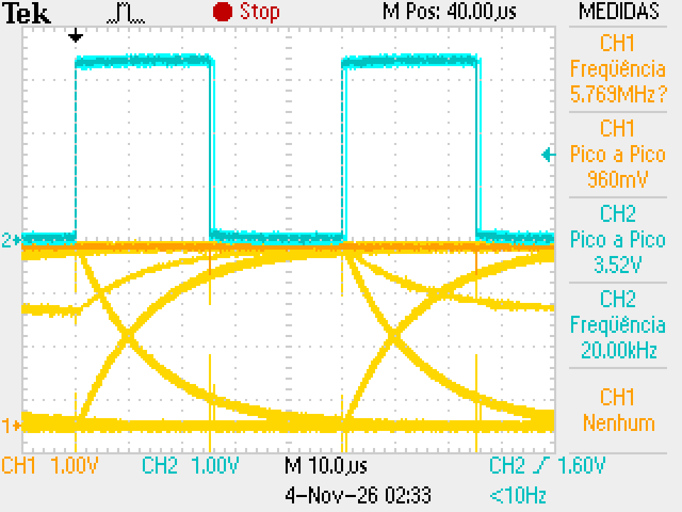

- Persistência infinita: ver a tela. A abertura em k* sai do log do RX (ensaio).
- Log do RX: `logs/invalidos/RC33n_PAM2_20261103_160502.txt`
- RX: BER_amostra=0/100000
- RX: BER_filtro=0/100000
- RX: Modulação PAM-2 | canal: Dupont_RC_33n | aquisição válida = 1 | sincronismo = 1
- RX: amostra única: Ne = 0 em 100000 bits -> BER = 0.00e+00 ; Ns = 0 em 100000 -> SER = 0.00e+00

Arquivos: `capturas/RC33n_PAM2_olho_osc_tela.png`, `RC33n_PAM2_olho_osc_CH1.csv`, `RC33n_PAM2_olho_osc_CH2.csv`

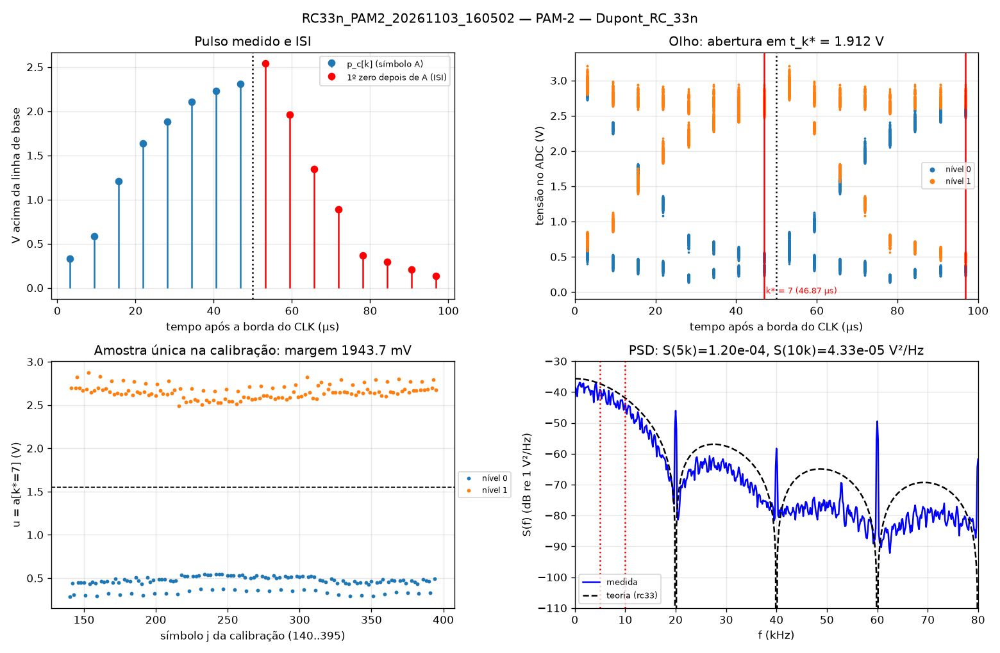

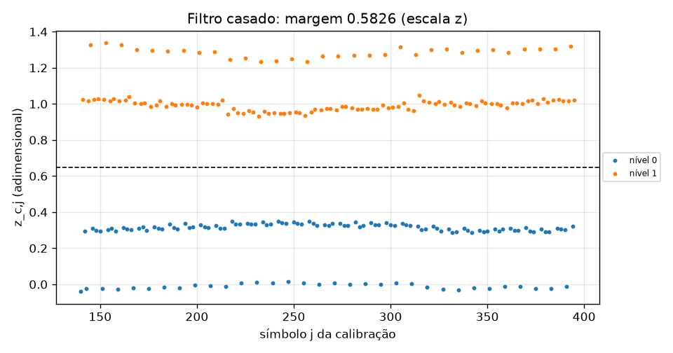

<details><summary>Saída completa do RX</summary>

```
Aguardando... quando aparecer #ARMADO, aperte RESET no TX.
#ARMADO PAM-2 canal=Dupont_RC_33n : reinicie o TX (ou aperte KEY no TX)
#ARMADO PAM-2 canal=Dupont_RC_33n : reinicie o TX (ou aperte KEY no TX)
>> recebendo relatório...
modulacao=PAM-2
canal=Dupont_RC_33n
Rs_sym_s=20000
fa_amostras_s=160000
bordas_CLK=100444
simbolos_esperados=100444
simbolos_processados=100444
amostras_processadas=803552
posicao_DMA_1a_borda=325
amostras_descartadas_antes_CLK=12732741
bordas_com_contagem_errada=0
overrun_processamento=0
erro_ADC_overrun=0
perda_CLK=0
aquisicao_valida=1
b_c=427.36
E_c=35231548.0
p_c[0]=409.64
p_c[1]=727.79
p_c[2]=1494.59
p_c[3]=2029.04
p_c[4]=2333.59
p_c[5]=2613.74
p_c[6]=2770.44
p_c[7]=2868.89
ISI_zero_apos_A[0]=3152.34
ISI_zero_apos_A[1]=2436.94
ISI_zero_apos_A[2]=1669.14
ISI_zero_apos_A[3]=1102.34
ISI_zero_apos_A[4]=452.19
ISI_zero_apos_A[5]=366.84
ISI_zero_apos_A[6]=256.64
ISI_zero_apos_A[7]=169.24
separacao_k[0]=-3035
separacao_k[1]=-1914
separacao_k[2]=-472
separacao_k[3]=656
separacao_k[4]=1585
separacao_k[5]=1969
separacao_k[6]=2226
separacao_k[7]=2412
k_estrela=7
t_k_estrela_us=46.87
centro_u[0]=553.14
centro_z[0]=0.23284
centro_u[1]=3292.99
centro_z[1]=1.06499
limiar_u[0]=1923.07
limiar_z[0]=0.64892
margem_u_ADC=2412
margem_u_mV_nominal=1943.7
margem_u_par=0-1
margem_z=0.58257
margem_z_par=0-1
calibracao_ok=1
media8_nivel[0]=-55.61 (simbolo j=140, z=-0.03936)
media8_nivel[1]=1949.14 (simbolo j=141, z=1.02383)
inicio_quadro_erros_u=0
inicio_quadro_erros_z=0
sincronismo_ok=1
payload_bits=100000
payload_simbolos=100000
amostra_unica_Ne=0
amostra_unica_Ns=0
filtro_casado_Ne=0
filtro_casado_Ns=0
BER_amostra=0/100000
BER_filtro=0/100000
SER_amostra=0/100000
SER_filtro=0/100000
janela_exemplo_j=451
janela_exemplo_nivel_TX=1
janela a[0]=3813 x[0]=3385.64 p_c[0]=409.64
janela a[1]=3566 x[1]=3138.64 p_c[1]=727.79
janela a[2]=3472 x[2]=3044.64 p_c[2]=1494.59
janela a[3]=3457 x[3]=3029.64 p_c[3]=2029.04
janela a[4]=3378 x[4]=2950.64 p_c[4]=2333.59
janela a[5]=3439 x[5]=3011.64 p_c[5]=2613.74
janela a[6]=3446 x[6]=3018.64 p_c[6]=2770.44
janela a[7]=3464 x[7]=3036.64 p_c[7]=2868.89
janela_z=1.31135
#END_REPORT
#BEGIN_TRAIN j,nivel,a0,a1,a2,a3,a4,a5,a6,a7,z
#END_TRAIN
#BEGIN_PSD simbolo,nivel,a0,a1,a2,a3,a4,a5,a6,a7
>> log gravado em entrega/logs/invalidos/RC33n_PAM2_20261103_160502.txt
================ RC33n_PAM2_20261103_160502 ================
Modulação PAM-2 | canal: Dupont_RC_33n | aquisição válida = 1 | sincronismo = 1
Bordas de CLK = 100444 de 100444 ; amostras = 803552 (= 8 x 100444) ; descartadas antes do CLK = 12732741

-- Filtro casado (Seção 4.5.1) --
b_c = 427.36 códigos (344.4 mV)
p_c[k] = [409.6 727.8 1494.6 2029.0 2333.6 2613.7 2770.4 2868.9] códigos
E_c = 3.523e+07
ISI no 1º zero depois de A = [3152.3 2436.9 1669.1 1102.3 452.2 366.8 256.6 169.2] códigos
conferência com o firmware: max|Δp_c| = 0.00375, k* firmware = 7, k* Python = 7

-- Escolha de k* (Seção 4.3) --
  k=0  t= 3.12 us  menor separação = -3035 códigos (-2445.8 mV)
  k=1  t= 9.37 us  menor separação = -1914 códigos (-1542.4 mV)
  k=2  t=15.62 us  menor separação =  -472 códigos ( -380.4 mV)
  k=3  t=21.87 us  menor separação =   656 códigos (  528.6 mV)
  k=4  t=28.12 us  menor separação =  1585 códigos ( 1277.3 mV)
  k=5  t=34.37 us  menor separação =  1969 códigos ( 1586.7 mV)
  k=6  t=40.62 us  menor separação =  2226 códigos ( 1793.8 mV)
  k=7  t=46.87 us  menor separação =  2412 códigos ( 1943.7 mV)  <== k*

-- Centros, limiares, margens (Seção 4.5.2) --
centros u (códigos) = [553.1, 3293.0] ; em V = [0.446, 2.654]
limiares u (códigos) = [1923.1] ; em V = [1.55]
centros z = [0.2328, 1.065] ; limiares z = [0.6489]
margem amostra única = 2412 códigos = 1943.7 mV (par de níveis 0-1)
margem filtro casado = 0.5826 (escala z; par 0-1)
margem relativa (margem / distância média entre centros): u = 0.88 , z = 0.70

-- Olho (1024 símbolos do payload) --
abertura vertical em t_k* = 46.87 us: 1.912 V (menor entre níveis vizinhos)
abertura por k (V) = [-2.478, -1.556, -0.432, 0.465, 1.237, 1.551, 1.758, 1.912]

-- PSD (fa = 160 kHz, Vref = 3.3000 V, média retirada, Hann, N = 1024, 50%, 15 blocos) --
resolução = 156.25 Hz ; duração do registro = 51.2 ms ; potência AC = 1.0401 V^2 (var = 1.0469)
S(5 kHz)  = 1.196e-04 V^2/Hz (média de 5 bins 8.967e-05; teoria 1.861e-04)
S(10 kHz) = 4.325e-05 V^2/Hz (média de 5 bins 2.887e-05; teoria 6.360e-05)

-- Contagem de erros (firmware, mesmas amostras do payload) --
amostra única: Ne = 0 em 100000 bits -> BER = 0.00e+00 ; Ns = 0 em 100000 -> SER = 0.00e+00
filtro casado: Ne = 0 em 100000 bits -> BER = 0.00e+00 ; Ns = 0 em 100000 -> SER = 0.00e+00
  -> escrever "0 erros em 100.000 bits" (BER observada = 0, NÃO prova BER física nula;
     com 0 erros, limite superior de 95% ~ 3/100000 = 3e-5).

-- Janela real (símbolo j = 451, nível TX = 1) --
  k   a[k]    x[k]=a-b_c    p_c[k]       p_c*x
  0   3813     3385.64      409.64     1386907.8
  1   3566     3138.64      727.79     2284285.3
  2   3472     3044.64     1494.59     4550505.5
  3   3457     3029.64     2029.04     6147279.7
  4   3378     2950.64     2333.59     6885603.8
  5   3439     3011.64     2613.74     7871665.0
  6   3446     3018.64     2770.44     8362982.7
  7   3464     3036.64     2868.89     8711808.3
  soma = 46201038.2 ; E_c = 35231546.9 ; z = soma/E_c = 1.31135 (firmware: 1.31135)

  [OK] Log completo até #END_PSD
  [OK] bordas_CLK = símbolos esperados (100444 = 100444)
  [OK] amostras = 8 × símbolos (803552 = 8 × 100444)
  [OK] bordas_com_contagem_errada = 0
  [OK] overrun_processamento = 0 e erro_ADC_overrun = 0
  [OK] perda_CLK = 0
  [OK] aquisicao_valida = 1
  [OK] calibracao_ok = 1 (centros em ordem crescente)
  [OK] sincronismo_ok = 1 (48 bits de início corretos)
figura: entrega/figuras/RC33n_PAM2_20261103_160502.png
figura: entrega/figuras/RC33n_PAM2_20261103_160502_z.png
```
</details>

## RC33n PAM2 olho osc — canal RC33n, TX em PAM-2  ·  03/11/2026 16:13


> ⚠️ **Problema de montagem (2ª vez) — sincronismo perdido.** O ADC do RX viu quase um sinal constante: centros dos níveis 0 e 1 = 1186 e 1336 códigos (≈ 0,96 e 1,08 V) e linha de base 1033, enquanto o osciloscópio em TP3 ainda mostra a excursão completa. Os dois níveis "convergindo para a média" é o sintoma de **resistência alta em série com a entrada do ADC** (contato ruim no 1 kΩ, em TP4 ou no fio até o PA1): o capacitor de amostragem do ADC não carrega em 6,25 µs e as amostras viram a média do sinal. Na tentativa anterior o contato estava só parcialmente ruim (níveis 553/3293). Log em `logs/invalidos/`.


- **Pontas:** CH1 = TP3 · CH2 = CLK
- **O que é:** Diagrama de olho em TP3, disparo na subida do CLK, persistência infinita. k* = 7 ↔ 46,87 µs depois da borda.
- **Aquisições:** 482

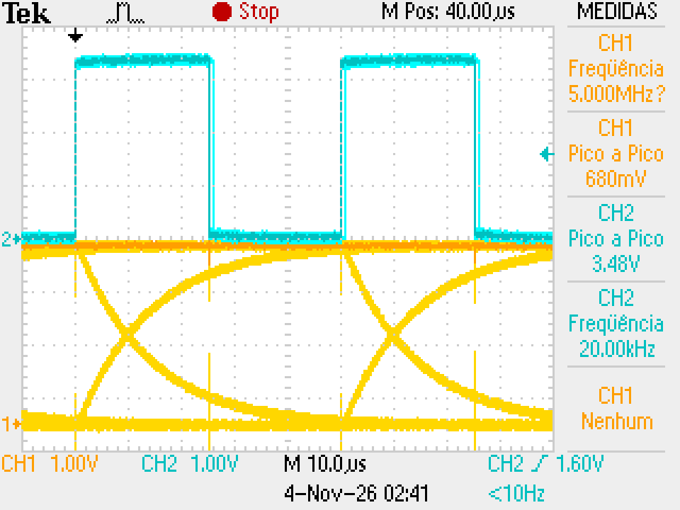

- Persistência infinita: ver a tela. A abertura em k* sai do log do RX (ensaio).
- Log do RX: `logs/invalidos/RC33n_PAM2_20261103_161314.txt`
- RX: BER=NAO_ATRIBUIDA (quadro invalido ou sem sincronismo: repita o ensaio)
- RX: Modulação PAM-2 | canal: Dupont_RC_33n | aquisição válida = 1 | sincronismo = 0
- RX: SEM BER: quadro inválido ou sem sincronismo -> repetir o ensaio.

Arquivos: `capturas/RC33n_PAM2_olho_osc_tela.png`, `RC33n_PAM2_olho_osc_CH1.csv`, `RC33n_PAM2_olho_osc_CH2.csv`

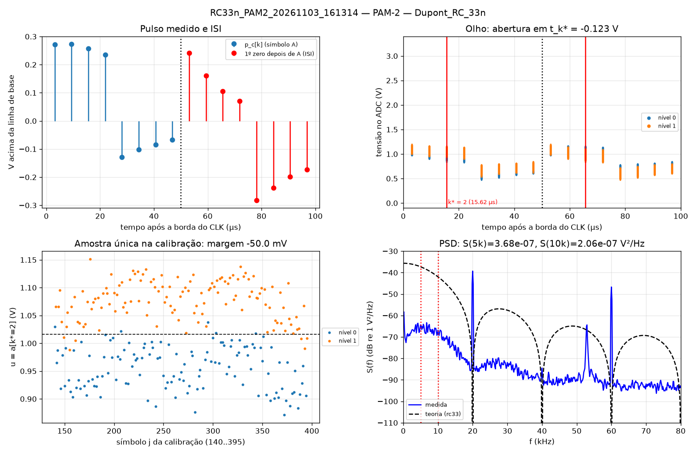

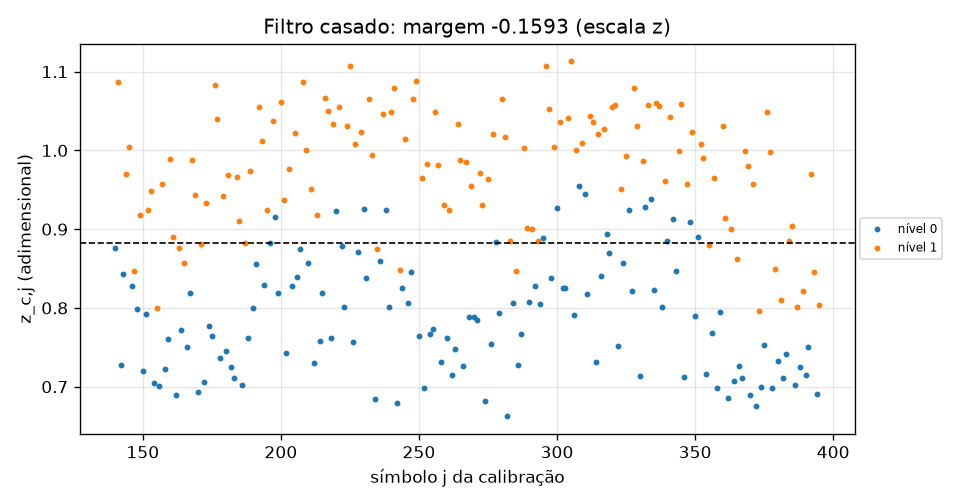

<details><summary>Saída completa do RX</summary>

```
Aguardando... quando aparecer #ARMADO, aperte RESET no TX.
#ARMADO PAM-2 canal=Dupont_RC_33n : reinicie o TX (ou aperte KEY no TX)
#ARMADO PAM-2 canal=Dupont_RC_33n : reinicie o TX (ou aperte KEY no TX)
>> recebendo relatório...
modulacao=PAM-2
canal=Dupont_RC_33n
Rs_sym_s=20000
fa_amostras_s=160000
bordas_CLK=100444
simbolos_esperados=100444
simbolos_processados=100444
amostras_processadas=803552
posicao_DMA_1a_borda=234
amostras_descartadas_antes_CLK=4656874
bordas_com_contagem_errada=0
overrun_processamento=0
erro_ADC_overrun=0
perda_CLK=0
aquisicao_valida=1
b_c=1033.17
E_c=475212.9
p_c[0]=337.43
p_c[1]=338.78
p_c[2]=319.53
p_c[3]=291.73
p_c[4]=-159.87
p_c[5]=-126.52
p_c[6]=-103.92
p_c[7]=-83.72
ISI_zero_apos_A[0]=300.13
ISI_zero_apos_A[1]=198.68
ISI_zero_apos_A[2]=130.03
ISI_zero_apos_A[3]=88.53
ISI_zero_apos_A[4]=-349.57
ISI_zero_apos_A[5]=-295.22
ISI_zero_apos_A[6]=-246.17
ISI_zero_apos_A[7]=-215.17
separacao_k[0]=-168
separacao_k[1]=-71
separacao_k[2]=-62
separacao_k[3]=-82
separacao_k[4]=-75
separacao_k[5]=-72
separacao_k[6]=-107
separacao_k[7]=-85
k_estrela=2
t_k_estrela_us=15.62
centro_u[0]=1185.58
centro_z[0]=0.78809
centro_u[1]=1336.14
centro_z[1]=0.97749
limiar_u[0]=1260.86
limiar_z[0]=0.88279
margem_u_ADC=-62
margem_u_mV_nominal=-50.0
margem_u_par=0-1
margem_z=-0.15927
margem_z_par=0-1
calibracao_ok=1
media8_nivel[0]=41.58 (simbolo j=140, z=0.87585)
media8_nivel[1]=106.83 (simbolo j=141, z=1.08655)
inicio_quadro_erros_u=10
inicio_quadro_erros_z=12
sincronismo_ok=0
payload_bits=100000
payload_simbolos=100000
BER=NAO_ATRIBUIDA (quadro invalido ou sem sincronismo: repita o ensaio)
janela_exemplo_j=451
janela_exemplo_nivel_TX=1
janela a[0]=1347 x[0]=313.83 p_c[0]=337.43
janela a[1]=1328 x[1]=294.83 p_c[1]=338.78
janela a[2]=1206 x[2]=172.83 p_c[2]=319.53
janela a[3]=1214 x[3]=180.83 p_c[3]=291.73
janela a[4]=794 x[4]=-239.17 p_c[4]=-159.87
janela a[5]=758 x[5]=-275.17 p_c[5]=-126.52
janela a[6]=862 x[6]=-171.17 p_c[6]=-103.92
janela a[7]=940 x[7]=-93.17 p_c[7]=-83.72
janela_z=0.86781
#END_REPORT
#BEGIN_TRAIN j,nivel,a0,a1,a2,a3,a4,a5,a6,a7,z
#END_TRAIN
#BEGIN_PSD simbolo,nivel,a0,a1,a2,a3,a4,a5,a6,a7
>> log gravado em entrega/logs/invalidos/RC33n_PAM2_20261103_161314.txt
================ RC33n_PAM2_20261103_161314 ================
Modulação PAM-2 | canal: Dupont_RC_33n | aquisição válida = 1 | sincronismo = 0
Bordas de CLK = 100444 de 100444 ; amostras = 803552 (= 8 x 100444) ; descartadas antes do CLK = 4656874

-- Filtro casado (Seção 4.5.1) --
b_c = 1033.17 códigos (832.6 mV)
p_c[k] = [337.4 338.8 319.5 291.7 -159.9 -126.5 -103.9 -83.7] códigos
E_c = 4.752e+05
ISI no 1º zero depois de A = [300.1 198.7 130.0 88.5 -349.6 -295.2 -246.2 -215.2] códigos
conferência com o firmware: max|Δp_c| = 0.00125, k* firmware = 2, k* Python = 2

-- Escolha de k* (Seção 4.3) --
  k=0  t= 3.12 us  menor separação =  -168 códigos ( -135.4 mV)
  k=1  t= 9.37 us  menor separação =   -71 códigos (  -57.2 mV)
  k=2  t=15.62 us  menor separação =   -62 códigos (  -50.0 mV)  <== k*
  k=3  t=21.87 us  menor separação =   -82 códigos (  -66.1 mV)
  k=4  t=28.12 us  menor separação =   -75 códigos (  -60.4 mV)
  k=5  t=34.37 us  menor separação =   -72 códigos (  -58.0 mV)
  k=6  t=40.62 us  menor separação =  -107 códigos (  -86.2 mV)
  k=7  t=46.87 us  menor separação =   -85 códigos (  -68.5 mV)

-- Centros, limiares, margens (Seção 4.5.2) --
centros u (códigos) = [1185.6, 1336.1] ; em V = [0.955, 1.077]
limiares u (códigos) = [1260.9] ; em V = [1.016]
centros z = [0.7881, 0.9775] ; limiares z = [0.8828]
margem amostra única = -62 códigos = -50.0 mV (par de níveis 0-1)
margem filtro casado = -0.1593 (escala z; par 0-1)
margem relativa (margem / distância média entre centros): u = -0.41 , z = -0.84

-- Olho (1024 símbolos do payload) --
abertura vertical em t_k* = 15.62 us: -0.123 V (menor entre níveis vizinhos)
abertura por k (V) = [-0.154, -0.145, -0.123, -0.127, -0.147, -0.119, -0.135, -0.16]

-- PSD (fa = 160 kHz, Vref = 3.3000 V, média retirada, Hann, N = 1024, 50%, 15 blocos) --
resolução = 156.25 Hz ; duração do registro = 51.2 ms ; potência AC = 0.0358 V^2 (var = 0.0358)
S(5 kHz)  = 3.677e-07 V^2/Hz (média de 5 bins 2.742e-07; teoria 1.861e-04)
S(10 kHz) = 2.055e-07 V^2/Hz (média de 5 bins 1.421e-07; teoria 6.360e-05)

-- Contagem de erros (firmware, mesmas amostras do payload) --
SEM BER: quadro inválido ou sem sincronismo -> repetir o ensaio.

-- Janela real (símbolo j = 451, nível TX = 1) --
  k   a[k]    x[k]=a-b_c    p_c[k]       p_c*x
  0   1347      313.83      337.43      105896.5
  1   1328      294.83      338.78       99883.3
  2   1206      172.83      319.53       55225.0
  3   1214      180.83      291.73       52754.1
  4    794     -239.17     -159.87       38235.6
  5    758     -275.17     -126.52       34814.0
  6    862     -171.17     -103.92       17787.6
  7    940      -93.17      -83.72        7800.0
  soma = 412396.1 ; E_c = 475212.9 ; z = soma/E_c = 0.86781 (firmware: 0.86781)

  [OK] Log completo até #END_PSD
  [OK] bordas_CLK = símbolos esperados (100444 = 100444)
  [OK] amostras = 8 × símbolos (803552 = 8 × 100444)
  [OK] bordas_com_contagem_errada = 0
  [OK] overrun_processamento = 0 e erro_ADC_overrun = 0
  [OK] perda_CLK = 0
  [OK] aquisicao_valida = 1
  [OK] calibracao_ok = 1 (centros em ordem crescente)
  [FALHOU] sincronismo_ok = 1 (48 bits de início corretos)
figura: entrega/figuras/RC33n_PAM2_20261103_161314.png
figura: entrega/figuras/RC33n_PAM2_20261103_161314_z.png
```
</details>

## RC33n PAM2 olho osc — canal RC33n, TX em PAM-2  ·  03/11/2026 16:18

- **Pontas:** CH1 = TP3 · CH2 = CLK
- **O que é:** Diagrama de olho em TP3, disparo na subida do CLK, persistência infinita. k* = 7 ↔ 46,87 µs depois da borda.
- **Aquisições:** 476


- Persistência infinita: ver a tela. A abertura em k* sai do log do RX (ensaio).
- Log do RX: `logs/RC33n_PAM2_20261103_161754.txt`
- RX: BER=NAO_ATRIBUIDA (quadro invalido ou sem sincronismo: repita o ensaio)
- RX: BER_amostra=0/100000
- RX: BER_filtro=0/100000
- RX: Modulação PAM-2 | canal: Dupont_RC_33n | aquisição válida = 1 | sincronismo = 1

Arquivos: `capturas/RC33n_PAM2_olho_osc_tela.png`, `RC33n_PAM2_olho_osc_CH1.csv`, `RC33n_PAM2_olho_osc_CH2.csv`

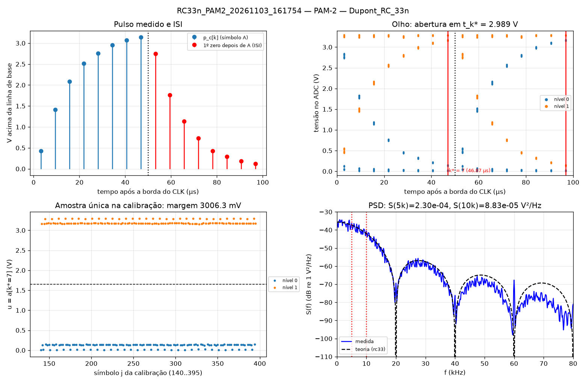

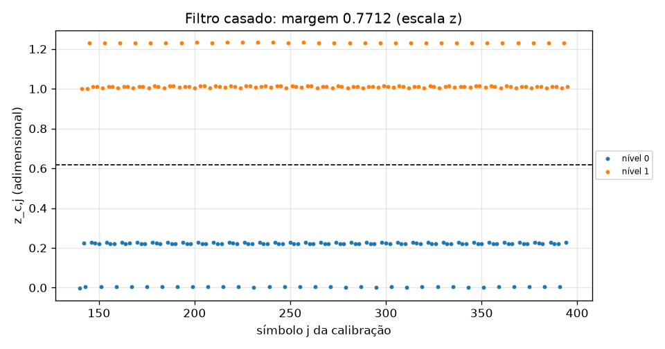

<details><summary>Saída completa do RX</summary>

```
Aguardando... quando aparecer #ARMADO, aperte RESET no TX.
M-2
canal=nao_informado
Rs_sym_s=20000
fa_amostras_s=160000
bordas_CLK=11326
simbolos_esperados=100444
simbolos_processados=11302
amostras_processadas=90416
posicao_DMA_1a_borda=461
amostras_descartadas_antes_CLK=371661
bordas_com_contagem_errada=0
overrun_processamento=0
erro_ADC_overrun=0
perda_CLK=1
aquisicao_valida=0
b_c=12.80
E_c=77113960.0
p_c[0]=584.10
p_c[1]=1836.55
p_c[2]=2654.50
p_c[3]=3175.90
p_c[4]=3486.55
p_c[5]=3717.75
p_c[6]=3849.70
p_c[7]=3933.10
ISI_zero_apos_A[0]=3398.60
ISI_zero_apos_A[1]=2173.80
ISI_zero_apos_A[2]=1387.70
ISI_zero_apos_A[3]=886.35
ISI_zero_apos_A[4]=540.35
ISI_zero_apos_A[5]=361.05
ISI_zero_apos_A[6]=232.95
ISI_zero_apos_A[7]=147.60
separacao_k[0]=-2994
separacao_k[1]=-483
separacao_k[2]=1151
separacao_k[3]=2216
separacao_k[4]=2887
separacao_k[5]=3310
separacao_k[6]=3567
separacao_k[7]=3742
k_estrela=7
t_k_estrela_us=46.87
centro_u[0]=126.51
centro_z[0]=0.16968
centro_u[1]=3984.50
centro_z[1]=1.05836
limiar_u[0]=2055.50
limiar_z[0]=0.61402
margem_u_ADC=3742
margem_u_mV_nominal=3015.5
margem_u_par=0-1
margem_z=0.75999
margem_z_par=0-1
calibracao_ok=1
media8_nivel[0]=-0.18 (simbolo j=140, z=-0.00061)
media8_nivel[1]=2912.20 (simbolo j=141, z=1.00208)
inicio_quadro_erros_u=0
inicio_quadro_erros_z=0
sincronismo_ok=1
payload_bits=10858
payload_simbolos=10858
BER=NAO_ATRIBUIDA (quadro invalido ou sem sincronismo: repita o ensaio)
janela_exemplo_j=451
janela_exemplo_nivel_TX=1
janela a[0]=4095 x[0]=4082.20 p_c[0]=584.10
janela a[1]=4095 x[1]=4082.20 p_c[1]=1836.55
janela a[2]=4095 x[2]=4082.20 p_c[2]=2654.50
janela a[3]=4095 x[3]=4082.20 p_c[3]=3175.90
janela a[4]=4083 x[4]=4070.20 p_c[4]=3486.55
janela a[5]=4095 x[5]=4082.20 p_c[5]=3717.75
janela a[6]=4095 x[6]=4082.20 p_c[6]=3849.70
janela a[7]=4095 x[7]=4082.20 p_c[7]=3933.10
janela_z=1.22962
#END_REPORT
#BEGIN_TRAIN j,nivel,a0,a1,a2,a3,a4,a5,a6,a7,z
0,0,32,8,11,9,5,13,8,6,0.00000
1,0,32,11,8,12,7,6,11,8,0.00000
2,0,32,12,8,5,13,8,9,10,0.00000
3,1,615,1860,2678,3194,3495,3731,3862,3942,0.00000
4,0,3444,2191,1403,908,558,373,250,161,0.00000
5,0,128,75,53,34,29,23,16,17,0.00000
6,0,39,11,15,17,13,12,14,10,0.00000
7,0,32,12,11,9,12,6,12,10,0.00000
8,0,33,10,11,10,9,16,8,11,0.00000
9,0,38,9,10,14,6,11,1
#ARMADO PAM-2 canal=nao_informado : reinicie o TX (ou aperte KEY no TX)
#ARMADO PAM-2 canal=Dupont_RC_33n : reinicie o TX (ou aperte KEY no TX)
>> recebendo relatório...
modulacao=PAM-2
canal=Dupont_RC_33n
Rs_sym_s=20000
fa_amostras_s=160000
bordas_CLK=100444
simbolos_esperados=100444
simbolos_processados=100444
amostras_processadas=803552
posicao_DMA_1a_borda=222
amostras_descartadas_antes_CLK=4805854
bordas_com_contagem_errada=0
overrun_processamento=0
erro_ADC_overrun=0
perda_CLK=0
aquisicao_valida=1
b_c=26.24
E_c=74794320.0
p_c[0]=526.06
p_c[1]=1757.96
p_c[2]=2589.16
p_c[3]=3119.06
p_c[4]=3426.11
p_c[5]=3673.86
p_c[6]=3812.91
p_c[7]=3901.41
ISI_zero_apos_A[0]=3413.71
ISI_zero_apos_A[1]=2194.41
ISI_zero_apos_A[2]=1411.91
ISI_zero_apos_A[3]=904.71
ISI_zero_apos_A[4]=527.11
ISI_zero_apos_A[5]=368.21
ISI_zero_apos_A[6]=235.31
ISI_zero_apos_A[7]=149.46
separacao_k[0]=-2975
separacao_k[1]=-483
separacao_k[2]=1144
separacao_k[3]=2187
separacao_k[4]=2875
separacao_k[5]=3291
separacao_k[6]=3560
separacao_k[7]=3734
k_estrela=7
t_k_estrela_us=46.87
centro_u[0]=130.81
centro_z[0]=0.16670
centro_u[1]=3978.10
centro_z[1]=1.06550
limiar_u[0]=2054.46
limiar_z[0]=0.61610
margem_u_ADC=3734
margem_u_mV_nominal=3009.1
margem_u_par=0-1
margem_z=0.77115
margem_z_par=0-1
calibracao_ok=1
media8_nivel[0]=-3.24 (simbolo j=140, z=-0.00223)
media8_nivel[1]=2853.14 (simbolo j=141, z=1.00048)
inicio_quadro_erros_u=0
inicio_quadro_erros_z=0
sincronismo_ok=1
payload_bits=100000
payload_simbolos=100000
amostra_unica_Ne=0
amostra_unica_Ns=0
filtro_casado_Ne=0
filtro_casado_Ns=0
BER_amostra=0/100000
BER_filtro=0/100000
SER_amostra=0/100000
SER_filtro=0/100000
janela_exemplo_j=451
janela_exemplo_nivel_TX=1
janela a[0]=4095 x[0]=4068.76 p_c[0]=526.06
janela a[1]=4095 x[1]=4068.76 p_c[1]=1757.96
janela a[2]=4091 x[2]=4064.76 p_c[2]=2589.16
janela a[3]=4087 x[3]=4060.76 p_c[3]=3119.06
janela a[4]=4051 x[4]=4024.76 p_c[4]=3426.11
janela a[5]=4089 x[5]=4062.76 p_c[5]=3673.86
janela a[6]=4085 x[6]=4058.76 p_c[6]=3812.91
janela a[7]=4095 x[7]=4068.76 p_c[7]=3901.41
janela_z=1.23737
#END_REPORT
#BEGIN_TRAIN j,nivel,a0,a1,a2,a3,a4,a5,a6,a7,z
#END_TRAIN
#BEGIN_PSD simbolo,nivel,a0,a1,a2,a3,a4,a5,a6,a7
>> log gravado em entrega/logs/RC33n_PAM2_20261103_161754.txt
================ RC33n_PAM2_20261103_161754 ================
Modulação PAM-2 | canal: Dupont_RC_33n | aquisição válida = 1 | sincronismo = 1
Bordas de CLK = 100444 de 100444 ; amostras = 803552 (= 8 x 100444) ; descartadas antes do CLK = 4805854

-- Filtro casado (Seção 4.5.1) --
b_c = 26.24 códigos (21.1 mV)
p_c[k] = [526.1 1758.0 2589.2 3119.1 3426.1 3673.9 3812.9 3901.4] códigos
E_c = 7.479e+07
ISI no 1º zero depois de A = [3413.7 2194.4 1411.9 904.7 527.1 368.2 235.3 149.5] códigos
conferência com o firmware: max|Δp_c| = 0.0025, k* firmware = 7, k* Python = 7

-- Escolha de k* (Seção 4.3) --
  k=0  t= 3.12 us  menor separação = -2975 códigos (-2397.4 mV)
  k=1  t= 9.37 us  menor separação =  -483 códigos ( -389.2 mV)
  k=2  t=15.62 us  menor separação =  1144 códigos (  921.9 mV)
  k=3  t=21.87 us  menor separação =  2187 códigos ( 1762.4 mV)
  k=4  t=28.12 us  menor separação =  2875 códigos ( 2316.8 mV)
  k=5  t=34.37 us  menor separação =  3291 códigos ( 2652.1 mV)
  k=6  t=40.62 us  menor separação =  3560 códigos ( 2868.9 mV)
  k=7  t=46.87 us  menor separação =  3734 códigos ( 3009.1 mV)  <== k*

-- Centros, limiares, margens (Seção 4.5.2) --
centros u (códigos) = [130.8, 3978.1] ; em V = [0.105, 3.206]
limiares u (códigos) = [2054.5] ; em V = [1.656]
centros z = [0.1667, 1.0655] ; limiares z = [0.6161]
margem amostra única = 3734 códigos = 3009.1 mV (par de níveis 0-1)
margem filtro casado = 0.7712 (escala z; par 0-1)
margem relativa (margem / distância média entre centros): u = 0.97 , z = 0.86

-- Olho (1024 símbolos do payload) --
abertura vertical em t_k* = 46.87 us: 2.992 V (menor entre níveis vizinhos)
abertura por k (V) = [-2.413, -0.406, 0.901, 1.747, 2.298, 2.625, 2.857, 2.992]

-- PSD (fa = 160 kHz, Vref = 3.3000 V, média retirada, Hann, N = 1024, 50%, 15 blocos) --
resolução = 156.25 Hz ; duração do registro = 51.2 ms ; potência AC = 1.9403 V^2 (var = 1.9478)
S(5 kHz)  = 2.305e-04 V^2/Hz (média de 5 bins 1.728e-04; teoria 1.861e-04)
S(10 kHz) = 8.844e-05 V^2/Hz (média de 5 bins 5.762e-05; teoria 6.360e-05)

-- Contagem de erros (firmware, mesmas amostras do payload) --
amostra única: Ne = 0 em 100000 bits -> BER = 0.00e+00 ; Ns = 0 em 100000 -> SER = 0.00e+00
filtro casado: Ne = 0 em 100000 bits -> BER = 0.00e+00 ; Ns = 0 em 100000 -> SER = 0.00e+00
  -> escrever "0 erros em 100.000 bits" (BER observada = 0, NÃO prova BER física nula;
     com 0 erros, limite superior de 95% ~ 3/100000 = 3e-5).

-- Janela real (símbolo j = 451, nível TX = 1) --
  k   a[k]    x[k]=a-b_c    p_c[k]       p_c*x
  0   4095     4068.76      526.06     2140423.4
  1   4095     4068.76     1757.96     7152731.9
  2   4091     4064.76     2589.16    10524330.6
  3   4087     4060.76     3119.06    12665772.0
  4   4051     4024.76     3426.11    13789289.1
  5   4089     4062.76     3673.86    14926030.8
  6   4085     4058.76     3812.91    15475706.3
  7   4095     4068.76     3901.41    15873920.9
  soma = 92548205.0 ; E_c = 74794321.0 ; z = soma/E_c = 1.23737 (firmware: 1.23737)

  [OK] Log completo até #END_PSD
  [OK] bordas_CLK = símbolos esperados (100444 = 100444)
  [OK] amostras = 8 × símbolos (803552 = 8 × 100444)
  [OK] bordas_com_contagem_errada = 0
  [OK] overrun_processamento = 0 e erro_ADC_overrun = 0
  [OK] perda_CLK = 0
  [OK] aquisicao_valida = 1
  [OK] calibracao_ok = 1 (centros em ordem crescente)
  [OK] sincronismo_ok = 1 (48 bits de início corretos)
figura: entrega/figuras/RC33n_PAM2_20261103_161754.png
figura: entrega/figuras/RC33n_PAM2_20261103_161754_z.png
```
</details>

## Dupont PAM2 olho osc — canal Dupont, TX em PAM-2  ·  03/11/2026 16:21

- **Pontas:** CH1 = TP3 · CH2 = CLK
- **O que é:** Diagrama de olho em TP3, disparo na subida do CLK, persistência infinita. k* = 7 ↔ 46,87 µs depois da borda.
- **Aquisições:** 484

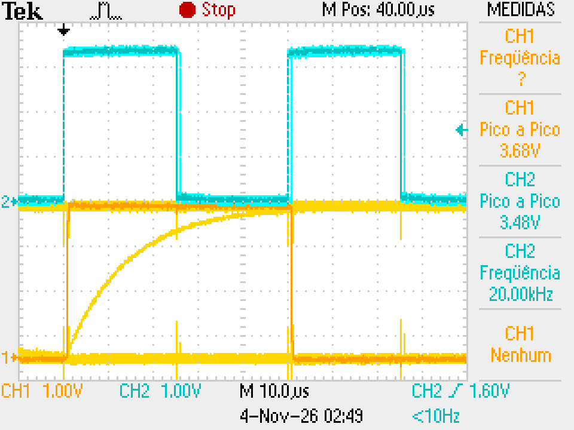

- Persistência infinita: ver a tela. A abertura em k* sai do log do RX (ensaio).
- Log do RX: `logs/Dupont_PAM2_20261103_162110.txt`
- RX: BER_amostra=0/100000
- RX: BER_filtro=0/100000
- RX: Modulação PAM-2 | canal: Dupont_direto | aquisição válida = 1 | sincronismo = 1
- RX: amostra única: Ne = 0 em 100000 bits -> BER = 0.00e+00 ; Ns = 0 em 100000 -> SER = 0.00e+00

Arquivos: `capturas/Dupont_PAM2_olho_osc_tela.png`, `Dupont_PAM2_olho_osc_CH1.csv`, `Dupont_PAM2_olho_osc_CH2.csv`

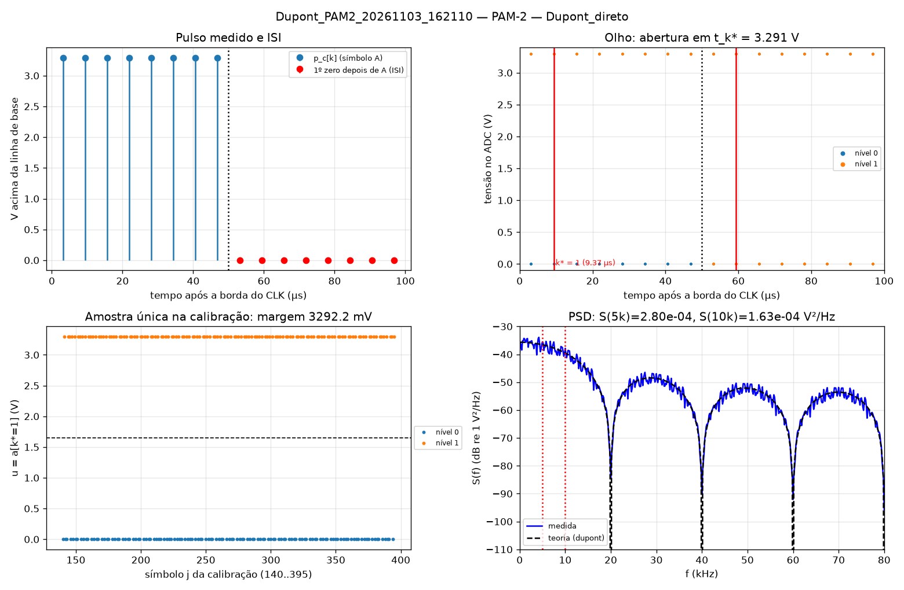

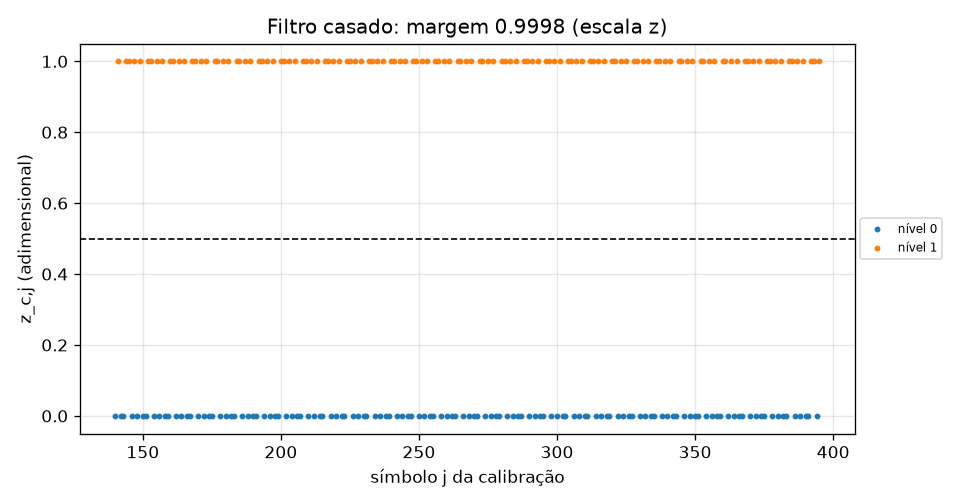

<details><summary>Saída completa do RX</summary>

```
Aguardando... quando aparecer #ARMADO, aperte RESET no TX.
#ARMADO PAM-2 canal=Dupont_RC_33n : reinicie o TX (ou aperte KEY no TX)
#ARMADO PAM-2 canal=Dupont_direto : reinicie o TX (ou aperte KEY no TX)
>> recebendo relatório...
modulacao=PAM-2
canal=Dupont_direto
Rs_sym_s=20000
fa_amostras_s=160000
bordas_CLK=100444
simbolos_esperados=100444
simbolos_processados=100444
amostras_processadas=803552
posicao_DMA_1a_borda=434
amostras_descartadas_antes_CLK=26046898
bordas_com_contagem_errada=0
overrun_processamento=0
erro_ADC_overrun=0
perda_CLK=0
aquisicao_valida=1
b_c=4.07
E_c=133885328.0
p_c[0]=4090.93
p_c[1]=4090.93
p_c[2]=4090.93
p_c[3]=4090.93
p_c[4]=4090.93
p_c[5]=4090.93
p_c[6]=4090.93
p_c[7]=4090.93
ISI_zero_apos_A[0]=0.38
ISI_zero_apos_A[1]=0.28
ISI_zero_apos_A[2]=0.23
ISI_zero_apos_A[3]=0.03
ISI_zero_apos_A[4]=0.13
ISI_zero_apos_A[5]=0.08
ISI_zero_apos_A[6]=0.18
ISI_zero_apos_A[7]=-0.02
separacao_k[0]=4087
separacao_k[1]=4089
separacao_k[2]=4088
separacao_k[3]=4088
separacao_k[4]=4088
separacao_k[5]=4087
separacao_k[6]=4089
separacao_k[7]=4085
k_estrela=1
t_k_estrela_us=9.37
centro_u[0]=3.45
centro_z[0]=-0.00013
centro_u[1]=4095.00
centro_z[1]=1.00000
limiar_u[0]=2049.23
limiar_z[0]=0.49993
margem_u_ADC=4089
margem_u_mV_nominal=3295.2
margem_u_par=0-1
margem_z=0.99980
margem_z_par=0-1
calibracao_ok=1
media8_nivel[0]=0.30 (simbolo j=140, z=0.00007)
media8_nivel[1]=4090.93 (simbolo j=141, z=1.00000)
inicio_quadro_erros_u=0
inicio_quadro_erros_z=0
sincronismo_ok=1
payload_bits=100000
payload_simbolos=100000
amostra_unica_Ne=0
amostra_unica_Ns=0
filtro_casado_Ne=0
filtro_casado_Ns=0
BER_amostra=0/100000
BER_filtro=0/100000
SER_amostra=0/100000
SER_filtro=0/100000
janela_exemplo_j=451
janela_exemplo_nivel_TX=1
janela a[0]=4095 x[0]=4090.93 p_c[0]=4090.93
janela a[1]=4095 x[1]=4090.93 p_c[1]=4090.93
janela a[2]=4095 x[2]=4090.93 p_c[2]=4090.93
janela a[3]=4095 x[3]=4090.93 p_c[3]=4090.93
janela a[4]=4095 x[4]=4090.93 p_c[4]=4090.93
janela a[5]=4095 x[5]=4090.93 p_c[5]=4090.93
janela a[6]=4095 x[6]=4090.93 p_c[6]=4090.93
janela a[7]=4095 x[7]=4090.93 p_c[7]=4090.93
janela_z=1.00000
#END_REPORT
#BEGIN_TRAIN j,nivel,a0,a1,a2,a3,a4,a5,a6,a7,z
#END_TRAIN
#BEGIN_PSD simbolo,nivel,a0,a1,a2,a3,a4,a5,a6,a7
>> log gravado em entrega/logs/Dupont_PAM2_20261103_162110.txt
================ Dupont_PAM2_20261103_162110 ================
Modulação PAM-2 | canal: Dupont_direto | aquisição válida = 1 | sincronismo = 1
Bordas de CLK = 100444 de 100444 ; amostras = 803552 (= 8 x 100444) ; descartadas antes do CLK = 26046898

-- Filtro casado (Seção 4.5.1) --
b_c = 4.08 códigos (3.3 mV)
p_c[k] = [4090.9 4090.9 4090.9 4090.9 4090.9 4090.9 4090.9 4090.9] códigos
E_c = 1.339e+08
ISI no 1º zero depois de A = [0.4 0.3 0.2 0.0 0.1 0.1 0.2 -0.0] códigos
conferência com o firmware: max|Δp_c| = 0.005, k* firmware = 1, k* Python = 1

-- Escolha de k* (Seção 4.3) --
  k=0  t= 3.12 us  menor separação =  4087 códigos ( 3293.6 mV)
  k=1  t= 9.37 us  menor separação =  4089 códigos ( 3295.2 mV)  <== k*
  k=2  t=15.62 us  menor separação =  4088 códigos ( 3294.4 mV)
  k=3  t=21.87 us  menor separação =  4088 códigos ( 3294.4 mV)
  k=4  t=28.12 us  menor separação =  4088 códigos ( 3294.4 mV)
  k=5  t=34.37 us  menor separação =  4087 códigos ( 3293.6 mV)
  k=6  t=40.62 us  menor separação =  4089 códigos ( 3295.2 mV)
  k=7  t=46.87 us  menor separação =  4085 códigos ( 3291.9 mV)

-- Centros, limiares, margens (Seção 4.5.2) --
centros u (códigos) = [3.5, 4095.0] ; em V = [0.003, 3.3]
limiares u (códigos) = [2049.2] ; em V = [1.651]
centros z = [-0.0001, 1.0] ; limiares z = [0.4999]
margem amostra única = 4089 códigos = 3295.2 mV (par de níveis 0-1)
margem filtro casado = 0.9998 (escala z; par 0-1)
margem relativa (margem / distância média entre centros): u = 1.00 , z = 1.00

-- Olho (1024 símbolos do payload) --
abertura vertical em t_k* = 9.37 us: 3.294 V (menor entre níveis vizinhos)
abertura por k (V) = [3.294, 3.294, 3.293, 3.29, 3.292, 3.294, 3.291, 3.289]

-- PSD (fa = 160 kHz, Vref = 3.3000 V, média retirada, Hann, N = 1024, 50%, 15 blocos) --
resolução = 156.25 Hz ; duração do registro = 51.2 ms ; potência AC = 2.7173 V^2 (var = 2.7163)
S(5 kHz)  = 2.809e-04 V^2/Hz (média de 5 bins 2.105e-04; teoria 2.214e-04)
S(10 kHz) = 1.638e-04 V^2/Hz (média de 5 bins 1.064e-04; teoria 1.118e-04)

-- Contagem de erros (firmware, mesmas amostras do payload) --
amostra única: Ne = 0 em 100000 bits -> BER = 0.00e+00 ; Ns = 0 em 100000 -> SER = 0.00e+00
filtro casado: Ne = 0 em 100000 bits -> BER = 0.00e+00 ; Ns = 0 em 100000 -> SER = 0.00e+00
  -> escrever "0 erros em 100.000 bits" (BER observada = 0, NÃO prova BER física nula;
     com 0 erros, limite superior de 95% ~ 3/100000 = 3e-5).

-- Janela real (símbolo j = 451, nível TX = 1) --
  k   a[k]    x[k]=a-b_c    p_c[k]       p_c*x
  0   4095     4090.93     4090.93    16735667.4
  1   4095     4090.93     4090.93    16735667.4
  2   4095     4090.93     4090.93    16735667.4
  3   4095     4090.93     4090.93    16735667.4
  4   4095     4090.93     4090.93    16735667.4
  5   4095     4090.93     4090.93    16735667.4
  6   4095     4090.93     4090.93    16735667.4
  7   4095     4090.93     4090.93    16735667.4
  soma = 133885338.8 ; E_c = 133885338.8 ; z = soma/E_c = 1.00000 (firmware: 1.0)

  [OK] Log completo até #END_PSD
  [OK] bordas_CLK = símbolos esperados (100444 = 100444)
  [OK] amostras = 8 × símbolos (803552 = 8 × 100444)
  [OK] bordas_com_contagem_errada = 0
  [OK] overrun_processamento = 0 e erro_ADC_overrun = 0
  [OK] perda_CLK = 0
  [OK] aquisicao_valida = 1
  [OK] calibracao_ok = 1 (centros em ordem crescente)
  [OK] sincronismo_ok = 1 (48 bits de início corretos)
figura: entrega/figuras/Dupont_PAM2_20261103_162110.png
figura: entrega/figuras/Dupont_PAM2_20261103_162110_z.png
```
</details>

## Dupont PAM4 olho osc — canal Dupont, TX em PAM-4  ·  03/11/2026 16:23

- **Pontas:** CH1 = TP3 · CH2 = CLK
- **O que é:** Diagrama de olho em TP3, disparo na subida do CLK, persistência infinita. k* = 7 ↔ 46,87 µs depois da borda.
- **Aquisições:** 244

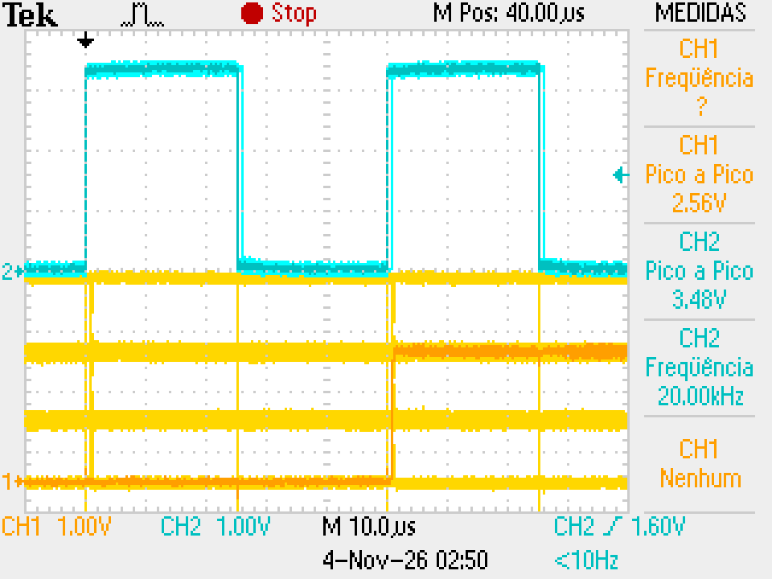

- Persistência infinita: ver a tela. A abertura em k* sai do log do RX (ensaio).
- Log do RX: `logs/Dupont_PAM4_20261103_162254.txt`
- RX: BER_amostra=0/100000
- RX: BER_filtro=0/100000
- RX: Modulação PAM-4 | canal: Dupont_direto | aquisição válida = 1 | sincronismo = 1
- RX: amostra única: Ne = 0 em 100000 bits -> BER = 0.00e+00 ; Ns = 0 em 50000 -> SER = 0.00e+00

Arquivos: `capturas/Dupont_PAM4_olho_osc_tela.png`, `Dupont_PAM4_olho_osc_CH1.csv`, `Dupont_PAM4_olho_osc_CH2.csv`

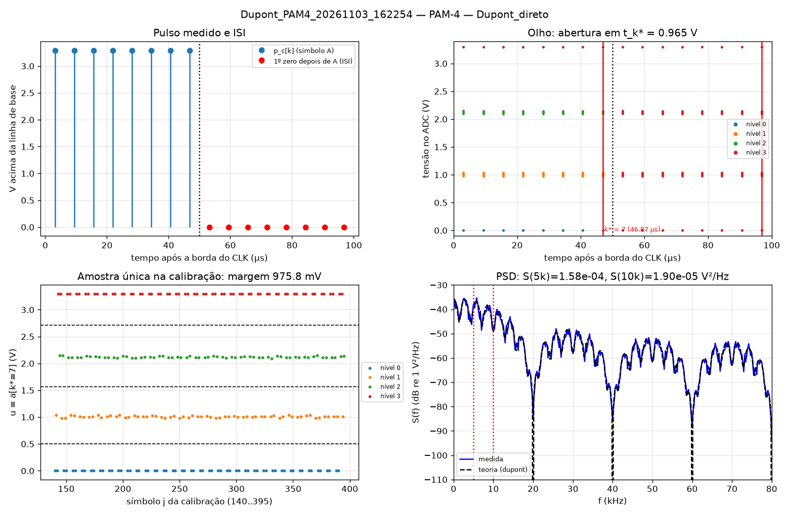

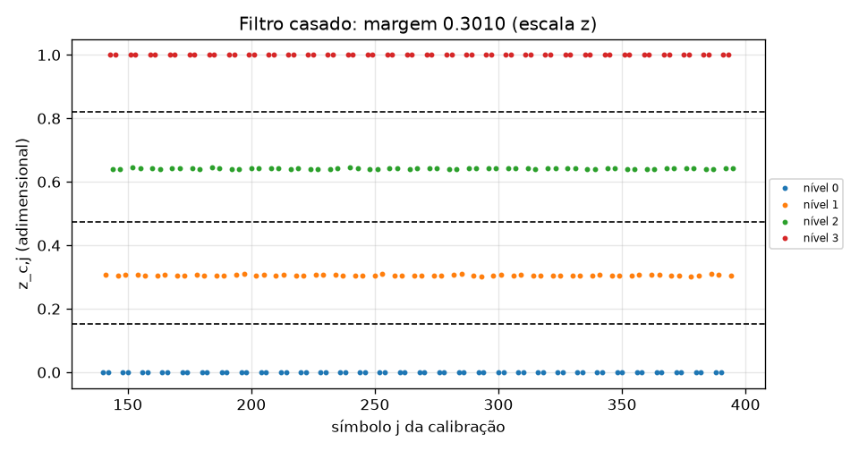

<details><summary>Saída completa do RX</summary>

```
Aguardando... quando aparecer #ARMADO, aperte RESET no TX.
#ARMADO PAM-4 canal=Dupont_direto : reinicie o TX (ou aperte KEY no TX)
#ARMADO PAM-4 canal=Dupont_direto : reinicie o TX (ou aperte KEY no TX)
>> recebendo relatório...
modulacao=PAM-4
canal=Dupont_direto
Rs_sym_s=20000
fa_amostras_s=160000
bordas_CLK=50420
simbolos_esperados=50420
simbolos_processados=50420
amostras_processadas=403360
posicao_DMA_1a_borda=295
amostras_descartadas_antes_CLK=11685671
bordas_com_contagem_errada=0
overrun_processamento=0
erro_ADC_overrun=0
perda_CLK=0
aquisicao_valida=1
b_c=3.86
E_c=133897200.0
p_c[0]=4091.14
p_c[1]=4091.14
p_c[2]=4090.84
p_c[3]=4091.14
p_c[4]=4091.14
p_c[5]=4091.14
p_c[6]=4091.14
p_c[7]=4091.14
ISI_zero_apos_A[0]=0.84
ISI_zero_apos_A[1]=-0.21
ISI_zero_apos_A[2]=-0.26
ISI_zero_apos_A[3]=-0.01
ISI_zero_apos_A[4]=0.34
ISI_zero_apos_A[5]=0.19
ISI_zero_apos_A[6]=-0.06
ISI_zero_apos_A[7]=-0.16
separacao_k[0]=1209
separacao_k[1]=1210
separacao_k[2]=1206
separacao_k[3]=1207
separacao_k[4]=1208
separacao_k[5]=1208
separacao_k[6]=1207
separacao_k[7]=1212
k_estrela=7
t_k_estrela_us=46.87
centro_u[0]=3.88
centro_z[0]=0.00003
centro_u[1]=1253.80
centro_z[1]=0.30576
centro_u[2]=2633.14
centro_z[2]=0.64203
centro_u[3]=4095.00
centro_z[3]=1.00001
limiar_u[0]=628.84
limiar_z[0]=0.15289
limiar_u[1]=1943.47
limiar_z[1]=0.47390
limiar_u[2]=3364.07
limiar_z[2]=0.82102
margem_u_ADC=1212
margem_u_mV_nominal=976.7
margem_u_par=0-1
margem_z=0.30105
margem_z_par=0-1
calibracao_ok=1
media8_nivel[0]=0.02 (simbolo j=140, z=0.00000)
media8_nivel[1]=1254.27 (simbolo j=141, z=0.30658)
media8_nivel[2]=2619.77 (simbolo j=144, z=0.64036)
media8_nivel[3]=4091.14 (simbolo j=143, z=1.00001)
inicio_quadro_erros_u=0
inicio_quadro_erros_z=0
sincronismo_ok=1
payload_bits=100000
payload_simbolos=50000
amostra_unica_Ne=0
amostra_unica_Ns=0
filtro_casado_Ne=0
filtro_casado_Ns=0
BER_amostra=0/100000
BER_filtro=0/100000
SER_amostra=0/50000
SER_filtro=0/50000
janela_exemplo_j=427
janela_exemplo_nivel_TX=3
janela a[0]=4095 x[0]=4091.14 p_c[0]=4091.14
janela a[1]=4095 x[1]=4091.14 p_c[1]=4091.14
janela a[2]=4095 x[2]=4091.14 p_c[2]=4090.84
janela a[3]=4095 x[3]=4091.14 p_c[3]=4091.14
janela a[4]=4095 x[4]=4091.14 p_c[4]=4091.14
janela a[5]=4095 x[5]=4091.14 p_c[5]=4091.14
janela a[6]=4095 x[6]=4091.14 p_c[6]=4091.14
janela a[7]=4095 x[7]=4091.14 p_c[7]=4091.14
janela_z=1.00001
#END_REPORT
#BEGIN_TRAIN j,nivel,a0,a1,a2,a3,a4,a5,a6,a7,z
#END_TRAIN
#BEGIN_PSD simbolo,nivel,a0,a1,a2,a3,a4,a5,a6,a7
>> log gravado em entrega/logs/Dupont_PAM4_20261103_162254.txt
================ Dupont_PAM4_20261103_162254 ================
Modulação PAM-4 | canal: Dupont_direto | aquisição válida = 1 | sincronismo = 1
Bordas de CLK = 50420 de 50420 ; amostras = 403360 (= 8 x 50420) ; descartadas antes do CLK = 11685671

-- Filtro casado (Seção 4.5.1) --
b_c = 3.86 códigos (3.1 mV)
p_c[k] = [4091.1 4091.1 4090.8 4091.1 4091.1 4091.1 4091.1 4091.1] códigos
E_c = 1.339e+08
ISI no 1º zero depois de A = [0.8 -0.2 -0.3 -0.0 0.3 0.2 -0.1 -0.2] códigos
conferência com o firmware: max|Δp_c| = 0.00375, k* firmware = 7, k* Python = 7

-- Escolha de k* (Seção 4.3) --
  k=0  t= 3.12 us  menor separação =  1209 códigos (  974.3 mV)
  k=1  t= 9.37 us  menor separação =  1210 códigos (  975.1 mV)
  k=2  t=15.62 us  menor separação =  1206 códigos (  971.9 mV)
  k=3  t=21.87 us  menor separação =  1207 códigos (  972.7 mV)
  k=4  t=28.12 us  menor separação =  1208 códigos (  973.5 mV)
  k=5  t=34.37 us  menor separação =  1208 códigos (  973.5 mV)
  k=6  t=40.62 us  menor separação =  1207 códigos (  972.7 mV)
  k=7  t=46.87 us  menor separação =  1212 códigos (  976.7 mV)  <== k*

-- Centros, limiares, margens (Seção 4.5.2) --
centros u (códigos) = [3.9, 1253.8, 2633.1, 4095.0] ; em V = [0.003, 1.01, 2.122, 3.3]
limiares u (códigos) = [628.8, 1943.5, 3364.1] ; em V = [0.507, 1.566, 2.711]
centros z = [0.0, 0.3058, 0.642, 1.0] ; limiares z = [0.1529, 0.4739, 0.821]
margem amostra única = 1212 códigos = 976.7 mV (par de níveis 0-1, Gray 00/01)
margem filtro casado = 0.3010 (escala z; par 0-1)
margem relativa (margem / distância média entre centros): u = 0.89 , z = 0.90

-- Olho (1024 símbolos do payload) --
abertura vertical em t_k* = 46.87 us: 0.966 V (menor entre níveis vizinhos)
abertura por k (V) = [0.971, 0.966, 0.969, 0.967, 0.968, 0.97, 0.965, 0.966]

-- PSD (fa = 160 kHz, Vref = 3.3000 V, média retirada, Hann, N = 1024, 50%, 15 blocos) --
resolução = 156.25 Hz ; duração do registro = 51.2 ms ; potência AC = 1.4472 V^2 (var = 1.4674)
S(5 kHz)  = 1.584e-04 V^2/Hz (média de 5 bins 1.189e-04; teoria 1.230e-04)
S(10 kHz) = 1.902e-05 V^2/Hz (média de 5 bins 1.642e-05; teoria 1.242e-05)

-- Contagem de erros (firmware, mesmas amostras do payload) --
amostra única: Ne = 0 em 100000 bits -> BER = 0.00e+00 ; Ns = 0 em 50000 -> SER = 0.00e+00
filtro casado: Ne = 0 em 100000 bits -> BER = 0.00e+00 ; Ns = 0 em 50000 -> SER = 0.00e+00
  -> escrever "0 erros em 100.000 bits" (BER observada = 0, NÃO prova BER física nula;
     com 0 erros, limite superior de 95% ~ 3/100000 = 3e-5).

-- Janela real (símbolo j = 427, nível TX = 3) --
  k   a[k]    x[k]=a-b_c    p_c[k]       p_c*x
  0   4095     4091.14     4091.14    16737457.2
  1   4095     4091.14     4091.14    16737457.2
  2   4095     4091.14     4090.84    16736229.8
  3   4095     4091.14     4091.14    16737457.2
  4   4095     4091.14     4091.14    16737457.2
  5   4095     4091.14     4091.14    16737457.2
  6   4095     4091.14     4091.14    16737457.2
  7   4095     4091.14     4091.14    16737457.2
  soma = 133898430.1 ; E_c = 133897202.9 ; z = soma/E_c = 1.00001 (firmware: 1.00001)

  [OK] Log completo até #END_PSD
  [OK] bordas_CLK = símbolos esperados (50420 = 50420)
  [OK] amostras = 8 × símbolos (403360 = 8 × 50420)
  [OK] bordas_com_contagem_errada = 0
  [OK] overrun_processamento = 0 e erro_ADC_overrun = 0
  [OK] perda_CLK = 0
  [OK] aquisicao_valida = 1
  [OK] calibracao_ok = 1 (centros em ordem crescente)
  [OK] sincronismo_ok = 1 (48 bits de início corretos)
figura: entrega/figuras/Dupont_PAM4_20261103_162254.png
figura: entrega/figuras/Dupont_PAM4_20261103_162254_z.png
```
</details>

## TX TP2 PAM4 niveis gray — canal Dupont, TX em PAM-4  ·  03/11/2026 16:24

- **Pontas:** CH1 = TP2 · CH2 = CLK
- **O que é:** Símbolos 140–149 = início do treinamento de níveis. PAM-4: 0,1,0,3,2,3,1,2,0,1 (ordem Gray); PAM-2: 0,1,0,0,1,1,0,1,0,1. Níveis previstos 0/1,1/2,2/3,3 V.
- **Aquisições:** 1

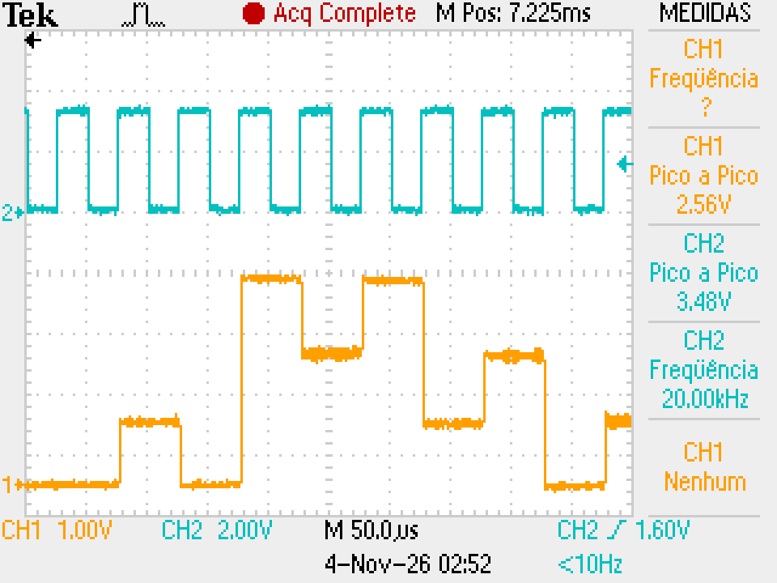

- Símbolos 140–149 (nível esperado → média medida em TP2):
-   [0] -0.002 V  [1] 1.026 V  [0] -0.007 V  [3] 3.389 V  [2] 2.160 V  [3] 3.365 V  [1] 0.997 V  [2] 2.124 V  [0] -0.024 V  [1] 1.028 V
- Níveis médios: 0: -0.011 V · 1: 1.017 V · 2: 2.142 V · 3: 3.377 V
- Degraus entre níveis: 1.028 V · 1.125 V · 1.235 V
- Ordem conferida: [0, 1, 0, 3, 2, 3, 1, 2, 0, 1] → OK
- Log do RX: `logs/Dupont_PAM4_20261103_162448.txt`
- RX: BER_amostra=0/100000
- RX: BER_filtro=0/100000
- RX: Modulação PAM-4 | canal: Dupont_direto | aquisição válida = 1 | sincronismo = 1
- RX: amostra única: Ne = 0 em 100000 bits -> BER = 0.00e+00 ; Ns = 0 em 50000 -> SER = 0.00e+00

Arquivos: `capturas/TX_TP2_PAM4_niveis_gray_tela.png`, `TX_TP2_PAM4_niveis_gray_CH1.csv`, `TX_TP2_PAM4_niveis_gray_CH2.csv`


<details><summary>Saída completa do RX</summary>

```
Aguardando... quando aparecer #ARMADO, aperte RESET no TX.
#ARMADO PAM-4 canal=Dupont_direto : reinicie o TX (ou aperte KEY no TX)
#ARMADO PAM-4 canal=Dupont_direto : reinicie o TX (ou aperte KEY no TX)
>> recebendo relatório...
modulacao=PAM-4
canal=Dupont_direto
Rs_sym_s=20000
fa_amostras_s=160000
bordas_CLK=50420
simbolos_esperados=50420
simbolos_processados=50420
amostras_processadas=403360
posicao_DMA_1a_borda=418
amostras_descartadas_antes_CLK=13830562
bordas_com_contagem_errada=0
overrun_processamento=0
erro_ADC_overrun=0
perda_CLK=0
aquisicao_valida=1
b_c=3.74
E_c=133907024.0
p_c[0]=4091.26
p_c[1]=4091.26
p_c[2]=4091.26
p_c[3]=4091.26
p_c[4]=4091.26
p_c[5]=4091.26
p_c[6]=4091.26
p_c[7]=4091.26
ISI_zero_apos_A[0]=0.61
ISI_zero_apos_A[1]=0.51
ISI_zero_apos_A[2]=0.71
ISI_zero_apos_A[3]=-0.04
ISI_zero_apos_A[4]=0.01
ISI_zero_apos_A[5]=0.26
ISI_zero_apos_A[6]=0.11
ISI_zero_apos_A[7]=0.46
separacao_k[0]=1220
separacao_k[1]=1219
separacao_k[2]=1215
separacao_k[3]=1214
separacao_k[4]=1220
separacao_k[5]=1219
separacao_k[6]=1217
separacao_k[7]=1217
k_estrela=0
t_k_estrela_us=3.12
centro_u[0]=4.00
centro_z[0]=0.00003
centro_u[1]=1259.63
centro_z[1]=0.30608
centro_u[2]=2633.27
centro_z[2]=0.64234
centro_u[3]=4095.00
centro_z[3]=1.00000
limiar_u[0]=631.81
limiar_z[0]=0.15306
limiar_u[1]=1946.45
limiar_z[1]=0.47421
limiar_u[2]=3364.13
limiar_z[2]=0.82117
margem_u_ADC=1220
margem_u_mV_nominal=983.2
margem_u_par=0-1
margem_z=0.30257
margem_z_par=0-1
calibracao_ok=1
media8_nivel[0]=0.13 (simbolo j=140, z=0.00003)
media8_nivel[1]=1250.26 (simbolo j=141, z=0.30559)
media8_nivel[2]=2624.88 (simbolo j=144, z=0.64158)
media8_nivel[3]=4091.26 (simbolo j=143, z=1.00000)
inicio_quadro_erros_u=0
inicio_quadro_erros_z=0
sincronismo_ok=1
payload_bits=100000
payload_simbolos=50000
amostra_unica_Ne=0
amostra_unica_Ns=0
filtro_casado_Ne=0
filtro_casado_Ns=0
BER_amostra=0/100000
BER_filtro=0/100000
SER_amostra=0/50000
SER_filtro=0/50000
janela_exemplo_j=427
janela_exemplo_nivel_TX=3
janela a[0]=4095 x[0]=4091.26 p_c[0]=4091.26
janela a[1]=4095 x[1]=4091.26 p_c[1]=4091.26
janela a[2]=4095 x[2]=4091.26 p_c[2]=4091.26
janela a[3]=4095 x[3]=4091.26 p_c[3]=4091.26
janela a[4]=4095 x[4]=4091.26 p_c[4]=4091.26
janela a[5]=4095 x[5]=4091.26 p_c[5]=4091.26
janela a[6]=4095 x[6]=4091.26 p_c[6]=4091.26
janela a[7]=4095 x[7]=4091.26 p_c[7]=4091.26
janela_z=1.00000
#END_REPORT
#BEGIN_TRAIN j,nivel,a0,a1,a2,a3,a4,a5,a6,a7,z
#END_TRAIN
#BEGIN_PSD simbolo,nivel,a0,a1,a2,a3,a4,a5,a6,a7
>> log gravado em entrega/logs/Dupont_PAM4_20261103_162448.txt
================ Dupont_PAM4_20261103_162448 ================
Modulação PAM-4 | canal: Dupont_direto | aquisição válida = 1 | sincronismo = 1
Bordas de CLK = 50420 de 50420 ; amostras = 403360 (= 8 x 50420) ; descartadas antes do CLK = 13830562

-- Filtro casado (Seção 4.5.1) --
b_c = 3.74 códigos (3.0 mV)
p_c[k] = [4091.3 4091.3 4091.3 4091.3 4091.3 4091.3 4091.3 4091.3] códigos
E_c = 1.339e+08
ISI no 1º zero depois de A = [0.6 0.5 0.7 -0.0 0.0 0.3 0.1 0.5] códigos
conferência com o firmware: max|Δp_c| = 0.00375, k* firmware = 0, k* Python = 0

-- Escolha de k* (Seção 4.3) --
  k=0  t= 3.12 us  menor separação =  1220 códigos (  983.2 mV)  <== k*
  k=1  t= 9.37 us  menor separação =  1219 códigos (  982.3 mV)
  k=2  t=15.62 us  menor separação =  1215 códigos (  979.1 mV)
  k=3  t=21.87 us  menor separação =  1214 códigos (  978.3 mV)
  k=4  t=28.12 us  menor separação =  1220 códigos (  983.2 mV)
  k=5  t=34.37 us  menor separação =  1219 códigos (  982.3 mV)
  k=6  t=40.62 us  menor separação =  1217 códigos (  980.7 mV)
  k=7  t=46.87 us  menor separação =  1217 códigos (  980.7 mV)

-- Centros, limiares, margens (Seção 4.5.2) --
centros u (códigos) = [4.0, 1259.6, 2633.3, 4095.0] ; em V = [0.003, 1.015, 2.122, 3.3]
limiares u (códigos) = [631.8, 1946.4, 3364.1] ; em V = [0.509, 1.569, 2.711]
centros z = [0.0, 0.3061, 0.6423, 1.0] ; limiares z = [0.1531, 0.4742, 0.8212]
margem amostra única = 1220 códigos = 983.2 mV (par de níveis 0-1, Gray 00/01)
margem filtro casado = 0.3026 (escala z; par 0-1)
margem relativa (margem / distância média entre centros): u = 0.89 , z = 0.91

-- Olho (1024 símbolos do payload) --
abertura vertical em t_k* = 3.12 us: 0.978 V (menor entre níveis vizinhos)
abertura por k (V) = [0.978, 0.976, 0.976, 0.978, 0.979, 0.978, 0.978, 0.977]

-- PSD (fa = 160 kHz, Vref = 3.3000 V, média retirada, Hann, N = 1024, 50%, 15 blocos) --
resolução = 156.25 Hz ; duração do registro = 51.2 ms ; potência AC = 1.4471 V^2 (var = 1.4673)
S(5 kHz)  = 1.585e-04 V^2/Hz (média de 5 bins 1.189e-04; teoria 1.230e-04)
S(10 kHz) = 1.898e-05 V^2/Hz (média de 5 bins 1.636e-05; teoria 1.242e-05)

-- Contagem de erros (firmware, mesmas amostras do payload) --
amostra única: Ne = 0 em 100000 bits -> BER = 0.00e+00 ; Ns = 0 em 50000 -> SER = 0.00e+00
filtro casado: Ne = 0 em 100000 bits -> BER = 0.00e+00 ; Ns = 0 em 50000 -> SER = 0.00e+00
  -> escrever "0 erros em 100.000 bits" (BER observada = 0, NÃO prova BER física nula;
     com 0 erros, limite superior de 95% ~ 3/100000 = 3e-5).

-- Janela real (símbolo j = 427, nível TX = 3) --
  k   a[k]    x[k]=a-b_c    p_c[k]       p_c*x
  0   4095     4091.26     4091.26    16738377.7
  1   4095     4091.26     4091.26    16738377.7
  2   4095     4091.26     4091.26    16738377.7
  3   4095     4091.26     4091.26    16738377.7
  4   4095     4091.26     4091.26    16738377.7
  5   4095     4091.26     4091.26    16738377.7
  6   4095     4091.26     4091.26    16738377.7
  7   4095     4091.26     4091.26    16738377.7
  soma = 133907021.6 ; E_c = 133907021.6 ; z = soma/E_c = 1.00000 (firmware: 1.0)

  [OK] Log completo até #END_PSD
  [OK] bordas_CLK = símbolos esperados (50420 = 50420)
  [OK] amostras = 8 × símbolos (403360 = 8 × 50420)
  [OK] bordas_com_contagem_errada = 0
  [OK] overrun_processamento = 0 e erro_ADC_overrun = 0
  [OK] perda_CLK = 0
  [OK] aquisicao_valida = 1
  [OK] calibracao_ok = 1 (centros em ordem crescente)
  [OK] sincronismo_ok = 1 (48 bits de início corretos)
figura: entrega/figuras/Dupont_PAM4_20261103_162448.png
figura: entrega/figuras/Dupont_PAM4_20261103_162448_z.png
```
</details>

## TX TP2 PAM4 ripple PWM — canal Dupont, TX em PAM-4  ·  03/11/2026 16:25

- **Pontas:** CH1 = TP2 · CH2 = CLK
- **O que é:** Ripple do PWM em TP2 no meio do símbolo 141 (nível 1). Previsto ≈ 150 mVpp.
- **Aquisições:** 1

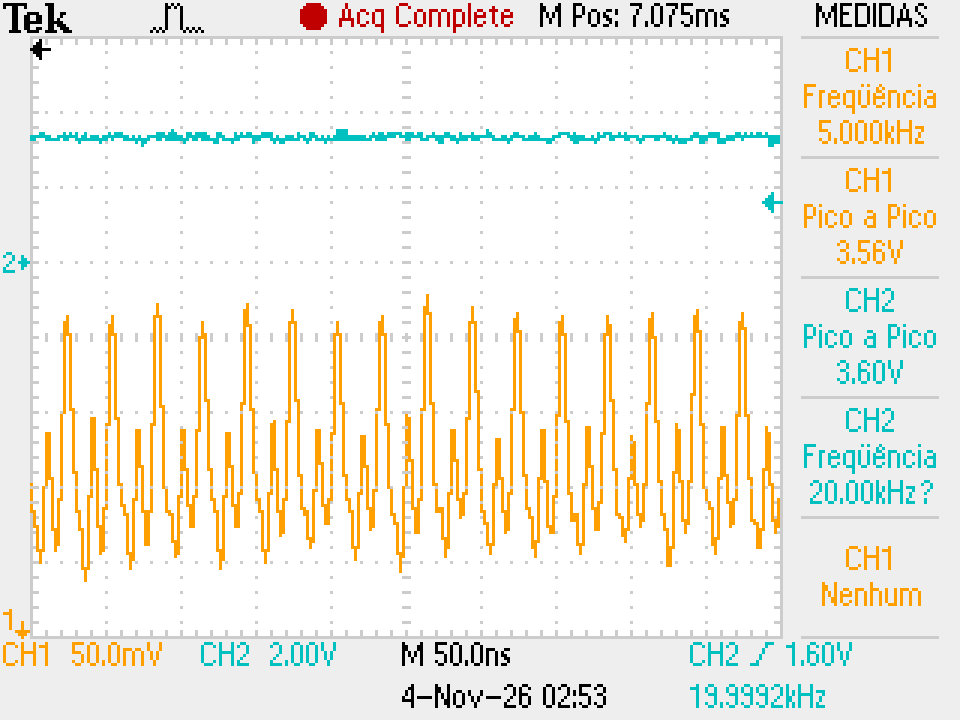

- Ripple em TP2: Vpp = 190 mV (min 0.938 V, max 1.128 V, média 1.013 V)
- Log do RX: `logs/invalidos/Dupont_PAM4_20261103_162538.txt` (**inválido**)
- RX: BER=NAO_ATRIBUIDA (quadro invalido ou sem sincronismo: repita o ensaio)

- Ripple ≈ 190 mVpp a ~33 MHz (período ≈ 30 ns = 3 ciclos de 10 ns do TIM1) no nível 1 (média 1,013 V); previsto ≈ 150 mVpp. A banda de 60 MHz do TDS2002B ainda passa 33 MHz, mas atenua um pouco.
- Log do RX deste RESET: **inválido** (`perda_CLK=1` após só 1 218 bordas ≈ 61 ms) — CLK sumiu no início do quadro (RESET duplo/botão com repique ou mau contato no fio CLK PB4→PA0). Movido para `logs/invalidos/`.

Arquivos: `capturas/TX_TP2_PAM4_ripple_PWM_tela.png`, `TX_TP2_PAM4_ripple_PWM_CH1.csv`, `TX_TP2_PAM4_ripple_PWM_CH2.csv`

<details><summary>Saída completa do RX</summary>

```
Aguardando... quando aparecer #ARMADO, aperte RESET no TX.
#ARMADO PAM-4 canal=Dupont_direto : reinicie o TX (ou aperte KEY no TX)
#ARMADO PAM-4 canal=Dupont_direto : reinicie o TX (ou aperte KEY no TX)
>> recebendo relatório...
modulacao=PAM-4
canal=Dupont_direto
Rs_sym_s=20000
fa_amostras_s=160000
bordas_CLK=1218
simbolos_esperados=50420
simbolos_processados=1209
amostras_processadas=9672
posicao_DMA_1a_borda=311
amostras_descartadas_antes_CLK=4893495
bordas_com_contagem_errada=0
overrun_processamento=0
erro_ADC_overrun=0
perda_CLK=1
aquisicao_valida=0
b_c=3.98
E_c=133891472.0
p_c[0]=4091.02
p_c[1]=4091.02
p_c[2]=4091.02
p_c[3]=4091.02
p_c[4]=4091.02
p_c[5]=4091.02
p_c[6]=4091.02
p_c[7]=4091.02
ISI_zero_apos_A[0]=0.97
ISI_zero_apos_A[1]=0.17
ISI_zero_apos_A[2]=-0.18
ISI_zero_apos_A[3]=-0.43
ISI_zero_apos_A[4]=-0.43
ISI_zero_apos_A[5]=-0.08
ISI_zero_apos_A[6]=-0.18
ISI_zero_apos_A[7]=0.12
separacao_k[0]=1222
separacao_k[1]=1213
separacao_k[2]=1218
separacao_k[3]=1218
separacao_k[4]=1219
separacao_k[5]=1222
separacao_k[6]=1219
separacao_k[7]=1215
k_estrela=0
t_k_estrela_us=3.12
centro_u[0]=4.14
centro_z[0]=0.00000
centro_u[1]=1259.05
centro_z[1]=0.30588
centro_u[2]=2632.09
centro_z[2]=0.64225
centro_u[3]=4095.00
centro_z[3]=1.00000
limiar_u[0]=631.59
limiar_z[0]=0.15294
limiar_u[1]=1945.57
limiar_z[1]=0.47407
limiar_u[2]=3363.55
limiar_z[2]=0.82112
margem_u_ADC=1222
margem_u_mV_nominal=984.8
margem_u_par=0-1
margem_z=0.30298
margem_z_par=0-1
calibracao_ok=1
media8_nivel[0]=-0.23 (simbolo j=140, z=-0.00006)
media8_nivel[1]=1256.77 (simbolo j=141, z=0.30720)
media8_nivel[2]=2631.27 (simbolo j=144, z=0.64318)
media8_nivel[3]=4091.02 (simbolo j=143, z=1.00000)
inicio_quadro_erros_u=0
inicio_quadro_erros_z=0
sincronismo_ok=1
payload_bits=1578
payload_simbolos=789
BER=NAO_ATRIBUIDA (quadro invalido ou sem sincronismo: repita o ensaio)
janela_exemplo_j=427
janela_exemplo_nivel_TX=3
janela a[0]=4095 x[0]=4091.02 p_c[0]=4091.02
janela a[1]=4095 x[1]=4091.02 p_c[1]=4091.02
janela a[2]=4095 x[2]=4091.02 p_c[2]=4091.02
janela a[3]=4095 x[3]=4091.02 p_c[3]=4091.02
janela a[4]=4095 x[4]=4091.02 p_c[4]=4091.02
janela a[5]=4095 x[5]=4091.02 p_c[5]=4091.02
janela a[6]=4095 x[6]=4091.02 p_c[6]=4091.02
janela a[7]=4095 x[7]=4091.02 p_c[7]=4091.02
janela_z=1.00000
#END_REPORT
#BEGIN_TRAIN j,nivel,a0,a1,a2,a3,a4,a5,a6,a7,z
#END_TRAIN
#BEGIN_PSD simbolo,nivel,a0,a1,a2,a3,a4,a5,a6,a7
>> log gravado em entrega/logs/Dupont_PAM4_20261103_162538.txt
Traceback (most recent call last):
  File "python/pam_app.py", line 820, in <module>
    cli(sys.argv[1:])
  File "python/pam_app.py", line 368, in cli
    res = core.analisar(caminho, args.vref)
          ^^^^^^^^^^^^^^^^^^^^^^^^^^^^^^^^^
  File "python/pam_core.py", line 411, in analisar
    raise ValueError("Bloco #BEGIN_PSD vazio. Log incompleto?")
ValueError: Bloco #BEGIN_PSD vazio. Log incompleto?
```
</details>

## TX alinhamento — canal Dupont, TX em PAM-4  ·  03/11/2026 16:28

- **Pontas:** CH1 = TP2 · CH2 = CLK
- **O que é:** Atraso entre a subida do CLK e o início da transição de TP2 (previsto 0,2–0,4 µs = latência da ISR do TIM3).
- **Aquisições:** 247

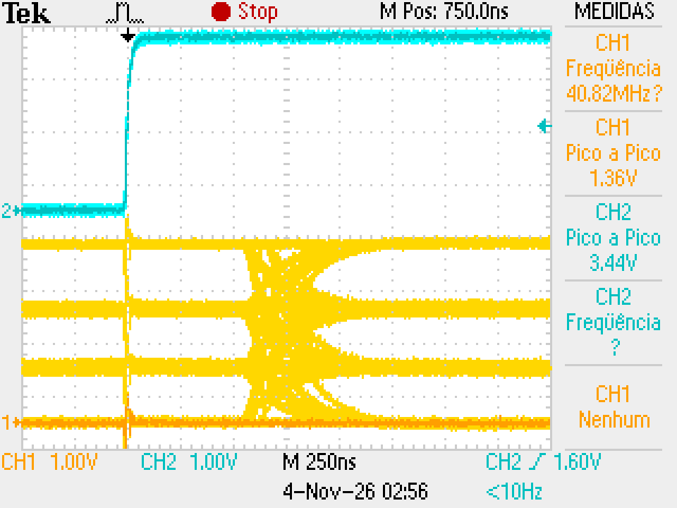

- **Atraso medido na tela com persistência (247 traços): as transições de TP2 começam ≈ 0,55 µs após a subida do CLK** e terminam até ≈ 1,0 µs (a própria transição com τ_TX ≈ 0,13 µs + níveis diferentes). Previsto 0,2–0,4 µs: a latência da ISR do TIM3 (entrada na interrupção + cálculo do próximo símbolo + escrita do CCR) ficou um pouco maior. Irrelevante para o RX: 0,55 µs ≪ 3,12 µs (1ª amostra, k = 0).
- O pico estreito em TP2 exatamente na borda do CLK (t ≈ 0) é diafonia do fio de CLK, não transição de símbolo (a análise automática "0,000 µs" pegou esse pico — descartada).
- Log do RX: `logs/Dupont_PAM4_20261103_162804.txt`
- RX: BER_amostra=0/100000
- RX: BER_filtro=0/100000
- RX: Modulação PAM-4 | canal: Dupont_direto | aquisição válida = 1 | sincronismo = 1
- RX: amostra única: Ne = 0 em 100000 bits -> BER = 0.00e+00 ; Ns = 0 em 50000 -> SER = 0.00e+00

Arquivos: `capturas/TX_alinhamento_tela.png`, `TX_alinhamento_CH1.csv`, `TX_alinhamento_CH2.csv`


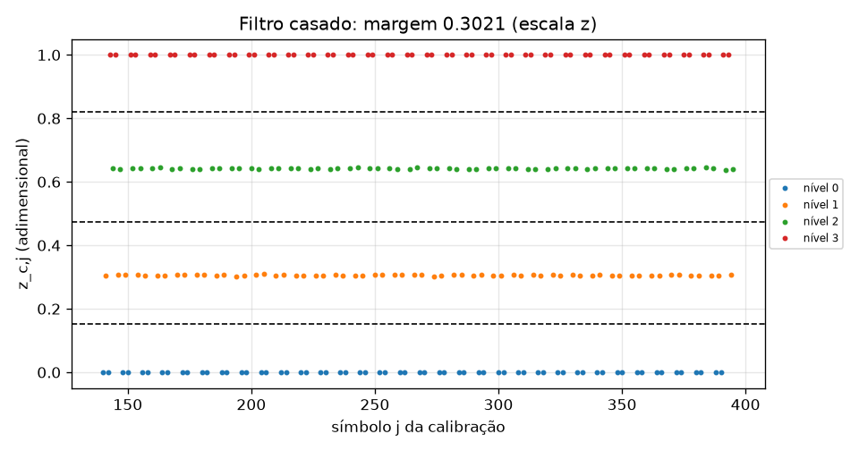

<details><summary>Saída completa do RX</summary>

```
Aguardando... quando aparecer #ARMADO, aperte RESET no TX.
#ARMADO PAM-4 canal=Dupont_direto : reinicie o TX (ou aperte KEY no TX)
#ARMADO PAM-4 canal=Dupont_direto : reinicie o TX (ou aperte KEY no TX)
>> recebendo relatório...
modulacao=PAM-4
canal=Dupont_direto
Rs_sym_s=20000
fa_amostras_s=160000
bordas_CLK=50420
simbolos_esperados=50420
simbolos_processados=50420
amostras_processadas=403360
posicao_DMA_1a_borda=385
amostras_descartadas_antes_CLK=16388481
bordas_com_contagem_errada=0
overrun_processamento=0
erro_ADC_overrun=0
perda_CLK=0
aquisicao_valida=1
b_c=3.70
E_c=133909888.0
p_c[0]=4091.30
p_c[1]=4091.30
p_c[2]=4091.30
p_c[3]=4091.30
p_c[4]=4091.30
p_c[5]=4091.30
p_c[6]=4091.30
p_c[7]=4091.30
ISI_zero_apos_A[0]=0.90
ISI_zero_apos_A[1]=0.40
ISI_zero_apos_A[2]=0.30
ISI_zero_apos_A[3]=0.30
ISI_zero_apos_A[4]=0.15
ISI_zero_apos_A[5]=0.40
ISI_zero_apos_A[6]=0.60
ISI_zero_apos_A[7]=0.50
separacao_k[0]=1218
separacao_k[1]=1220
separacao_k[2]=1215
separacao_k[3]=1217
separacao_k[4]=1218
separacao_k[5]=1217
separacao_k[6]=1222
separacao_k[7]=1215
k_estrela=6
t_k_estrela_us=40.62
centro_u[0]=3.91
centro_z[0]=0.00006
centro_u[1]=1255.84
centro_z[1]=0.30581
centro_u[2]=2629.44
centro_z[2]=0.64206
centro_u[3]=4095.00
centro_z[3]=1.00000
limiar_u[0]=629.88
limiar_z[0]=0.15294
limiar_u[1]=1942.64
limiar_z[1]=0.47394
limiar_u[2]=3362.22
limiar_z[2]=0.82103
margem_u_ADC=1222
margem_u_mV_nominal=984.8
margem_u_par=0-1
margem_z=0.30207
margem_z_par=0-1
calibracao_ok=1
media8_nivel[0]=0.30 (simbolo j=140, z=0.00007)
media8_nivel[1]=1247.80 (simbolo j=141, z=0.30499)
media8_nivel[2]=2630.30 (simbolo j=144, z=0.64290)
media8_nivel[3]=4091.30 (simbolo j=143, z=1.00000)
inicio_quadro_erros_u=0
inicio_quadro_erros_z=0
sincronismo_ok=1
payload_bits=100000
payload_simbolos=50000
amostra_unica_Ne=0
amostra_unica_Ns=0
filtro_casado_Ne=0
filtro_casado_Ns=0
BER_amostra=0/100000
BER_filtro=0/100000
SER_amostra=0/50000
SER_filtro=0/50000
janela_exemplo_j=427
janela_exemplo_nivel_TX=3
janela a[0]=4095 x[0]=4091.30 p_c[0]=4091.30
janela a[1]=4095 x[1]=4091.30 p_c[1]=4091.30
janela a[2]=4095 x[2]=4091.30 p_c[2]=4091.30
janela a[3]=4095 x[3]=4091.30 p_c[3]=4091.30
janela a[4]=4095 x[4]=4091.30 p_c[4]=4091.30
janela a[5]=4095 x[5]=4091.30 p_c[5]=4091.30
janela a[6]=4095 x[6]=4091.30 p_c[6]=4091.30
janela a[7]=4095 x[7]=4091.30 p_c[7]=4091.30
janela_z=1.00000
#END_REPORT
#BEGIN_TRAIN j,nivel,a0,a1,a2,a3,a4,a5,a6,a7,z
#END_TRAIN
#BEGIN_PSD simbolo,nivel,a0,a1,a2,a3,a4,a5,a6,a7
>> log gravado em entrega/logs/Dupont_PAM4_20261103_162804.txt
================ Dupont_PAM4_20261103_162804 ================
Modulação PAM-4 | canal: Dupont_direto | aquisição válida = 1 | sincronismo = 1
Bordas de CLK = 50420 de 50420 ; amostras = 403360 (= 8 x 50420) ; descartadas antes do CLK = 16388481

-- Filtro casado (Seção 4.5.1) --
b_c = 3.70 códigos (3.0 mV)
p_c[k] = [4091.3 4091.3 4091.3 4091.3 4091.3 4091.3 4091.3 4091.3] códigos
E_c = 1.339e+08
ISI no 1º zero depois de A = [0.9 0.4 0.3 0.3 0.1 0.4 0.6 0.5] códigos
conferência com o firmware: max|Δp_c| = 0, k* firmware = 6, k* Python = 6

-- Escolha de k* (Seção 4.3) --
  k=0  t= 3.12 us  menor separação =  1218 códigos (  981.5 mV)
  k=1  t= 9.37 us  menor separação =  1220 códigos (  983.2 mV)
  k=2  t=15.62 us  menor separação =  1215 códigos (  979.1 mV)
  k=3  t=21.87 us  menor separação =  1217 códigos (  980.7 mV)
  k=4  t=28.12 us  menor separação =  1218 códigos (  981.5 mV)
  k=5  t=34.37 us  menor separação =  1217 códigos (  980.7 mV)
  k=6  t=40.62 us  menor separação =  1222 códigos (  984.8 mV)  <== k*
  k=7  t=46.87 us  menor separação =  1215 códigos (  979.1 mV)

-- Centros, limiares, margens (Seção 4.5.2) --
centros u (códigos) = [3.9, 1255.8, 2629.4, 4095.0] ; em V = [0.003, 1.012, 2.119, 3.3]
limiares u (códigos) = [629.9, 1942.6, 3362.2] ; em V = [0.508, 1.565, 2.709]
centros z = [0.0001, 0.3058, 0.6421, 1.0] ; limiares z = [0.1529, 0.4739, 0.821]
margem amostra única = 1222 códigos = 984.8 mV (par de níveis 0-1, Gray 00/01)
margem filtro casado = 0.3021 (escala z; par 0-1)
margem relativa (margem / distância média entre centros): u = 0.90 , z = 0.91

-- Olho (1024 símbolos do payload) --
abertura vertical em t_k* = 40.62 us: 0.974 V (menor entre níveis vizinhos)
abertura por k (V) = [0.979, 0.977, 0.975, 0.975, 0.977, 0.978, 0.974, 0.978]

-- PSD (fa = 160 kHz, Vref = 3.3000 V, média retirada, Hann, N = 1024, 50%, 15 blocos) --
resolução = 156.25 Hz ; duração do registro = 51.2 ms ; potência AC = 1.4474 V^2 (var = 1.4676)
S(5 kHz)  = 1.584e-04 V^2/Hz (média de 5 bins 1.190e-04; teoria 1.230e-04)
S(10 kHz) = 1.913e-05 V^2/Hz (média de 5 bins 1.645e-05; teoria 1.242e-05)

-- Contagem de erros (firmware, mesmas amostras do payload) --
amostra única: Ne = 0 em 100000 bits -> BER = 0.00e+00 ; Ns = 0 em 50000 -> SER = 0.00e+00
filtro casado: Ne = 0 em 100000 bits -> BER = 0.00e+00 ; Ns = 0 em 50000 -> SER = 0.00e+00
  -> escrever "0 erros em 100.000 bits" (BER observada = 0, NÃO prova BER física nula;
     com 0 erros, limite superior de 95% ~ 3/100000 = 3e-5).

-- Janela real (símbolo j = 427, nível TX = 3) --
  k   a[k]    x[k]=a-b_c    p_c[k]       p_c*x
  0   4095     4091.30     4091.30    16738735.7
  1   4095     4091.30     4091.30    16738735.7
  2   4095     4091.30     4091.30    16738735.7
  3   4095     4091.30     4091.30    16738735.7
  4   4095     4091.30     4091.30    16738735.7
  5   4095     4091.30     4091.30    16738735.7
  6   4095     4091.30     4091.30    16738735.7
  7   4095     4091.30     4091.30    16738735.7
  soma = 133909885.5 ; E_c = 133909885.5 ; z = soma/E_c = 1.00000 (firmware: 1.0)

  [OK] Log completo até #END_PSD
  [OK] bordas_CLK = símbolos esperados (50420 = 50420)
  [OK] amostras = 8 × símbolos (403360 = 8 × 50420)
  [OK] bordas_com_contagem_errada = 0
  [OK] overrun_processamento = 0 e erro_ADC_overrun = 0
  [OK] perda_CLK = 0
  [OK] aquisicao_valida = 1
  [OK] calibracao_ok = 1 (centros em ordem crescente)
  [OK] sincronismo_ok = 1 (48 bits de início corretos)
figura: entrega/figuras/Dupont_PAM4_20261103_162804.png
figura: entrega/figuras/Dupont_PAM4_20261103_162804_z.png
```
</details>

## TX TP2 PAM2 niveis gray — canal Dupont, TX em PAM-2  ·  03/11/2026 16:30

- **Pontas:** CH1 = TP2 · CH2 = CLK
- **O que é:** Símbolos 140–149 = início do treinamento de níveis. PAM-4: 0,1,0,3,2,3,1,2,0,1 (ordem Gray); PAM-2: 0,1,0,0,1,1,0,1,0,1. Níveis previstos 0/1,1/2,2/3,3 V.
- **Aquisições:** 1

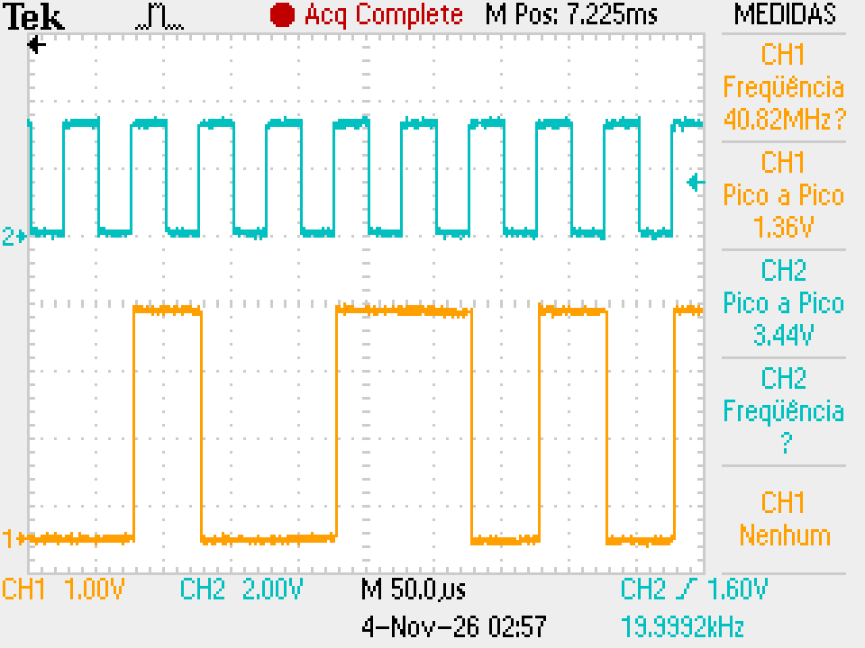

- Símbolos 140–149 (nível esperado → média medida em TP2):
-   [0] -0.003 V  [1] 3.391 V  [0] -0.022 V  [0] -0.010 V  [1] 3.387 V  [1] 3.372 V  [0] -0.038 V  [1] 3.370 V  [0] -0.030 V  [1] 3.378 V
- Níveis médios: 0: -0.021 V · 1: 3.380 V
- Degraus entre níveis: 3.400 V
- Ordem conferida: [0, 1, 0, 0, 1, 1, 0, 1, 0, 1] → OK
- Log do RX: `logs/Dupont_PAM2_20261103_162959.txt`
- RX: BER_amostra=0/100000
- RX: BER_filtro=0/100000
- RX: Modulação PAM-2 | canal: Dupont_direto | aquisição válida = 1 | sincronismo = 1
- RX: amostra única: Ne = 0 em 100000 bits -> BER = 0.00e+00 ; Ns = 0 em 100000 -> SER = 0.00e+00

Arquivos: `capturas/TX_TP2_PAM2_niveis_gray_tela.png`, `TX_TP2_PAM2_niveis_gray_CH1.csv`, `TX_TP2_PAM2_niveis_gray_CH2.csv`


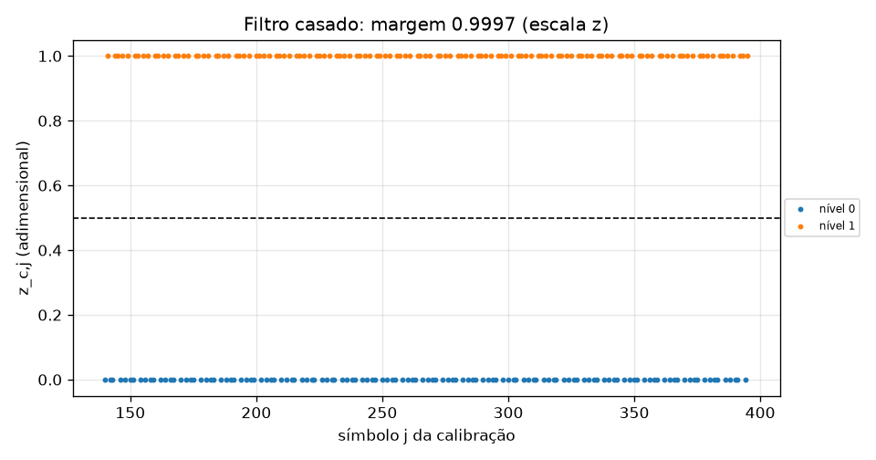

<details><summary>Saída completa do RX</summary>

```
Aguardando... quando aparecer #ARMADO, aperte RESET no TX.
#ARMADO PAM-2 canal=Dupont_direto : reinicie o TX (ou aperte KEY no TX)
#ARMADO PAM-2 canal=Dupont_direto : reinicie o TX (ou aperte KEY no TX)
>> recebendo relatório...
modulacao=PAM-2
canal=Dupont_direto
Rs_sym_s=20000
fa_amostras_s=160000
bordas_CLK=100444
simbolos_esperados=100444
simbolos_processados=100444
amostras_processadas=803552
posicao_DMA_1a_borda=315
amostras_descartadas_antes_CLK=9062715
bordas_com_contagem_errada=0
overrun_processamento=0
erro_ADC_overrun=0
perda_CLK=0
aquisicao_valida=1
b_c=4.17
E_c=133875936.0
p_c[0]=4090.83
p_c[1]=4090.83
p_c[2]=4090.83
p_c[3]=4090.83
p_c[4]=4090.83
p_c[5]=4090.63
p_c[6]=4090.63
p_c[7]=4090.83
ISI_zero_apos_A[0]=-0.37
ISI_zero_apos_A[1]=0.13
ISI_zero_apos_A[2]=0.18
ISI_zero_apos_A[3]=-0.12
ISI_zero_apos_A[4]=-0.72
ISI_zero_apos_A[5]=0.03
ISI_zero_apos_A[6]=0.03
ISI_zero_apos_A[7]=0.33
separacao_k[0]=4087
separacao_k[1]=4089
separacao_k[2]=4089
separacao_k[3]=4088
separacao_k[4]=4089
separacao_k[5]=4082
separacao_k[6]=4089
separacao_k[7]=4089
k_estrela=1
t_k_estrela_us=9.37
centro_u[0]=3.38
centro_z[0]=-0.00014
centro_u[1]=4095.00
centro_z[1]=1.00001
limiar_u[0]=2049.19
limiar_z[0]=0.49993
margem_u_ADC=4089
margem_u_mV_nominal=3295.2
margem_u_par=0-1
margem_z=0.99972
margem_z_par=0-1
calibracao_ok=1
media8_nivel[0]=0.46 (simbolo j=140, z=0.00011)
media8_nivel[1]=4090.83 (simbolo j=141, z=1.00001)
inicio_quadro_erros_u=0
inicio_quadro_erros_z=0
sincronismo_ok=1
payload_bits=100000
payload_simbolos=100000
amostra_unica_Ne=0
amostra_unica_Ns=0
filtro_casado_Ne=0
filtro_casado_Ns=0
BER_amostra=0/100000
BER_filtro=0/100000
SER_amostra=0/100000
SER_filtro=0/100000
janela_exemplo_j=451
janela_exemplo_nivel_TX=1
janela a[0]=4095 x[0]=4090.83 p_c[0]=4090.83
janela a[1]=4095 x[1]=4090.83 p_c[1]=4090.83
janela a[2]=4095 x[2]=4090.83 p_c[2]=4090.83
janela a[3]=4095 x[3]=4090.83 p_c[3]=4090.83
janela a[4]=4095 x[4]=4090.83 p_c[4]=4090.83
janela a[5]=4095 x[5]=4090.83 p_c[5]=4090.63
janela a[6]=4095 x[6]=4090.83 p_c[6]=4090.63
janela a[7]=4095 x[7]=4090.83 p_c[7]=4090.83
janela_z=1.00001
#END_REPORT
#BEGIN_TRAIN j,nivel,a0,a1,a2,a3,a4,a5,a6,a7,z
#END_TRAIN
#BEGIN_PSD simbolo,nivel,a0,a1,a2,a3,a4,a5,a6,a7
>> log gravado em entrega/logs/Dupont_PAM2_20261103_162959.txt
================ Dupont_PAM2_20261103_162959 ================
Modulação PAM-2 | canal: Dupont_direto | aquisição válida = 1 | sincronismo = 1
Bordas de CLK = 100444 de 100444 ; amostras = 803552 (= 8 x 100444) ; descartadas antes do CLK = 9062715

-- Filtro casado (Seção 4.5.1) --
b_c = 4.17 códigos (3.4 mV)
p_c[k] = [4090.8 4090.8 4090.8 4090.8 4090.8 4090.6 4090.6 4090.8] códigos
E_c = 1.339e+08
ISI no 1º zero depois de A = [-0.4 0.1 0.2 -0.1 -0.7 0.0 0.0 0.3] códigos
conferência com o firmware: max|Δp_c| = 0.00125, k* firmware = 1, k* Python = 1

-- Escolha de k* (Seção 4.3) --
  k=0  t= 3.12 us  menor separação =  4087 códigos ( 3293.6 mV)
  k=1  t= 9.37 us  menor separação =  4089 códigos ( 3295.2 mV)  <== k*
  k=2  t=15.62 us  menor separação =  4089 códigos ( 3295.2 mV)
  k=3  t=21.87 us  menor separação =  4088 códigos ( 3294.4 mV)
  k=4  t=28.12 us  menor separação =  4089 códigos ( 3295.2 mV)
  k=5  t=34.37 us  menor separação =  4082 códigos ( 3289.5 mV)
  k=6  t=40.62 us  menor separação =  4089 códigos ( 3295.2 mV)
  k=7  t=46.87 us  menor separação =  4089 códigos ( 3295.2 mV)

-- Centros, limiares, margens (Seção 4.5.2) --
centros u (códigos) = [3.4, 4095.0] ; em V = [0.003, 3.3]
limiares u (códigos) = [2049.2] ; em V = [1.651]
centros z = [-0.0001, 1.0] ; limiares z = [0.4999]
margem amostra única = 4089 códigos = 3295.2 mV (par de níveis 0-1)
margem filtro casado = 0.9997 (escala z; par 0-1)
margem relativa (margem / distância média entre centros): u = 1.00 , z = 1.00

-- Olho (1024 símbolos do payload) --
abertura vertical em t_k* = 9.37 us: 3.291 V (menor entre níveis vizinhos)
abertura por k (V) = [3.29, 3.291, 3.291, 3.294, 3.292, 3.29, 3.29, 3.293]

-- PSD (fa = 160 kHz, Vref = 3.3000 V, média retirada, Hann, N = 1024, 50%, 15 blocos) --
resolução = 156.25 Hz ; duração do registro = 51.2 ms ; potência AC = 2.7171 V^2 (var = 2.7162)
S(5 kHz)  = 2.809e-04 V^2/Hz (média de 5 bins 2.105e-04; teoria 2.214e-04)
S(10 kHz) = 1.637e-04 V^2/Hz (média de 5 bins 1.063e-04; teoria 1.118e-04)

-- Contagem de erros (firmware, mesmas amostras do payload) --
amostra única: Ne = 0 em 100000 bits -> BER = 0.00e+00 ; Ns = 0 em 100000 -> SER = 0.00e+00
filtro casado: Ne = 0 em 100000 bits -> BER = 0.00e+00 ; Ns = 0 em 100000 -> SER = 0.00e+00
  -> escrever "0 erros em 100.000 bits" (BER observada = 0, NÃO prova BER física nula;
     com 0 erros, limite superior de 95% ~ 3/100000 = 3e-5).

-- Janela real (símbolo j = 451, nível TX = 1) --
  k   a[k]    x[k]=a-b_c    p_c[k]       p_c*x
  0   4095     4090.83     4090.83    16734900.3
  1   4095     4090.83     4090.83    16734900.3
  2   4095     4090.83     4090.83    16734900.3
  3   4095     4090.83     4090.83    16734900.3
  4   4095     4090.83     4090.83    16734900.3
  5   4095     4090.83     4090.63    16734082.1
  6   4095     4090.83     4090.63    16734082.1
  7   4095     4090.83     4090.83    16734900.3
  soma = 133877566.2 ; E_c = 133875929.9 ; z = soma/E_c = 1.00001 (firmware: 1.00001)

  [OK] Log completo até #END_PSD
  [OK] bordas_CLK = símbolos esperados (100444 = 100444)
  [OK] amostras = 8 × símbolos (803552 = 8 × 100444)
  [OK] bordas_com_contagem_errada = 0
  [OK] overrun_processamento = 0 e erro_ADC_overrun = 0
  [OK] perda_CLK = 0
  [OK] aquisicao_valida = 1
  [OK] calibracao_ok = 1 (centros em ordem crescente)
  [OK] sincronismo_ok = 1 (48 bits de início corretos)
figura: entrega/figuras/Dupont_PAM2_20261103_162959.png
figura: entrega/figuras/Dupont_PAM2_20261103_162959_z.png
```
</details>

## Dupont PAM2 TP2 TP3 degrau zoom — canal Dupont, TX em PAM-2  ·  03/11/2026 16:31

- **Pontas:** CH1 = TP2 · CH2 = TP3
- **O que é:** Zoom (250 ns/div) na 1ª subida 0→A do quadro — para canais rápidos (Dupont), onde τ ≈ 0,1 µs não se resolve a 25 µs/div.
- **Aquisições:** 1

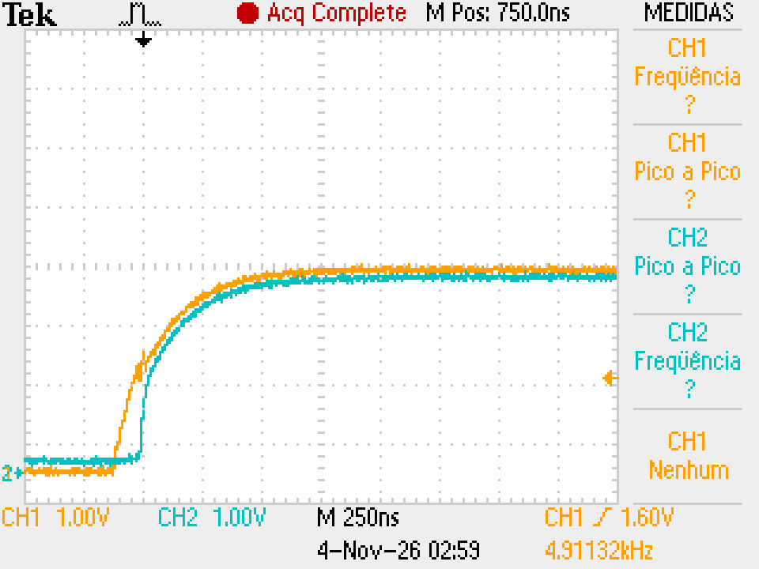

- t0 = início da transição do TX (TP2 sai da linha de base) = -0.11 µs na tela
- TP2: 0.040 → 3.427 V; **salto instantâneo em TP2 = 3.00 V (89 % do degrau)** — divisor 56/(330+56+R_GPIO) ≈ 14 % no RC; ≈ 100 % no Dupont
- TP3: V0 = 0.200 V (offset de ~0,2 V da ponta 1X do CH2 — não é do circuito), Vf (=TP2 final) = 3.427 V, no instante k* (46,9 µs após t0) = 3.308 V (96.3 % do degrau)
- t10 = 0.10 µs · t63 = 0.22 µs · t90 = 0.53 µs (medidos a partir de t0)
- **τ = t63 − t0 = 0.22 µs** · **t10-90 = 0.42 µs** (→ τ = t10-90/2,197 = 0.19 µs) · f_c = 1/(2πτ) = 716.9 kHz
- Rise Time automático do osciloscópio em TP3: 0.31 µs (usa min/max da tela inteira — só referência)
- Log do RX: **inválido** (`perda_CLK=1` após 3 094 bordas ≈ 155 ms) — 4ª perda de CLK no dia; ocorre logo depois de mexer na ponta que estava no PB4 → **mau contato no fio de CLK PB4→PA0**. Movido para `logs/invalidos/`.
- RX: BER=NAO_ATRIBUIDA (quadro invalido ou sem sincronismo: repita o ensaio)
- RX: Modulação PAM-2 | canal: Dupont_direto | aquisição válida = 0 | sincronismo = 1
- RX: SEM BER: quadro inválido ou sem sincronismo -> repetir o ensaio.

Arquivos: `capturas/Dupont_PAM2_TP2_TP3_degrau_zoom_tela.png`, `Dupont_PAM2_TP2_TP3_degrau_zoom_CH1.csv`, `Dupont_PAM2_TP2_TP3_degrau_zoom_CH2.csv`

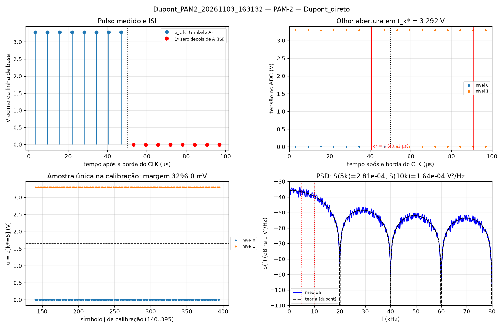

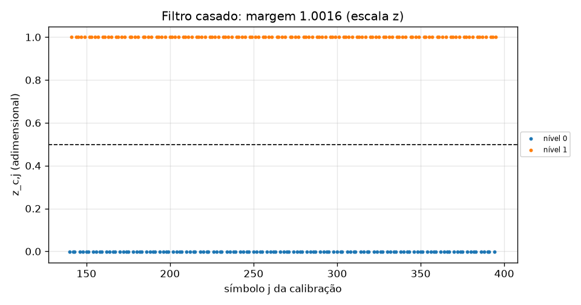

<details><summary>Saída completa do RX</summary>

```
Aguardando... quando aparecer #ARMADO, aperte RESET no TX.
#ARMADO PAM-2 canal=Dupont_direto : reinicie o TX (ou aperte KEY no TX)
#ARMADO PAM-2 canal=Dupont_direto : reinicie o TX (ou aperte KEY no TX)
>> recebendo relatório...
modulacao=PAM-2
canal=Dupont_direto
Rs_sym_s=20000
fa_amostras_s=160000
bordas_CLK=3094
simbolos_esperados=100444
simbolos_processados=3086
amostras_processadas=24688
posicao_DMA_1a_borda=138
amostras_descartadas_antes_CLK=7394442
bordas_com_contagem_errada=0
overrun_processamento=0
erro_ADC_overrun=0
perda_CLK=1
aquisicao_valida=0
b_c=11.01
E_c=133431632.0
p_c[0]=4083.99
p_c[1]=4083.99
p_c[2]=4083.99
p_c[3]=4083.99
p_c[4]=4083.99
p_c[5]=4083.99
p_c[6]=4083.99
p_c[7]=4083.99
ISI_zero_apos_A[0]=-6.96
ISI_zero_apos_A[1]=-6.16
ISI_zero_apos_A[2]=-6.11
ISI_zero_apos_A[3]=-6.56
ISI_zero_apos_A[4]=-6.61
ISI_zero_apos_A[5]=-6.76
ISI_zero_apos_A[6]=-6.66
ISI_zero_apos_A[7]=-6.51
separacao_k[0]=4088
separacao_k[1]=4086
separacao_k[2]=4087
separacao_k[3]=4088
separacao_k[4]=4089
separacao_k[5]=4087
separacao_k[6]=4090
separacao_k[7]=4089
k_estrela=6
t_k_estrela_us=40.62
centro_u[0]=3.66
centro_z[0]=-0.00177
centro_u[1]=4095.00
centro_z[1]=1.00000
limiar_u[0]=2049.33
limiar_z[0]=0.49911
margem_u_ADC=4090
margem_u_mV_nominal=3296.0
margem_u_par=0-1
margem_z=1.00156
margem_z_par=0-1
calibracao_ok=1
media8_nivel[0]=-6.51 (simbolo j=140, z=-0.00159)
media8_nivel[1]=4083.99 (simbolo j=141, z=1.00000)
inicio_quadro_erros_u=0
inicio_quadro_erros_z=0
sincronismo_ok=1
payload_bits=2642
payload_simbolos=2642
BER=NAO_ATRIBUIDA (quadro invalido ou sem sincronismo: repita o ensaio)
janela_exemplo_j=451
janela_exemplo_nivel_TX=1
janela a[0]=4095 x[0]=4083.99 p_c[0]=4083.99
janela a[1]=4095 x[1]=4083.99 p_c[1]=4083.99
janela a[2]=4095 x[2]=4083.99 p_c[2]=4083.99
janela a[3]=4095 x[3]=4083.99 p_c[3]=4083.99
janela a[4]=4095 x[4]=4083.99 p_c[4]=4083.99
janela a[5]=4095 x[5]=4083.99 p_c[5]=4083.99
janela a[6]=4095 x[6]=4083.99 p_c[6]=4083.99
janela a[7]=4095 x[7]=4083.99 p_c[7]=4083.99
janela_z=1.00000
#END_REPORT
#BEGIN_TRAIN j,nivel,a0,a1,a2,a3,a4,a5,a6,a7,z
#END_TRAIN
#BEGIN_PSD simbolo,nivel,a0,a1,a2,a3,a4,a5,a6,a7
>> log gravado em entrega/logs/Dupont_PAM2_20261103_163132.txt
================ Dupont_PAM2_20261103_163132 ================
Modulação PAM-2 | canal: Dupont_direto | aquisição válida = 0 | sincronismo = 1
Bordas de CLK = 3094 de 100444 ; amostras = 24688 (= 8 x 3086) ; descartadas antes do CLK = 7394442

-- Filtro casado (Seção 4.5.1) --
b_c = 11.01 códigos (8.9 mV)
p_c[k] = [4084.0 4084.0 4084.0 4084.0 4084.0 4084.0 4084.0 4084.0] códigos
E_c = 1.334e+08
ISI no 1º zero depois de A = [-7.0 -6.2 -6.1 -6.6 -6.6 -6.8 -6.7 -6.5] códigos
conferência com o firmware: max|Δp_c| = 0.0025, k* firmware = 6, k* Python = 6

-- Escolha de k* (Seção 4.3) --
  k=0  t= 3.12 us  menor separação =  4088 códigos ( 3294.4 mV)
  k=1  t= 9.37 us  menor separação =  4086 códigos ( 3292.7 mV)
  k=2  t=15.62 us  menor separação =  4087 códigos ( 3293.6 mV)
  k=3  t=21.87 us  menor separação =  4088 códigos ( 3294.4 mV)
  k=4  t=28.12 us  menor separação =  4089 códigos ( 3295.2 mV)
  k=5  t=34.37 us  menor separação =  4087 códigos ( 3293.6 mV)
  k=6  t=40.62 us  menor separação =  4090 códigos ( 3296.0 mV)  <== k*
  k=7  t=46.87 us  menor separação =  4089 códigos ( 3295.2 mV)

-- Centros, limiares, margens (Seção 4.5.2) --
centros u (códigos) = [3.7, 4095.0] ; em V = [0.003, 3.3]
limiares u (códigos) = [2049.3] ; em V = [1.651]
centros z = [-0.0018, 1.0] ; limiares z = [0.4991]
margem amostra única = 4090 códigos = 3296.0 mV (par de níveis 0-1)
margem filtro casado = 1.0016 (escala z; par 0-1)
margem relativa (margem / distância média entre centros): u = 1.00 , z = 1.00

-- Olho (1024 símbolos do payload) --
abertura vertical em t_k* = 40.62 us: 3.292 V (menor entre níveis vizinhos)
abertura por k (V) = [3.293, 3.291, 3.291, 3.29, 3.293, 3.291, 3.292, 3.29]

-- PSD (fa = 160 kHz, Vref = 3.3000 V, média retirada, Hann, N = 1024, 50%, 15 blocos) --
resolução = 156.25 Hz ; duração do registro = 51.2 ms ; potência AC = 2.7168 V^2 (var = 2.7158)
S(5 kHz)  = 2.808e-04 V^2/Hz (média de 5 bins 2.105e-04; teoria 2.214e-04)
S(10 kHz) = 1.637e-04 V^2/Hz (média de 5 bins 1.063e-04; teoria 1.118e-04)

-- Contagem de erros (firmware, mesmas amostras do payload) --
SEM BER: quadro inválido ou sem sincronismo -> repetir o ensaio.

-- Janela real (símbolo j = 451, nível TX = 1) --
  k   a[k]    x[k]=a-b_c    p_c[k]       p_c*x
  0   4095     4083.99     4083.99    16678953.9
  1   4095     4083.99     4083.99    16678953.9
  2   4095     4083.99     4083.99    16678953.9
  3   4095     4083.99     4083.99    16678953.9
  4   4095     4083.99     4083.99    16678953.9
  5   4095     4083.99     4083.99    16678953.9
  6   4095     4083.99     4083.99    16678953.9
  7   4095     4083.99     4083.99    16678953.9
  soma = 133431631.2 ; E_c = 133431631.2 ; z = soma/E_c = 1.00000 (firmware: 1.0)

  [OK] Log completo até #END_PSD
  [FALHOU] bordas_CLK = símbolos esperados (3094 = 100444)
  [OK] amostras = 8 × símbolos (24688 = 8 × 3086)
  [OK] bordas_com_contagem_errada = 0
  [OK] overrun_processamento = 0 e erro_ADC_overrun = 0
  [FALHOU] perda_CLK = 0
  [FALHOU] aquisicao_valida = 1
  [OK] calibracao_ok = 1 (centros em ordem crescente)
  [OK] sincronismo_ok = 1 (48 bits de início corretos)
figura: entrega/figuras/Dupont_PAM2_20261103_163132.png
figura: entrega/figuras/Dupont_PAM2_20261103_163132_z.png
```
</details>

## Dupont PAM4 TP2 TP3 degrau zoom — canal Dupont, TX em PAM-4  ·  03/11/2026 16:32

- **Pontas:** CH1 = TP2 · CH2 = TP3
- **O que é:** Zoom (250 ns/div) na 1ª subida 0→A do quadro — para canais rápidos (Dupont), onde τ ≈ 0,1 µs não se resolve a 25 µs/div.
- **Aquisições:** 1

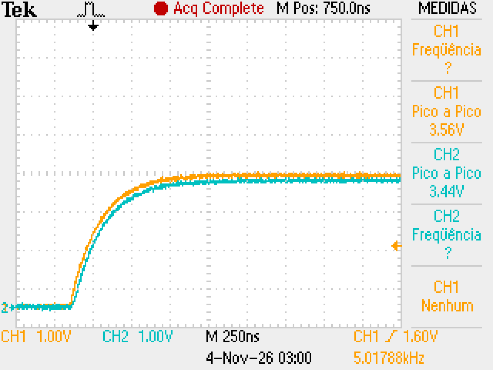

- t0 = início da transição do TX (TP2 sai da linha de base) = -0.13 µs na tela
- TP2: 0.040 → 3.424 V; **salto instantâneo em TP2 = 3.04 V (90 % do degrau)** — divisor 56/(330+56+R_GPIO) ≈ 14 % no RC; ≈ 100 % no Dupont
- TP3: V0 = 0.000 V, Vf (=TP2 final) = 3.424 V, no instante k* (46,9 µs após t0) = 3.301 V (96.4 % do degrau)
- t10 = 0.02 µs · t63 = 0.21 µs · t90 = 0.51 µs (medidos a partir de t0)
- **τ = t63 − t0 = 0.21 µs** · **t10-90 = 0.49 µs** (→ τ = t10-90/2,197 = 0.22 µs) · f_c = 1/(2πτ) = 765.2 kHz
- Rise Time automático do osciloscópio em TP3: 0.37 µs (usa min/max da tela inteira — só referência)
- Log do RX: **inválido** — 50 442 bordas para 50 420 símbolos (**22 bordas a mais**), calibração e sincronismo falharam. O fio de CLK foi reencaixado com o RX já armado: o repique do contato gerou bordas falsas e o RX começou a contar antes do quadro. Lição: mexer na fiação só ANTES de armar. Movido para `logs/invalidos/`.
- RX: BER=NAO_ATRIBUIDA (quadro invalido ou sem sincronismo: repita o ensaio)
- RX: Modulação PAM-4 | canal: Dupont_direto | aquisição válida = 1 | sincronismo = 0
- RX: SEM BER: quadro inválido ou sem sincronismo -> repetir o ensaio.

Arquivos: `capturas/Dupont_PAM4_TP2_TP3_degrau_zoom_tela.png`, `Dupont_PAM4_TP2_TP3_degrau_zoom_CH1.csv`, `Dupont_PAM4_TP2_TP3_degrau_zoom_CH2.csv`


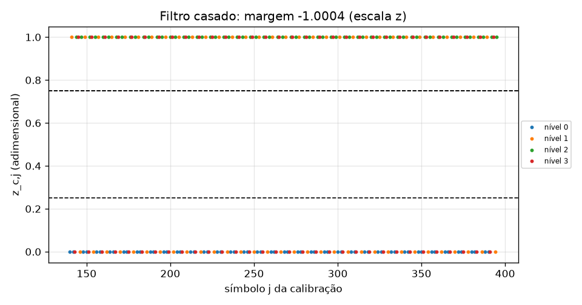

<details><summary>Saída completa do RX</summary>

```
Aguardando... quando aparecer #ARMADO, aperte RESET no TX.
#ARMADO PAM-4 canal=Dupont_direto : reinicie o TX (ou aperte KEY no TX)
#ARMADO PAM-4 canal=Dupont_direto : reinicie o TX (ou aperte KEY no TX)
>> recebendo relatório...
modulacao=PAM-4
canal=Dupont_direto
Rs_sym_s=20000
fa_amostras_s=160000
bordas_CLK=50442
simbolos_esperados=50420
simbolos_processados=50420
amostras_processadas=403360
posicao_DMA_1a_borda=192
amostras_descartadas_antes_CLK=3089088
bordas_com_contagem_errada=0
overrun_processamento=0
erro_ADC_overrun=0
perda_CLK=0
aquisicao_valida=1
b_c=4.49
E_c=133858352.0
p_c[0]=4090.51
p_c[1]=4090.51
p_c[2]=4090.51
p_c[3]=4090.51
p_c[4]=4090.51
p_c[5]=4090.51
p_c[6]=4090.51
p_c[7]=4090.51
ISI_zero_apos_A[0]=0.01
ISI_zero_apos_A[1]=-0.04
ISI_zero_apos_A[2]=0.36
ISI_zero_apos_A[3]=0.16
ISI_zero_apos_A[4]=0.21
ISI_zero_apos_A[5]=-0.14
ISI_zero_apos_A[6]=-0.09
ISI_zero_apos_A[7]=0.06
separacao_k[0]=-4094
separacao_k[1]=-4093
separacao_k[2]=-4094
separacao_k[3]=-4093
separacao_k[4]=-4094
separacao_k[5]=-4093
separacao_k[6]=-4094
separacao_k[7]=-4093
k_estrela=1
t_k_estrela_us=9.37
centro_u[0]=3.83
centro_z[0]=-0.00015
centro_u[1]=2049.27
centro_z[1]=0.49991
centro_u[2]=4094.97
centro_z[2]=1.00000
centro_u[3]=2049.39
centro_z[3]=0.49991
limiar_u[0]=1026.55
limiar_z[0]=0.24988
limiar_u[1]=3072.12
limiar_z[1]=0.74996
limiar_u[2]=3072.18
limiar_z[2]=0.74996
margem_u_ADC=-4093
margem_u_mV_nominal=-3298.4
margem_u_par=2-3
margem_z=-1.00036
margem_z_par=2-3
calibracao_ok=0
media8_nivel[0]=0.39 (simbolo j=140, z=0.00009)
media8_nivel[1]=4090.51 (simbolo j=141, z=1.00000)
media8_nivel[2]=4090.51 (simbolo j=144, z=1.00000)
media8_nivel[3]=-0.74 (simbolo j=143, z=-0.00018)
inicio_quadro_erros_u=32
inicio_quadro_erros_z=32
sincronismo_ok=0
payload_bits=100000
payload_simbolos=50000
BER=NAO_ATRIBUIDA (quadro invalido ou sem sincronismo: repita o ensaio)
janela_exemplo_j=427
janela_exemplo_nivel_TX=3
janela a[0]=4095 x[0]=4090.51 p_c[0]=4090.51
janela a[1]=4095 x[1]=4090.51 p_c[1]=4090.51
janela a[2]=4095 x[2]=4090.51 p_c[2]=4090.51
janela a[3]=4095 x[3]=4090.51 p_c[3]=4090.51
janela a[4]=4095 x[4]=4090.51 p_c[4]=4090.51
janela a[5]=4095 x[5]=4090.51 p_c[5]=4090.51
janela a[6]=4095 x[6]=4090.51 p_c[6]=4090.51
janela a[7]=4095 x[7]=4090.51 p_c[7]=4090.51
janela_z=1.00000
#END_REPORT
#BEGIN_TRAIN j,nivel,a0,a1,a2,a3,a4,a5,a6,a7,z
#END_TRAIN
#BEGIN_PSD simbolo,nivel,a0,a1,a2,a3,a4,a5,a6,a7
>> log gravado em entrega/logs/Dupont_PAM4_20261103_163236.txt
================ Dupont_PAM4_20261103_163236 ================
Modulação PAM-4 | canal: Dupont_direto | aquisição válida = 1 | sincronismo = 0
Bordas de CLK = 50442 de 50420 ; amostras = 403360 (= 8 x 50420) ; descartadas antes do CLK = 3089088

-- Filtro casado (Seção 4.5.1) --
b_c = 4.49 códigos (3.6 mV)
p_c[k] = [4090.5 4090.5 4090.5 4090.5 4090.5 4090.5 4090.5 4090.5] códigos
E_c = 1.339e+08
ISI no 1º zero depois de A = [0.0 -0.0 0.4 0.2 0.2 -0.1 -0.1 0.1] códigos
conferência com o firmware: max|Δp_c| = 0.0025, k* firmware = 1, k* Python = 1

-- Escolha de k* (Seção 4.3) --
  k=0  t= 3.12 us  menor separação = -4094 códigos (-3299.2 mV)
  k=1  t= 9.37 us  menor separação = -4093 códigos (-3298.4 mV)  <== k*
  k=2  t=15.62 us  menor separação = -4094 códigos (-3299.2 mV)
  k=3  t=21.87 us  menor separação = -4093 códigos (-3298.4 mV)
  k=4  t=28.12 us  menor separação = -4094 códigos (-3299.2 mV)
  k=5  t=34.37 us  menor separação = -4093 códigos (-3298.4 mV)
  k=6  t=40.62 us  menor separação = -4094 códigos (-3299.2 mV)
  k=7  t=46.87 us  menor separação = -4093 códigos (-3298.4 mV)

-- Centros, limiares, margens (Seção 4.5.2) --
centros u (códigos) = [3.8, 2049.3, 4095.0, 2049.4] ; em V = [0.003, 1.651, 3.3, 1.652]
limiares u (códigos) = [1026.5, 3072.1, 3072.2] ; em V = [0.827, 2.476, 2.476]
centros z = [-0.0002, 0.4999, 1.0, 0.4999] ; limiares z = [0.2499, 0.75, 0.75]
margem amostra única = -4093 códigos = -3298.4 mV (par de níveis 2-3, Gray 11/10)
margem filtro casado = -1.0004 (escala z; par 2-3)
margem relativa (margem / distância média entre centros): u = -6.00 , z = -6.00

-- Olho (1024 símbolos do payload) --
abertura vertical em t_k* = 9.37 us: -3.299 V (menor entre níveis vizinhos)
abertura por k (V) = [-3.3, -3.299, -3.3, -3.3, -3.3, -3.3, -3.299, -3.3]

-- PSD (fa = 160 kHz, Vref = 3.3000 V, média retirada, Hann, N = 1024, 50%, 15 blocos) --
resolução = 156.25 Hz ; duração do registro = 51.2 ms ; potência AC = 2.7164 V^2 (var = 2.7165)
S(5 kHz)  = 1.881e-04 V^2/Hz (média de 5 bins 2.043e-04; teoria 1.230e-04)
S(10 kHz) = 1.276e-04 V^2/Hz (média de 5 bins 9.267e-05; teoria 1.242e-05)

-- Contagem de erros (firmware, mesmas amostras do payload) --
SEM BER: quadro inválido ou sem sincronismo -> repetir o ensaio.

-- Janela real (símbolo j = 427, nível TX = 3) --
  k   a[k]    x[k]=a-b_c    p_c[k]       p_c*x
  0   4095     4090.51     4090.51    16732292.5
  1   4095     4090.51     4090.51    16732292.5
  2   4095     4090.51     4090.51    16732292.5
  3   4095     4090.51     4090.51    16732292.5
  4   4095     4090.51     4090.51    16732292.5
  5   4095     4090.51     4090.51    16732292.5
  6   4095     4090.51     4090.51    16732292.5
  7   4095     4090.51     4090.51    16732292.5
  soma = 133858340.1 ; E_c = 133858340.1 ; z = soma/E_c = 1.00000 (firmware: 1.0)

  [OK] Log completo até #END_PSD
  [FALHOU] bordas_CLK = símbolos esperados (50442 = 50420)
  [OK] amostras = 8 × símbolos (403360 = 8 × 50420)
  [OK] bordas_com_contagem_errada = 0
  [OK] overrun_processamento = 0 e erro_ADC_overrun = 0
  [OK] perda_CLK = 0
  [OK] aquisicao_valida = 1
  [FALHOU] calibracao_ok = 1 (centros em ordem crescente)
  [FALHOU] sincronismo_ok = 1 (48 bits de início corretos)
figura: entrega/figuras/Dupont_PAM4_20261103_163236.png
figura: entrega/figuras/Dupont_PAM4_20261103_163236_z.png
```
</details>

## Dupont PAM4 TP2 TP3 degrau — canal Dupont, TX em PAM-4  ·  03/11/2026 16:33

- **Pontas:** CH1 = TP2 · CH2 = TP3
- **O que é:** 1º pulso 0→A do treinamento (A dura 1 símbolo): entrada (TP2) × saída (TP3). τ por t63 e t10-90; resíduo no zero seguinte = ISI.
- **Aquisições:** 1

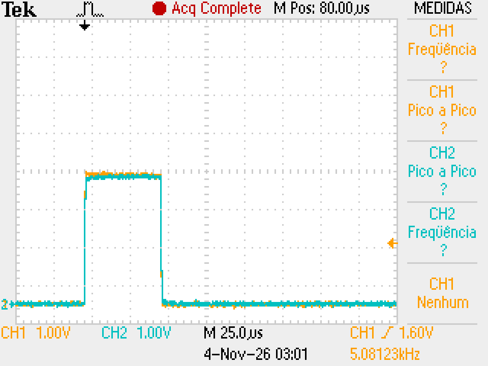

- t0 = início da transição do TX (TP2 sai da linha de base) = 0.60 µs na tela
- TP2: 0.000 → 3.375 V; **salto instantâneo em TP2 = 2.96 V (88 % do degrau)** — divisor 56/(330+56+R_GPIO) ≈ 14 % no RC; ≈ 100 % no Dupont
- TP3: V0 = 0.000 V, Vf (=TP2 final) = 3.375 V, no instante k* (46,9 µs após t0) = 3.338 V (98.9 % do degrau)
- t10 = 0.00 µs · t63 = 0.30 µs · t90 = 0.60 µs (medidos a partir de t0)
- **τ = t63 − t0 = 0.30 µs** · **t10-90 = 0.60 µs** (→ τ = t10-90/2,197 = 0.27 µs) · f_c = 1/(2πτ) = 530.5 kHz
- ISI: resíduo em TP3 no fim do 1º zero depois de A = +13 mV (previsto A·(1−e^(−Ts/τ))·e^(−Ts/τ) = 0 mV; resolução do osciloscópio ≈ 40 mV a 1 V/div)
- Rise Time automático do osciloscópio em TP3: 0.46 µs (usa min/max da tela inteira — só referência)
- Log do RX: **inválido** — 50 428 bordas para 50 420 (**8 bordas falsas**) sem ninguém mexer na fiação. Ver a seção "Problema do CLK" no fim do caderno. Movido para `logs/invalidos/`.
- RX: BER=NAO_ATRIBUIDA (quadro invalido ou sem sincronismo: repita o ensaio)
- RX: Modulação PAM-4 | canal: Dupont_direto | aquisição válida = 1 | sincronismo = 0
- RX: SEM BER: quadro inválido ou sem sincronismo -> repetir o ensaio.

Arquivos: `capturas/Dupont_PAM4_TP2_TP3_degrau_tela.png`, `Dupont_PAM4_TP2_TP3_degrau_CH1.csv`, `Dupont_PAM4_TP2_TP3_degrau_CH2.csv`

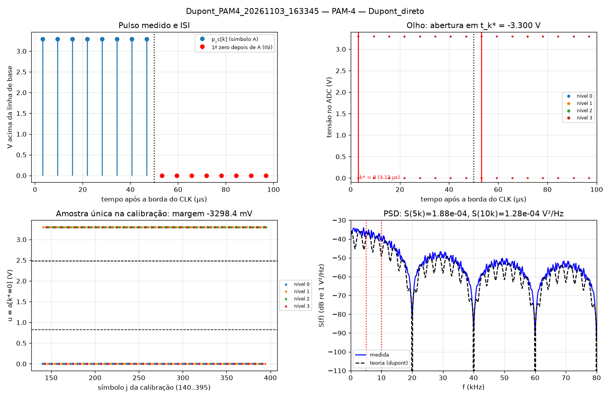


<details><summary>Saída completa do RX</summary>

```
Aguardando... quando aparecer #ARMADO, aperte RESET no TX.
#ARMADO PAM-4 canal=Dupont_direto : reinicie o TX (ou aperte KEY no TX)
#ARMADO PAM-4 canal=Dupont_direto : reinicie o TX (ou aperte KEY no TX)
>> recebendo relatório...
modulacao=PAM-4
canal=Dupont_direto
Rs_sym_s=20000
fa_amostras_s=160000
bordas_CLK=50428
simbolos_esperados=50420
simbolos_processados=50420
amostras_processadas=403360
posicao_DMA_1a_borda=317
amostras_descartadas_antes_CLK=6331709
bordas_com_contagem_errada=0
overrun_processamento=0
erro_ADC_overrun=0
perda_CLK=0
aquisicao_valida=1
b_c=4.41
E_c=133860376.0
p_c[0]=4090.59
p_c[1]=4090.59
p_c[2]=4090.59
p_c[3]=4090.59
p_c[4]=4090.24
p_c[5]=4090.59
p_c[6]=4090.59
p_c[7]=4090.59
ISI_zero_apos_A[0]=-0.36
ISI_zero_apos_A[1]=0.54
ISI_zero_apos_A[2]=0.34
ISI_zero_apos_A[3]=-0.21
ISI_zero_apos_A[4]=-0.26
ISI_zero_apos_A[5]=-0.11
ISI_zero_apos_A[6]=0.19
ISI_zero_apos_A[7]=0.09
separacao_k[0]=-4093
separacao_k[1]=-4095
separacao_k[2]=-4095
separacao_k[3]=-4093
separacao_k[4]=-4093
separacao_k[5]=-4094
separacao_k[6]=-4094
separacao_k[7]=-4095
k_estrela=0
t_k_estrela_us=3.12
centro_u[0]=4.16
centro_z[0]=-0.00014
centro_u[1]=2049.66
centro_z[1]=0.49993
centro_u[2]=4095.00
centro_z[2]=1.00000
centro_u[3]=2049.30
centro_z[3]=0.49991
limiar_u[0]=1026.91
limiar_z[0]=0.24990
limiar_u[1]=3072.33
limiar_z[1]=0.74997
limiar_u[2]=3072.15
limiar_z[2]=0.74996
margem_u_ADC=-4093
margem_u_mV_nominal=-3298.4
margem_u_par=2-3
margem_z=-1.00039
margem_z_par=2-3
calibracao_ok=0
media8_nivel[0]=0.46 (simbolo j=140, z=0.00011)
media8_nivel[1]=4090.59 (simbolo j=141, z=1.00001)
media8_nivel[2]=4090.59 (simbolo j=144, z=1.00001)
media8_nivel[3]=0.34 (simbolo j=143, z=0.00008)
inicio_quadro_erros_u=32
inicio_quadro_erros_z=32
sincronismo_ok=0
payload_bits=100000
payload_simbolos=50000
BER=NAO_ATRIBUIDA (quadro invalido ou sem sincronismo: repita o ensaio)
janela_exemplo_j=427
janela_exemplo_nivel_TX=3
janela a[0]=4095 x[0]=4090.59 p_c[0]=4090.59
janela a[1]=4095 x[1]=4090.59 p_c[1]=4090.59
janela a[2]=4095 x[2]=4090.59 p_c[2]=4090.59
janela a[3]=4095 x[3]=4090.59 p_c[3]=4090.59
janela a[4]=4095 x[4]=4090.59 p_c[4]=4090.24
janela a[5]=4095 x[5]=4090.59 p_c[5]=4090.59
janela a[6]=4095 x[6]=4090.59 p_c[6]=4090.59
janela a[7]=4095 x[7]=4090.59 p_c[7]=4090.59
janela_z=1.00001
#END_REPORT
#BEGIN_TRAIN j,nivel,a0,a1,a2,a3,a4,a5,a6,a7,z
#END_TRAIN
#BEGIN_PSD simbolo,nivel,a0,a1,a2,a3,a4,a5,a6,a7
>> log gravado em entrega/logs/Dupont_PAM4_20261103_163345.txt
================ Dupont_PAM4_20261103_163345 ================
Modulação PAM-4 | canal: Dupont_direto | aquisição válida = 1 | sincronismo = 0
Bordas de CLK = 50428 de 50420 ; amostras = 403360 (= 8 x 50420) ; descartadas antes do CLK = 6331709

-- Filtro casado (Seção 4.5.1) --
b_c = 4.41 códigos (3.6 mV)
p_c[k] = [4090.6 4090.6 4090.6 4090.6 4090.2 4090.6 4090.6 4090.6] códigos
E_c = 1.339e+08
ISI no 1º zero depois de A = [-0.4 0.5 0.3 -0.2 -0.3 -0.1 0.2 0.1] códigos
conferência com o firmware: max|Δp_c| = 0.0025, k* firmware = 0, k* Python = 0

-- Escolha de k* (Seção 4.3) --
  k=0  t= 3.12 us  menor separação = -4093 códigos (-3298.4 mV)  <== k*
  k=1  t= 9.37 us  menor separação = -4095 códigos (-3300.0 mV)
  k=2  t=15.62 us  menor separação = -4095 códigos (-3300.0 mV)
  k=3  t=21.87 us  menor separação = -4093 códigos (-3298.4 mV)
  k=4  t=28.12 us  menor separação = -4093 códigos (-3298.4 mV)
  k=5  t=34.37 us  menor separação = -4094 códigos (-3299.2 mV)
  k=6  t=40.62 us  menor separação = -4094 códigos (-3299.2 mV)
  k=7  t=46.87 us  menor separação = -4095 códigos (-3300.0 mV)

-- Centros, limiares, margens (Seção 4.5.2) --
centros u (códigos) = [4.2, 2049.7, 4095.0, 2049.3] ; em V = [0.003, 1.652, 3.3, 1.651]
limiares u (códigos) = [1026.9, 3072.3, 3072.1] ; em V = [0.828, 2.476, 2.476]
centros z = [-0.0001, 0.4999, 1.0, 0.4999] ; limiares z = [0.2499, 0.75, 0.75]
margem amostra única = -4093 códigos = -3298.4 mV (par de níveis 2-3, Gray 11/10)
margem filtro casado = -1.0004 (escala z; par 2-3)
margem relativa (margem / distância média entre centros): u = -6.00 , z = -6.00

-- Olho (1024 símbolos do payload) --
abertura vertical em t_k* = 3.12 us: -3.300 V (menor entre níveis vizinhos)
abertura por k (V) = [-3.3, -3.3, -3.3, -3.3, -3.3, -3.3, -3.3, -3.3]

-- PSD (fa = 160 kHz, Vref = 3.3000 V, média retirada, Hann, N = 1024, 50%, 15 blocos) --
resolução = 156.25 Hz ; duração do registro = 51.2 ms ; potência AC = 2.7165 V^2 (var = 2.7165)
S(5 kHz)  = 1.881e-04 V^2/Hz (média de 5 bins 2.043e-04; teoria 1.230e-04)
S(10 kHz) = 1.277e-04 V^2/Hz (média de 5 bins 9.268e-05; teoria 1.242e-05)

-- Contagem de erros (firmware, mesmas amostras do payload) --
SEM BER: quadro inválido ou sem sincronismo -> repetir o ensaio.

-- Janela real (símbolo j = 427, nível TX = 3) --
  k   a[k]    x[k]=a-b_c    p_c[k]       p_c*x
  0   4095     4090.59     4090.59    16732906.1
  1   4095     4090.59     4090.59    16732906.1
  2   4095     4090.59     4090.59    16732906.1
  3   4095     4090.59     4090.59    16732906.1
  4   4095     4090.59     4090.24    16731474.4
  5   4095     4090.59     4090.59    16732906.1
  6   4095     4090.59     4090.59    16732906.1
  7   4095     4090.59     4090.59    16732906.1
  soma = 133861817.1 ; E_c = 133860385.5 ; z = soma/E_c = 1.00001 (firmware: 1.00001)

  [OK] Log completo até #END_PSD
  [FALHOU] bordas_CLK = símbolos esperados (50428 = 50420)
  [OK] amostras = 8 × símbolos (403360 = 8 × 50420)
  [OK] bordas_com_contagem_errada = 0
  [OK] overrun_processamento = 0 e erro_ADC_overrun = 0
  [OK] perda_CLK = 0
  [OK] aquisicao_valida = 1
  [FALHOU] calibracao_ok = 1 (centros em ordem crescente)
  [FALHOU] sincronismo_ok = 1 (48 bits de início corretos)
figura: entrega/figuras/Dupont_PAM4_20261103_163345.png
figura: entrega/figuras/Dupont_PAM4_20261103_163345_z.png
```
</details>

---

# RESUMO DO DIA (03/11/2026) — o que levar para o relatório e a defesa

## Tabela da Seção 5.1 (logs válidos de hoje, **Vref = 3,297 V medido**)

| Canal | PAM | Abertura em k* (V) | τ medido (µs) | k* (t) | Erros amostra única | Erros filtro casado |
|---|---|---|---|---|---|---|
| Dupont | 2 | 3,291 | ≈ 0,2 (zoom) | 1 (9,37 µs) — empate em todos os k | 0 / 100 000 | 0 / 100 000 |
| Dupont | 4 | 0,965 | ≈ 0,2 (zoom) | 7 (46,87 µs) — empate | 0 / 100 000 | 0 / 100 000 |
| RC 16,8 nF | 2 | 3,273 | 7,3 | 7 (46,87 µs) | 0 / 100 000 | 0 / 100 000 |
| RC 16,8 nF | 4 | 0,979 | 7,3 | 7 (46,87 µs) | 0 / 100 000 | 0 / 100 000 |
| RC 33 nF | 2 | 2,989 | 13,0–14,1 | 7 (46,87 µs) | 0 / 100 000 | 0 / 100 000 |
| RC 33 nF | 4 | 0,838 | 13,0–14,1 | 7 (46,87 µs) | 0 / 100 000 | 0 / 100 000 |

CSV: `tabela_resultados_20261103.csv`. Logs: Dupont_PAM2_20261103_162110, Dupont_PAM4_20261103_162254,
RC16n8_PAM2_20261103_154922, RC16n8_PAM4_20261103_154731, RC33n_PAM2_20261103_161754, RC33n_PAM4_20261103_160314.
**"0 erros em 100 000 bits" não prova BER nula: limite superior de 95 % ≈ 3·10⁻⁵.**

## τ e tempo de subida (osciloscópio, 1º pulso 0→A do quadro)

| Canal | τ previsto (nominal / 2 polos) | τ medido | t10-90 previsto | t10-90 medido |
|---|---|---|---|---|
| Dupont | 0,13 / 0,14 µs | 0,21–0,30 µs (limitado pela banda/ponta 1X) | 0,3 µs | 0,42–0,60 µs |
| RC 16,8 nF | 6,48 / 7,1 µs | **7,30 µs** (PAM-2 e PAM-4 iguais) | 14,2–15,6 µs | **16,2–16,7 µs** |
| RC 33 nF | 12,74 / 13,9 µs | **13,0–14,1 µs** | ≈ 28 µs | **27–31 µs** |

## PSD — razão RC/Dupont (estima |H(f)|²)

| Canal | PAM | 5 kHz medida | 5 kHz modelo 2 polos | 10 kHz medida | 10 kHz modelo 2 polos |
|---|---|---|---|---|---|
| RC 16,8 nF | 2 | 0,944 | 0,952 | 0,812 | 0,834 |
| RC 16,8 nF | 4 | 0,944 | 0,952 | 0,803 | 0,834 |
| RC 33 nF | 2 | 0,821 | 0,841 | 0,542 | 0,569 |
| RC 33 nF | 4 | 0,834 | 0,841 | 0,556 | 0,569 |

Figuras: `figuras/psd_Dupont_x_RC16n8_PAM2.png`, `..._PAM4.png`, `psd_Dupont_x_RC33n_PAM2.png`, `..._PAM4.png`.
A razão independe da modulação (PAM-2 ≈ PAM-4): é o canal, não o sinal. As medidas ficam 2–5 % abaixo do modelo de
2 polos → τ real um pouco maior que o modelo (coerente com τ medido 7,3 > 7,1 µs).

## Verificação do TX

- CLK: 20,0008 kHz, T = 49,998 µs, duty 50,0 %.
- Ordem Gray PAM-4 (símbolos 140–149): 0,1,0,3,2,3,1,2,0,1 ✔ · PAM-2: 0,1,0,0,1,1,0,1,0,1 ✔
- Níveis PAM-4 em TP2: −0,011 / 1,017 / 2,142 / 3,377 V → degraus **1,028 / 1,125 / 1,235 V** (não uniformes:
  pulsos PWM de 10–20 ns perdem área nas bordas do GPIO). **O menor degrau (0–1) é o que limita a abertura PAM-4**
  (≈ 0,97 V no Dupont e no RC 16,8 nF; só com 33 nF a ISI passa a pesar: 0,84 V).
- Ripple do PWM no nível 1: ≈ 190 mVpp a ~33 MHz (previsto ≈ 150 mVpp).
- Alinhamento: TP2 começa a mudar ≈ 0,55 µs após a subida do CLK (previsto 0,2–0,4 µs) — ≪ 3,12 µs da 1ª amostra.
- Com o canal RC ligado, TP2 sobe em exponencial: o 330 Ω do TX faz parte do RC (salto de ≈ 15–20 % = divisor 56 Ω).

## Problema do CLK (para o relatório: "dificuldades e como foram diagnosticadas")

Ao longo do dia, 6 quadros foram descartados pelo próprio RX (`aquisicao_valida=0` ou `sincronismo_ok=0`), todos
**detectados pelas verificações do firmware** — nenhum gerou BER falsa:
1. `perda_CLK=1` (CLK sumiu no meio do quadro) — RESET repetido / mau contato no fio CLK PB4→PA0.
2. Bordas **a mais** (50 442 e 50 428 para 50 420): fio de CLK reencaixado com o RX armado (repique) e,
   no último, bordas falsas **sem ninguém mexer** — só com o Dupont (bordas rápidas de dados ao lado do fio de CLK)
   e sem a ponta do osciloscópio no PB4 → provável **diafonia dados→CLK** criando bordas espúrias no PA0
   (entrada de alta impedância com pull-down de 10 kΩ).
3. Dois quadros RC 33 nF PAM-2 com níveis "puxados para a média" no ADC: contato ruim em série com o ADC (1 kΩ/TP4/PA1).

**Antes da defesa:** fio de CLK curto e firme, **longe do fio de dados** e com um fio de GND ao lado (par CLK+GND),
e conferir o 1 kΩ/fio do PA1. Teste: repetir um quadro Dupont PAM-4 sem a ponta no CLK e ver `bordas_CLK = 50420`.

## Pendências
- [x] **Vref medido = 3,297 V**; tabela, análises (`figuras/`) e PSDs refeitas com ele (as razões de PSD não dependem de Vref).
- [x] Fiação do CLK corrigida pela equipe e **confirmada**: quadro Dupont PAM-4 sem ponta no CLK (a condição que falhava) → `bordas_CLK = 50420` de 50420, aquisição válida, sincronismo OK, 0 erros (captura `Dupont_PAM4_TP2_TP3_degrau_testeCLK`).
- [x] Cabo manga (canal 3) — feito, ver abaixo.
## Dupont PAM4 TP2 TP3 degrau testeCLK — canal Dupont, TX em PAM-4  ·  03/11/2026 16:36

- **Pontas:** CH1 = TP2 · CH2 = TP3
- **O que é:** 1º pulso 0→A do treinamento (A dura 1 símbolo): entrada (TP2) × saída (TP3). τ por t63 e t10-90; resíduo no zero seguinte = ISI.
- **Aquisições:** 1

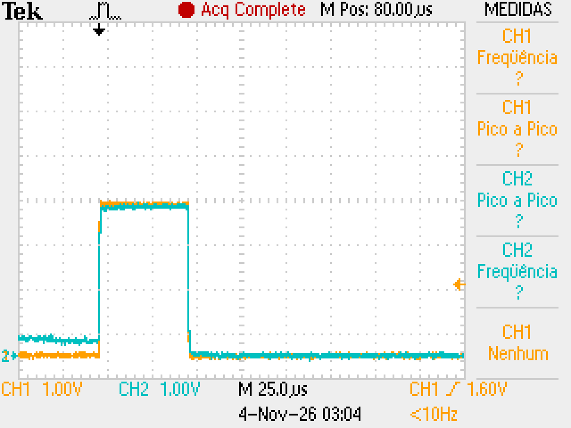

- t0 = início da transição do TX (TP2 sai da linha de base) = 0.60 µs na tela
- TP2: 0.000 → 3.381 V; **salto instantâneo em TP2 = 3.00 V (89 % do degrau)** — divisor 56/(330+56+R_GPIO) ≈ 14 % no RC; ≈ 100 % no Dupont
- TP3: V0 = 0.360 V, Vf (=TP2 final) = 3.381 V, no instante k* (46,9 µs após t0) = 3.354 V (99.1 % do degrau)
- t10 = 0.00 µs · t63 = 0.40 µs · t90 = 0.70 µs (medidos a partir de t0)
- **τ = t63 − t0 = 0.40 µs** · **t10-90 = 0.70 µs** (→ τ = t10-90/2,197 = 0.32 µs) · f_c = 1/(2πτ) = 397.9 kHz
- ISI: resíduo em TP3 no fim do 1º zero depois de A = -358 mV (previsto A·(1−e^(−Ts/τ))·e^(−Ts/τ) = 0 mV; resolução do osciloscópio ≈ 40 mV a 1 V/div)
- Rise Time automático do osciloscópio em TP3: 1.09 µs (usa min/max da tela inteira — só referência)
- Log do RX: `logs/Dupont_PAM4_20261103_163642.txt`
- RX: BER_amostra=0/100000
- RX: BER_filtro=0/100000
- RX: Modulação PAM-4 | canal: Dupont_direto | aquisição válida = 1 | sincronismo = 1
- RX: amostra única: Ne = 0 em 100000 bits -> BER = 0.00e+00 ; Ns = 0 em 50000 -> SER = 0.00e+00

Arquivos: `capturas/Dupont_PAM4_TP2_TP3_degrau_testeCLK_tela.png`, `Dupont_PAM4_TP2_TP3_degrau_testeCLK_CH1.csv`, `Dupont_PAM4_TP2_TP3_degrau_testeCLK_CH2.csv`


<details><summary>Saída completa do RX</summary>

```
Aguardando... quando aparecer #ARMADO, aperte RESET no TX.
#ARMADO PAM-4 canal=Dupont_direto : reinicie o TX (ou aperte KEY no TX)
#ARMADO PAM-4 canal=Dupont_direto : reinicie o TX (ou aperte KEY no TX)
>> recebendo relatório...
modulacao=PAM-4
canal=Dupont_direto
Rs_sym_s=20000
fa_amostras_s=160000
bordas_CLK=50420
simbolos_esperados=50420
simbolos_processados=50420
amostras_processadas=403360
posicao_DMA_1a_borda=496
amostras_descartadas_antes_CLK=5054960
bordas_com_contagem_errada=0
overrun_processamento=0
erro_ADC_overrun=0
perda_CLK=0
aquisicao_valida=1
b_c=25.42
E_c=132491920.0
p_c[0]=4069.58
p_c[1]=4069.58
p_c[2]=4069.58
p_c[3]=4069.58
p_c[4]=4069.58
p_c[5]=4069.58
p_c[6]=4069.58
p_c[7]=4069.58
ISI_zero_apos_A[0]=-20.47
ISI_zero_apos_A[1]=-20.77
ISI_zero_apos_A[2]=-20.72
ISI_zero_apos_A[3]=-20.72
ISI_zero_apos_A[4]=-21.42
ISI_zero_apos_A[5]=-21.02
ISI_zero_apos_A[6]=-20.87
ISI_zero_apos_A[7]=-21.17
separacao_k[0]=1219
separacao_k[1]=1212
separacao_k[2]=1214
separacao_k[3]=1211
separacao_k[4]=1218
separacao_k[5]=1217
separacao_k[6]=1217
separacao_k[7]=1218
k_estrela=0
t_k_estrela_us=3.12
centro_u[0]=4.34
centro_z[0]=-0.00517
centro_u[1]=1257.86
centro_z[1]=0.30231
centro_u[2]=2632.41
centro_z[2]=0.64024
centro_u[3]=4095.00
centro_z[3]=1.00000
limiar_u[0]=631.10
limiar_z[0]=0.14857
limiar_u[1]=1945.13
limiar_z[1]=0.47127
limiar_u[2]=3363.70
limiar_z[2]=0.82012
margem_u_ADC=1219
margem_u_mV_nominal=982.3
margem_u_par=0-1
margem_z=0.30316
margem_z_par=0-1
calibracao_ok=1
media8_nivel[0]=-20.92 (simbolo j=140, z=-0.00514)
media8_nivel[1]=1232.83 (simbolo j=141, z=0.30294)
media8_nivel[2]=2606.46 (simbolo j=144, z=0.64047)
media8_nivel[3]=4069.58 (simbolo j=143, z=1.00000)
inicio_quadro_erros_u=0
inicio_quadro_erros_z=0
sincronismo_ok=1
payload_bits=100000
payload_simbolos=50000
amostra_unica_Ne=0
amostra_unica_Ns=0
filtro_casado_Ne=0
filtro_casado_Ns=0
BER_amostra=0/100000
BER_filtro=0/100000
SER_amostra=0/50000
SER_filtro=0/50000
janela_exemplo_j=427
janela_exemplo_nivel_TX=3
janela a[0]=4095 x[0]=4069.58 p_c[0]=4069.58
janela a[1]=4095 x[1]=4069.58 p_c[1]=4069.58
janela a[2]=4095 x[2]=4069.58 p_c[2]=4069.58
janela a[3]=4095 x[3]=4069.58 p_c[3]=4069.58
janela a[4]=4095 x[4]=4069.58 p_c[4]=4069.58
janela a[5]=4095 x[5]=4069.58 p_c[5]=4069.58
janela a[6]=4095 x[6]=4069.58 p_c[6]=4069.58
janela a[7]=4095 x[7]=4069.58 p_c[7]=4069.58
janela_z=1.00000
#END_REPORT
#BEGIN_TRAIN j,nivel,a0,a1,a2,a3,a4,a5,a6,a7,z
#END_TRAIN
#BEGIN_PSD simbolo,nivel,a0,a1,a2,a3,a4,a5,a6,a7
>> log gravado em entrega/logs/Dupont_PAM4_20261103_163642.txt
================ Dupont_PAM4_20261103_163642 ================
Modulação PAM-4 | canal: Dupont_direto | aquisição válida = 1 | sincronismo = 1
Bordas de CLK = 50420 de 50420 ; amostras = 403360 (= 8 x 50420) ; descartadas antes do CLK = 5054960

-- Filtro casado (Seção 4.5.1) --
b_c = 25.42 códigos (20.5 mV)
p_c[k] = [4069.6 4069.6 4069.6 4069.6 4069.6 4069.6 4069.6 4069.6] códigos
E_c = 1.325e+08
ISI no 1º zero depois de A = [-20.5 -20.8 -20.7 -20.7 -21.4 -21.0 -20.9 -21.2] códigos
conferência com o firmware: max|Δp_c| = 0.00125, k* firmware = 0, k* Python = 0

-- Escolha de k* (Seção 4.3) --
  k=0  t= 3.12 us  menor separação =  1219 códigos (  982.3 mV)  <== k*
  k=1  t= 9.37 us  menor separação =  1212 códigos (  976.7 mV)
  k=2  t=15.62 us  menor separação =  1214 códigos (  978.3 mV)
  k=3  t=21.87 us  menor separação =  1211 códigos (  975.9 mV)
  k=4  t=28.12 us  menor separação =  1218 códigos (  981.5 mV)
  k=5  t=34.37 us  menor separação =  1217 códigos (  980.7 mV)
  k=6  t=40.62 us  menor separação =  1217 códigos (  980.7 mV)
  k=7  t=46.87 us  menor separação =  1218 códigos (  981.5 mV)

-- Centros, limiares, margens (Seção 4.5.2) --
centros u (códigos) = [4.3, 1257.9, 2632.4, 4095.0] ; em V = [0.004, 1.014, 2.121, 3.3]
limiares u (códigos) = [631.1, 1945.1, 3363.7] ; em V = [0.509, 1.568, 2.711]
centros z = [-0.0052, 0.3023, 0.6402, 1.0] ; limiares z = [0.1486, 0.4713, 0.8201]
margem amostra única = 1219 códigos = 982.3 mV (par de níveis 0-1, Gray 00/01)
margem filtro casado = 0.3032 (escala z; par 0-1)
margem relativa (margem / distância média entre centros): u = 0.89 , z = 0.90

-- Olho (1024 símbolos do payload) --
abertura vertical em t_k* = 3.12 us: 0.978 V (menor entre níveis vizinhos)
abertura por k (V) = [0.978, 0.971, 0.974, 0.975, 0.978, 0.975, 0.979, 0.978]

-- PSD (fa = 160 kHz, Vref = 3.3000 V, média retirada, Hann, N = 1024, 50%, 15 blocos) --
resolução = 156.25 Hz ; duração do registro = 51.2 ms ; potência AC = 1.4467 V^2 (var = 1.4670)
S(5 kHz)  = 1.583e-04 V^2/Hz (média de 5 bins 1.189e-04; teoria 1.230e-04)
S(10 kHz) = 1.907e-05 V^2/Hz (média de 5 bins 1.638e-05; teoria 1.242e-05)

-- Contagem de erros (firmware, mesmas amostras do payload) --
amostra única: Ne = 0 em 100000 bits -> BER = 0.00e+00 ; Ns = 0 em 50000 -> SER = 0.00e+00
filtro casado: Ne = 0 em 100000 bits -> BER = 0.00e+00 ; Ns = 0 em 50000 -> SER = 0.00e+00
  -> escrever "0 erros em 100.000 bits" (BER observada = 0, NÃO prova BER física nula;
     com 0 erros, limite superior de 95% ~ 3/100000 = 3e-5).

-- Janela real (símbolo j = 427, nível TX = 3) --
  k   a[k]    x[k]=a-b_c    p_c[k]       p_c*x
  0   4095     4069.58     4069.58    16561491.6
  1   4095     4069.58     4069.58    16561491.6
  2   4095     4069.58     4069.58    16561491.6
  3   4095     4069.58     4069.58    16561491.6
  4   4095     4069.58     4069.58    16561491.6
  5   4095     4069.58     4069.58    16561491.6
  6   4095     4069.58     4069.58    16561491.6
  7   4095     4069.58     4069.58    16561491.6
  soma = 132491932.4 ; E_c = 132491932.4 ; z = soma/E_c = 1.00000 (firmware: 1.0)

  [OK] Log completo até #END_PSD
  [OK] bordas_CLK = símbolos esperados (50420 = 50420)
  [OK] amostras = 8 × símbolos (403360 = 8 × 50420)
  [OK] bordas_com_contagem_errada = 0
  [OK] overrun_processamento = 0 e erro_ADC_overrun = 0
  [OK] perda_CLK = 0
  [OK] aquisicao_valida = 1
  [OK] calibracao_ok = 1 (centros em ordem crescente)
  [OK] sincronismo_ok = 1 (48 bits de início corretos)
figura: entrega/figuras/Dupont_PAM4_20261103_163642.png
figura: entrega/figuras/Dupont_PAM4_20261103_163642_z.png
```
</details>

## Manga PAM4 TP2 TP3 degrau — canal Manga, TX em PAM-4  ·  03/11/2026 16:53

- **Pontas:** CH1 = TP2 · CH2 = TP3
- **O que é:** 1º pulso 0→A do treinamento (A dura 1 símbolo): entrada (TP2) × saída (TP3). τ por t63 e t10-90; resíduo no zero seguinte = ISI.
- **Aquisições:** 1

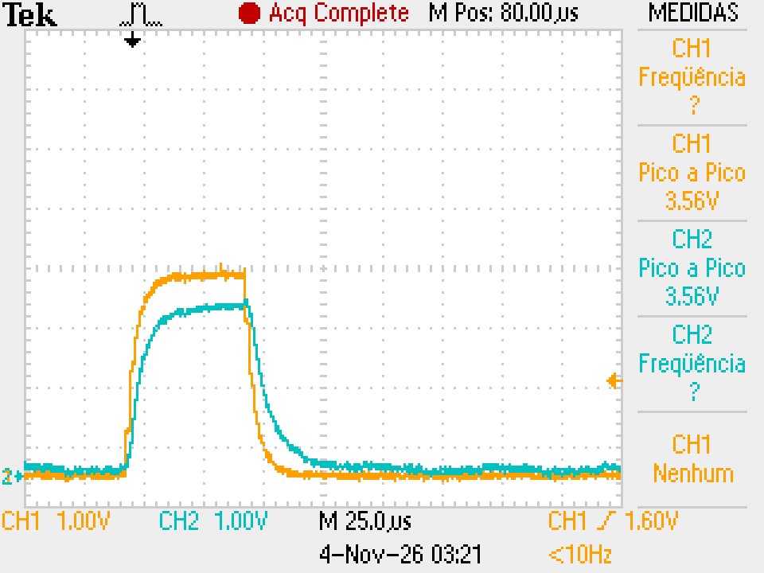

- t0 = início da transição do TX (TP2 sai da linha de base) = -2.40 µs na tela
- TP2: 0.000 → 3.375 V; **salto instantâneo em TP2 = 0.76 V (23 % do degrau)** — divisor 56/(330+56+R_GPIO) ≈ 14 % no RC; ≈ 100 % no Dupont
- TP3: V0 = 0.160 V, Vf (=TP2 final) = 3.375 V, no instante k* (46,9 µs após t0) = 2.847 V (83.6 % do degrau)
- t10 = 2.10 µs · t63 = 9.40 µs · t90 = nan µs (medidos a partir de t0)
- **τ = t63 − t0 = 9.40 µs** · **t10-90 = nan µs** (→ τ = t10-90/2,197 = nan µs) · f_c = 1/(2πτ) = 16.9 kHz
- ISI: resíduo em TP3 no fim do 1º zero depois de A = -19 mV (previsto A·(1−e^(−Ts/τ))·e^(−Ts/τ) = 16 mV; resolução do osciloscópio ≈ 40 mV a 1 V/div)
- Rise Time automático do osciloscópio em TP3: 12.55 µs (usa min/max da tela inteira — só referência)
- Log do RX: `logs/Manga_PAM4_20261103_165336.txt`
- RX: BER_amostra=0/100000
- RX: BER_filtro=14/100000
- RX: Modulação PAM-4 | canal: cabo_manga_200m | aquisição válida = 1 | sincronismo = 1
- RX: amostra única: Ne = 0 em 100000 bits -> BER = 0.00e+00 ; Ns = 0 em 50000 -> SER = 0.00e+00

Arquivos: `capturas/Manga_PAM4_TP2_TP3_degrau_tela.png`, `Manga_PAM4_TP2_TP3_degrau_CH1.csv`, `Manga_PAM4_TP2_TP3_degrau_CH2.csv`

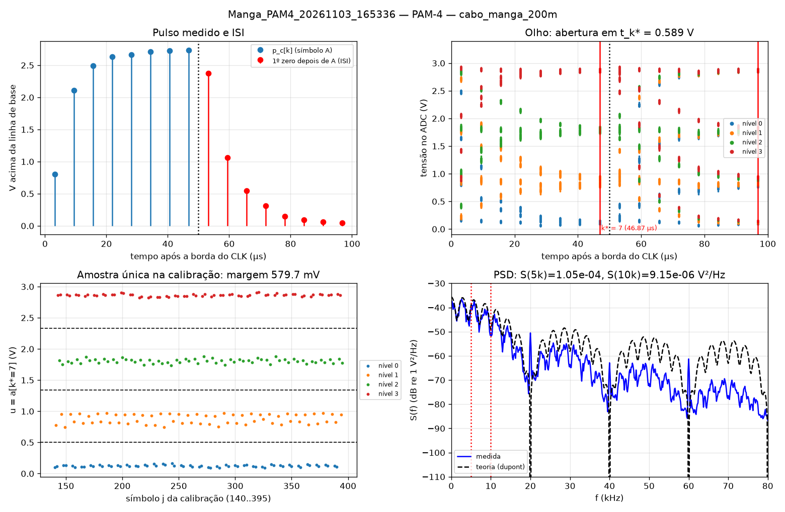


<details><summary>Saída completa do RX</summary>

```
Aguardando... quando aparecer #ARMADO, aperte RESET no TX.
#ARMADO PAM-4 canal=Dupont_direto : reinicie o TX (ou aperte KEY no TX)
#ARMADO PAM-4 canal=cabo_manga_200m : reinicie o TX (ou aperte KEY no TX)
>> recebendo relatório...
modulacao=PAM-4
canal=cabo_manga_200m
Rs_sym_s=20000
fa_amostras_s=160000
bordas_CLK=50420
simbolos_esperados=50420
simbolos_processados=50420
amostras_processadas=403360
posicao_DMA_1a_borda=168
amostras_descartadas_antes_CLK=16370856
bordas_com_contagem_errada=0
overrun_processamento=0
erro_ADC_overrun=0
perda_CLK=0
aquisicao_valida=1
b_c=136.42
E_c=73496240.0
p_c[0]=1000.98
p_c[1]=2621.13
p_c[2]=3098.73
p_c[3]=3273.03
p_c[4]=3306.83
p_c[5]=3365.18
p_c[6]=3388.53
p_c[7]=3401.08
ISI_zero_apos_A[0]=2951.93
ISI_zero_apos_A[1]=1317.88
ISI_zero_apos_A[2]=678.28
ISI_zero_apos_A[3]=388.23
ISI_zero_apos_A[4]=179.38
ISI_zero_apos_A[5]=118.33
ISI_zero_apos_A[6]=80.68
ISI_zero_apos_A[7]=55.03
separacao_k[0]=-2481
separacao_k[1]=-706
separacao_k[2]=4
separacao_k[3]=346
separacao_k[4]=503
separacao_k[5]=635
separacao_k[6]=687
separacao_k[7]=720
k_estrela=7
t_k_estrela_us=46.87
centro_u[0]=154.17
centro_z[0]=0.08179
centro_u[1]=1091.13
centro_z[1]=0.34761
centro_u[2]=2244.52
centro_z[2]=0.70021
centro_u[3]=3555.38
centro_z[3]=1.02751
limiar_u[0]=622.65
limiar_z[0]=0.21470
limiar_u[1]=1667.82
limiar_z[1]=0.52391
limiar_u[2]=2899.95
limiar_z[2]=0.86386
margem_u_ADC=720
margem_u_mV_nominal=580.2
margem_u_par=0-1
margem_z=0.08955
margem_z_par=0-1
calibracao_ok=1
media8_nivel[0]=1.46 (simbolo j=140, z=-0.00167)
media8_nivel[1]=622.83 (simbolo j=141, z=0.21720)
media8_nivel[2]=2550.33 (simbolo j=144, z=0.78320)
media8_nivel[3]=2940.21 (simbolo j=143, z=1.00432)
inicio_quadro_erros_u=0
inicio_quadro_erros_z=0
sincronismo_ok=1
payload_bits=100000
payload_simbolos=50000
amostra_unica_Ne=0
amostra_unica_Ns=0
filtro_casado_Ne=14
filtro_casado_Ns=14
BER_amostra=0/100000
BER_filtro=14/100000
SER_amostra=0/50000
SER_filtro=14/50000
janela_exemplo_j=427
janela_exemplo_nivel_TX=3
janela a[0]=2547 x[0]=2410.58 p_c[0]=1000.98
janela a[1]=3185 x[1]=3048.58 p_c[1]=2621.13
janela a[2]=3395 x[2]=3258.58 p_c[2]=3098.73
janela a[3]=3489 x[3]=3352.58 p_c[3]=3273.03
janela a[4]=3481 x[4]=3344.58 p_c[4]=3306.83
janela a[5]=3524 x[5]=3387.58 p_c[5]=3365.18
janela a[6]=3549 x[6]=3412.58 p_c[6]=3388.53
janela a[7]=3549 x[7]=3412.58 p_c[7]=3401.08
janela_z=1.04909
#END_REPORT
#BEGIN_TRAIN j,nivel,a0,a1,a2,a3,a4,a5,a6,a7,z
#END_TRAIN
#BEGIN_PSD simbolo,nivel,a0,a1,a2,a3,a4,a5,a6,a7
>> log gravado em entrega/logs/Manga_PAM4_20261103_165336.txt
================ Manga_PAM4_20261103_165336 ================
Modulação PAM-4 | canal: cabo_manga_200m | aquisição válida = 1 | sincronismo = 1
Bordas de CLK = 50420 de 50420 ; amostras = 403360 (= 8 x 50420) ; descartadas antes do CLK = 16370856

-- Filtro casado (Seção 4.5.1) --
b_c = 136.42 códigos (109.8 mV)
p_c[k] = [1001.0 2621.1 3098.7 3273.0 3306.8 3365.2 3388.5 3401.1] códigos
E_c = 7.35e+07
ISI no 1º zero depois de A = [2951.9 1317.9 678.3 388.2 179.4 118.3 80.7 55.0] códigos
conferência com o firmware: max|Δp_c| = 0.00125, k* firmware = 7, k* Python = 7

-- Escolha de k* (Seção 4.3) --
  k=0  t= 3.12 us  menor separação = -2481 códigos (-1997.5 mV)
  k=1  t= 9.37 us  menor separação =  -706 códigos ( -568.4 mV)
  k=2  t=15.62 us  menor separação =     4 códigos (    3.2 mV)
  k=3  t=21.87 us  menor separação =   346 códigos (  278.6 mV)
  k=4  t=28.12 us  menor separação =   503 códigos (  405.0 mV)
  k=5  t=34.37 us  menor separação =   635 códigos (  511.3 mV)
  k=6  t=40.62 us  menor separação =   687 códigos (  553.1 mV)
  k=7  t=46.87 us  menor separação =   720 códigos (  579.7 mV)  <== k*

-- Centros, limiares, margens (Seção 4.5.2) --
centros u (códigos) = [154.2, 1091.1, 2244.5, 3555.4] ; em V = [0.124, 0.878, 1.807, 2.863]
limiares u (códigos) = [622.6, 1667.8, 2899.9] ; em V = [0.501, 1.343, 2.335]
centros z = [0.0818, 0.3476, 0.7002, 1.0275] ; limiares z = [0.2147, 0.5239, 0.8639]
margem amostra única = 720 códigos = 579.7 mV (par de níveis 0-1, Gray 00/01)
margem filtro casado = 0.0895 (escala z; par 0-1)
margem relativa (margem / distância média entre centros): u = 0.64 , z = 0.28

-- Olho (1024 símbolos do payload) --
abertura vertical em t_k* = 46.87 us: 0.589 V (menor entre níveis vizinhos)
abertura por k (V) = [-2.375, -0.772, -0.089, 0.229, 0.38, 0.474, 0.549, 0.589]

-- PSD (fa = 160 kHz, Vref = 3.2970 V, média retirada, Hann, N = 1024, 50%, 15 blocos) --
resolução = 156.25 Hz ; duração do registro = 51.2 ms ; potência AC = 0.8751 V^2 (var = 0.8877)
S(5 kHz)  = 1.048e-04 V^2/Hz (média de 5 bins 7.935e-05; teoria 1.228e-04)
S(10 kHz) = 9.150e-06 V^2/Hz (média de 5 bins 8.077e-06; teoria 1.240e-05)

-- Contagem de erros (firmware, mesmas amostras do payload) --
amostra única: Ne = 0 em 100000 bits -> BER = 0.00e+00 ; Ns = 0 em 50000 -> SER = 0.00e+00
filtro casado: Ne = 14 em 100000 bits -> BER = 1.40e-04 ; Ns = 14 em 50000 -> SER = 2.80e-04
  -> escrever "0 erros em 100.000 bits" (BER observada = 0, NÃO prova BER física nula;
     com 0 erros, limite superior de 95% ~ 3/100000 = 3e-5).

-- Janela real (símbolo j = 427, nível TX = 3) --
  k   a[k]    x[k]=a-b_c    p_c[k]       p_c*x
  0   2547     2410.58     1000.98     2412946.6
  1   3185     3048.58     2621.13     7990731.6
  2   3395     3258.58     3098.73    10097467.6
  3   3489     3352.58     3273.03    10973103.2
  4   3481     3344.58     3306.83    11059965.8
  5   3524     3387.58     3365.18    11399824.9
  6   3549     3412.58     3388.53    11563638.2
  7   3549     3412.58     3401.08    11606466.1
  soma = 77104144.0 ; E_c = 73496236.9 ; z = soma/E_c = 1.04909 (firmware: 1.04909)

  [OK] Log completo até #END_PSD
  [OK] bordas_CLK = símbolos esperados (50420 = 50420)
  [OK] amostras = 8 × símbolos (403360 = 8 × 50420)
  [OK] bordas_com_contagem_errada = 0
  [OK] overrun_processamento = 0 e erro_ADC_overrun = 0
  [OK] perda_CLK = 0
  [OK] aquisicao_valida = 1
  [OK] calibracao_ok = 1 (centros em ordem crescente)
  [OK] sincronismo_ok = 1 (48 bits de início corretos)
figura: entrega/figuras/Manga_PAM4_20261103_165336.png
figura: entrega/figuras/Manga_PAM4_20261103_165336_z.png
```
</details>

## Manga PAM2 TP2 TP3 degrau — canal Manga, TX em PAM-2  ·  03/11/2026 16:54

- **Pontas:** CH1 = TP2 · CH2 = TP3
- **O que é:** 1º pulso 0→A do treinamento (A dura 1 símbolo): entrada (TP2) × saída (TP3). τ por t63 e t10-90; resíduo no zero seguinte = ISI.
- **Aquisições:** 1


- t0 = início da transição do TX (TP2 sai da linha de base) = -2.40 µs na tela
- TP2: 0.000 → 3.365 V; **salto instantâneo em TP2 = 0.76 V (23 % do degrau)** — divisor 56/(330+56+R_GPIO) ≈ 14 % no RC; ≈ 100 % no Dupont
- TP3: V0 = 0.040 V, Vf (=TP2 final) = 3.365 V, no instante k* (46,9 µs após t0) = 3.162 V (93.9 % do degrau)
- t10 = 1.60 µs · t63 = 7.30 µs · t90 = 19.40 µs (medidos a partir de t0)
- **τ = t63 − t0 = 7.30 µs** · **t10-90 = 17.80 µs** (→ τ = t10-90/2,197 = 8.10 µs) · f_c = 1/(2πτ) = 21.8 kHz
- ISI: resíduo em TP3 no fim do 1º zero depois de A = +16 mV (previsto A·(1−e^(−Ts/τ))·e^(−Ts/τ) = 4 mV; resolução do osciloscópio ≈ 40 mV a 1 V/div)
- Rise Time automático do osciloscópio em TP3: 11.90 µs (usa min/max da tela inteira — só referência)
- Log do RX: `logs/Manga_PAM2_20261103_165439.txt`
- RX: BER_amostra=0/100000
- RX: BER_filtro=0/100000
- RX: Modulação PAM-2 | canal: cabo_manga_200m | aquisição válida = 1 | sincronismo = 1
- RX: amostra única: Ne = 0 em 100000 bits -> BER = 0.00e+00 ; Ns = 0 em 100000 -> SER = 0.00e+00

Arquivos: `capturas/Manga_PAM2_TP2_TP3_degrau_tela.png`, `Manga_PAM2_TP2_TP3_degrau_CH1.csv`, `Manga_PAM2_TP2_TP3_degrau_CH2.csv`


<details><summary>Saída completa do RX</summary>

```
Aguardando... quando aparecer #ARMADO, aperte RESET no TX.
#ARMADO PAM-2 canal=cabo_manga_200m : reinicie o TX (ou aperte KEY no TX)
#ARMADO PAM-2 canal=cabo_manga_200m : reinicie o TX (ou aperte KEY no TX)
>> recebendo relatório...
modulacao=PAM-2
canal=cabo_manga_200m
Rs_sym_s=20000
fa_amostras_s=160000
bordas_CLK=100444
simbolos_esperados=100444
simbolos_processados=100444
amostras_processadas=803552
posicao_DMA_1a_borda=26
amostras_descartadas_antes_CLK=4722202
bordas_com_contagem_errada=0
overrun_processamento=0
erro_ADC_overrun=0
perda_CLK=0
aquisicao_valida=1
b_c=26.84
E_c=98893168.0
p_c[0]=1222.56
p_c[1]=3087.91
p_c[2]=3633.21
p_c[3]=3806.01
p_c[4]=3837.71
p_c[5]=3882.06
p_c[6]=3894.81
p_c[7]=3899.91
ISI_zero_apos_A[0]=2882.01
ISI_zero_apos_A[1]=947.31
ISI_zero_apos_A[2]=326.61
ISI_zero_apos_A[3]=126.66
ISI_zero_apos_A[4]=28.66
ISI_zero_apos_A[5]=22.11
ISI_zero_apos_A[6]=15.31
ISI_zero_apos_A[7]=11.06
separacao_k[0]=-1881
separacao_k[1]=1892
separacao_k[2]=3140
separacao_k[3]=3563
separacao_k[4]=3717
separacao_k[5]=3791
separacao_k[6]=3816
separacao_k[7]=3830
k_estrela=7
t_k_estrela_us=46.87
centro_u[0]=34.11
centro_z[0]=0.06234
centro_u[1]=3938.68
centro_z[1]=1.02148
limiar_u[0]=1986.39
limiar_z[0]=0.54191
margem_u_ADC=3830
margem_u_mV_nominal=3086.4
margem_u_par=0-1
margem_z=0.88587
margem_z_par=0-1
calibracao_ok=1
media8_nivel[0]=-14.09 (simbolo j=140, z=-0.00428)
media8_nivel[1]=3424.66 (simbolo j=141, z=1.00575)
inicio_quadro_erros_u=0
inicio_quadro_erros_z=0
sincronismo_ok=1
payload_bits=100000
payload_simbolos=100000
amostra_unica_Ne=0
amostra_unica_Ns=0
filtro_casado_Ne=0
filtro_casado_Ns=0
BER_amostra=0/100000
BER_filtro=0/100000
SER_amostra=0/100000
SER_filtro=0/100000
janela_exemplo_j=451
janela_exemplo_nivel_TX=1
janela a[0]=4040 x[0]=4013.16 p_c[0]=1222.56
janela a[1]=4022 x[1]=3995.16 p_c[1]=3087.91
janela a[2]=4019 x[2]=3992.16 p_c[2]=3633.21
janela a[3]=4021 x[3]=3994.16 p_c[3]=3806.01
janela a[4]=4001 x[4]=3974.16 p_c[4]=3837.71
janela a[5]=4020 x[5]=3993.16 p_c[5]=3882.06
janela a[6]=4025 x[6]=3998.16 p_c[6]=3894.81
janela a[7]=4021 x[7]=3994.16 p_c[7]=3899.91
janela_z=1.10070
#END_REPORT
#BEGIN_TRAIN j,nivel,a0,a1,a2,a3,a4,a5,a6,a7,z
#END_TRAIN
#BEGIN_PSD simbolo,nivel,a0,a1,a2,a3,a4,a5,a6,a7
>> log gravado em entrega/logs/Manga_PAM2_20261103_165439.txt
================ Manga_PAM2_20261103_165439 ================
Modulação PAM-2 | canal: cabo_manga_200m | aquisição válida = 1 | sincronismo = 1
Bordas de CLK = 100444 de 100444 ; amostras = 803552 (= 8 x 100444) ; descartadas antes do CLK = 4722202

-- Filtro casado (Seção 4.5.1) --
b_c = 26.84 códigos (21.6 mV)
p_c[k] = [1222.6 3087.9 3633.2 3806.0 3837.7 3882.1 3894.8 3899.9] códigos
E_c = 9.889e+07
ISI no 1º zero depois de A = [2882.0 947.3 326.6 126.7 28.7 22.1 15.3 11.1] códigos
conferência com o firmware: max|Δp_c| = 0.0025, k* firmware = 7, k* Python = 7

-- Escolha de k* (Seção 4.3) --
  k=0  t= 3.12 us  menor separação = -1881 códigos (-1514.4 mV)
  k=1  t= 9.37 us  menor separação =  1892 códigos ( 1523.3 mV)
  k=2  t=15.62 us  menor separação =  3140 códigos ( 2528.1 mV)
  k=3  t=21.87 us  menor separação =  3563 códigos ( 2868.7 mV)
  k=4  t=28.12 us  menor separação =  3717 códigos ( 2992.7 mV)
  k=5  t=34.37 us  menor separação =  3791 códigos ( 3052.2 mV)
  k=6  t=40.62 us  menor separação =  3816 códigos ( 3072.4 mV)
  k=7  t=46.87 us  menor separação =  3830 códigos ( 3083.6 mV)  <== k*

-- Centros, limiares, margens (Seção 4.5.2) --
centros u (códigos) = [34.1, 3938.7] ; em V = [0.027, 3.171]
limiares u (códigos) = [1986.4] ; em V = [1.599]
centros z = [0.0623, 1.0215] ; limiares z = [0.5419]
margem amostra única = 3830 códigos = 3083.6 mV (par de níveis 0-1)
margem filtro casado = 0.8859 (escala z; par 0-1)
margem relativa (margem / distância média entre centros): u = 0.98 , z = 0.92

-- Olho (1024 símbolos do payload) --
abertura vertical em t_k* = 46.87 us: 3.208 V (menor entre níveis vizinhos)
abertura por k (V) = [-0.75, 2.241, 2.942, 3.122, 3.167, 3.197, 3.21, 3.208]

-- PSD (fa = 160 kHz, Vref = 3.2970 V, média retirada, Hann, N = 1024, 50%, 15 blocos) --
resolução = 156.25 Hz ; duração do registro = 51.2 ms ; potência AC = 2.3531 V^2 (var = 2.3556)
S(5 kHz)  = 2.633e-04 V^2/Hz (média de 5 bins 1.975e-04; teoria 2.210e-04)
S(10 kHz) = 1.410e-04 V^2/Hz (média de 5 bins 9.161e-05; teoria 1.116e-04)

-- Contagem de erros (firmware, mesmas amostras do payload) --
amostra única: Ne = 0 em 100000 bits -> BER = 0.00e+00 ; Ns = 0 em 100000 -> SER = 0.00e+00
filtro casado: Ne = 0 em 100000 bits -> BER = 0.00e+00 ; Ns = 0 em 100000 -> SER = 0.00e+00
  -> escrever "0 erros em 100.000 bits" (BER observada = 0, NÃO prova BER física nula;
     com 0 erros, limite superior de 95% ~ 3/100000 = 3e-5).

-- Janela real (símbolo j = 451, nível TX = 1) --
  k   a[k]    x[k]=a-b_c    p_c[k]       p_c*x
  0   4040     4013.16     1222.56     4906342.0
  1   4022     3995.16     3087.91    12336712.2
  2   4019     3992.16     3633.21    14504374.7
  3   4021     3994.16     3806.01    15201832.4
  4   4001     3974.16     3837.71    15251693.1
  5   4020     3993.16     3882.06    15501706.4
  6   4025     3998.16     3894.81    15572093.3
  7   4021     3994.16     3899.91    15576884.3
  soma = 108851638.3 ; E_c = 98893155.3 ; z = soma/E_c = 1.10070 (firmware: 1.1007)

  [OK] Log completo até #END_PSD
  [OK] bordas_CLK = símbolos esperados (100444 = 100444)
  [OK] amostras = 8 × símbolos (803552 = 8 × 100444)
  [OK] bordas_com_contagem_errada = 0
  [OK] overrun_processamento = 0 e erro_ADC_overrun = 0
  [OK] perda_CLK = 0
  [OK] aquisicao_valida = 1
  [OK] calibracao_ok = 1 (centros em ordem crescente)
  [OK] sincronismo_ok = 1 (48 bits de início corretos)
figura: entrega/figuras/Manga_PAM2_20261103_165439.png
figura: entrega/figuras/Manga_PAM2_20261103_165439_z.png
```
</details>

## Manga PAM2 olho osc — canal Manga, TX em PAM-2  ·  03/11/2026 16:56

- **Pontas:** CH1 = TP3 · CH2 = CLK
- **O que é:** Diagrama de olho em TP3, disparo na subida do CLK, persistência infinita. k* = 7 ↔ 46,87 µs depois da borda.
- **Aquisições:** 480


- Persistência infinita: ver a tela. A abertura em k* sai do log do RX (ensaio).
- Log do RX: **inválido** (`perda_CLK=1` após 31 326 bordas ≈ 1,6 s). A tela mostra curvas exponenciais no CH2 (azul) = a ponta do CH2 ainda estava em TP3 no início do quadro e foi movida para o CLK durante a transmissão — ao encaixar a garra no PB4 o CLK falhou. Movido para `logs/invalidos/`; ensaio repetido.
- RX: BER=NAO_ATRIBUIDA (quadro invalido ou sem sincronismo: repita o ensaio)
- RX: Modulação PAM-2 | canal: cabo_manga_200m | aquisição válida = 0 | sincronismo = 1
- RX: SEM BER: quadro inválido ou sem sincronismo -> repetir o ensaio.

Arquivos: `capturas/Manga_PAM2_olho_osc_tela.png`, `Manga_PAM2_olho_osc_CH1.csv`, `Manga_PAM2_olho_osc_CH2.csv`


<details><summary>Saída completa do RX</summary>

```
Aguardando... quando aparecer #ARMADO, aperte RESET no TX.
#ARMADO PAM-2 canal=cabo_manga_200m : reinicie o TX (ou aperte KEY no TX)
#ARMADO PAM-2 canal=cabo_manga_200m : reinicie o TX (ou aperte KEY no TX)
>> recebendo relatório...
modulacao=PAM-2
canal=cabo_manga_200m
Rs_sym_s=20000
fa_amostras_s=160000
bordas_CLK=31326
simbolos_esperados=100444
simbolos_processados=31306
amostras_processadas=250448
posicao_DMA_1a_borda=431
amostras_descartadas_antes_CLK=9799087
bordas_com_contagem_errada=0
overrun_processamento=0
erro_ADC_overrun=0
perda_CLK=1
aquisicao_valida=0
b_c=6.96
E_c=117493640.0
p_c[0]=2407.49
p_c[1]=3667.84
p_c[2]=3955.04
p_c[3]=4032.09
p_c[4]=4059.24
p_c[5]=4070.54
p_c[6]=4078.24
p_c[7]=4082.34
ISI_zero_apos_A[0]=1685.94
ISI_zero_apos_A[1]=424.64
ISI_zero_apos_A[2]=133.54
ISI_zero_apos_A[3]=57.59
ISI_zero_apos_A[4]=31.09
ISI_zero_apos_A[5]=20.84
ISI_zero_apos_A[6]=15.44
ISI_zero_apos_A[7]=11.84
separacao_k[0]=593
separacao_k[1]=3225
separacao_k[2]=3810
separacao_k[3]=3965
separacao_k[4]=4018
separacao_k[5]=4025
separacao_k[6]=4050
separacao_k[7]=4053
k_estrela=7
t_k_estrela_us=46.87
centro_u[0]=19.05
centro_z[0]=0.04368
centro_u[1]=4093.64
centro_z[1]=1.01553
limiar_u[0]=2056.34
limiar_z[0]=0.52961
margem_u_ADC=4053
margem_u_mV_nominal=3266.2
margem_u_par=0-1
margem_z=0.93973
margem_z_par=0-1
calibracao_ok=1
media8_nivel[0]=0.79 (simbolo j=140, z=0.00019)
media8_nivel[1]=3795.29 (simbolo j=141, z=1.00025)
inicio_quadro_erros_u=0
inicio_quadro_erros_z=0
sincronismo_ok=1
payload_bits=30862
payload_simbolos=30862
BER=NAO_ATRIBUIDA (quadro invalido ou sem sincronismo: repita o ensaio)
janela_exemplo_j=451
janela_exemplo_nivel_TX=1
janela a[0]=4095 x[0]=4088.04 p_c[0]=2407.49
janela a[1]=4095 x[1]=4088.04 p_c[1]=3667.84
janela a[2]=4095 x[2]=4088.04 p_c[2]=3955.04
janela a[3]=4095 x[3]=4088.04 p_c[3]=4032.09
janela a[4]=4095 x[4]=4088.04 p_c[4]=4059.24
janela a[5]=4095 x[5]=4088.04 p_c[5]=4070.54
janela a[6]=4095 x[6]=4088.04 p_c[6]=4078.24
janela a[7]=4095 x[7]=4088.04 p_c[7]=4082.34
janela_z=1.05609
#END_REPORT
#BEGIN_TRAIN j,nivel,a0,a1,a2,a3,a4,a5,a6,a7,z
#END_TRAIN
#BEGIN_PSD simbolo,nivel,a0,a1,a2,a3,a4,a5,a6,a7
>> log gravado em entrega/logs/Manga_PAM2_20261103_165603.txt
================ Manga_PAM2_20261103_165603 ================
Modulação PAM-2 | canal: cabo_manga_200m | aquisição válida = 0 | sincronismo = 1
Bordas de CLK = 31326 de 100444 ; amostras = 250448 (= 8 x 31306) ; descartadas antes do CLK = 9799087

-- Filtro casado (Seção 4.5.1) --
b_c = 6.96 códigos (5.6 mV)
p_c[k] = [2407.5 3667.8 3955.0 4032.1 4059.2 4070.5 4078.2 4082.3] códigos
E_c = 1.175e+08
ISI no 1º zero depois de A = [1685.9 424.6 133.5 57.6 31.1 20.8 15.4 11.8] códigos
conferência com o firmware: max|Δp_c| = 0.00375, k* firmware = 7, k* Python = 7

-- Escolha de k* (Seção 4.3) --
  k=0  t= 3.12 us  menor separação =   593 códigos (  477.4 mV)
  k=1  t= 9.37 us  menor separação =  3225 códigos ( 2596.5 mV)
  k=2  t=15.62 us  menor separação =  3810 códigos ( 3067.5 mV)
  k=3  t=21.87 us  menor separação =  3965 códigos ( 3192.3 mV)
  k=4  t=28.12 us  menor separação =  4018 códigos ( 3235.0 mV)
  k=5  t=34.37 us  menor separação =  4025 códigos ( 3240.6 mV)
  k=6  t=40.62 us  menor separação =  4050 códigos ( 3260.8 mV)
  k=7  t=46.87 us  menor separação =  4053 códigos ( 3263.2 mV)  <== k*

-- Centros, limiares, margens (Seção 4.5.2) --
centros u (códigos) = [19.0, 4093.6] ; em V = [0.015, 3.296]
limiares u (códigos) = [2056.3] ; em V = [1.656]
centros z = [0.0437, 1.0155] ; limiares z = [0.5296]
margem amostra única = 4053 códigos = 3263.2 mV (par de níveis 0-1)
margem filtro casado = 0.9397 (escala z; par 0-1)
margem relativa (margem / distância média entre centros): u = 0.99 , z = 0.97

-- Olho (1024 símbolos do payload) --
abertura vertical em t_k* = 46.87 us: 3.264 V (menor entre níveis vizinhos)
abertura por k (V) = [0.526, 2.589, 3.055, 3.183, 3.209, 3.246, 3.257, 3.264]

-- PSD (fa = 160 kHz, Vref = 3.2970 V, média retirada, Hann, N = 1024, 50%, 15 blocos) --
resolução = 156.25 Hz ; duração do registro = 51.2 ms ; potência AC = 2.4387 V^2 (var = 2.4410)
S(5 kHz)  = 2.703e-04 V^2/Hz (média de 5 bins 2.026e-04; teoria 2.210e-04)
S(10 kHz) = 1.461e-04 V^2/Hz (média de 5 bins 9.492e-05; teoria 1.116e-04)

-- Contagem de erros (firmware, mesmas amostras do payload) --
SEM BER: quadro inválido ou sem sincronismo -> repetir o ensaio.

-- Janela real (símbolo j = 451, nível TX = 1) --
  k   a[k]    x[k]=a-b_c    p_c[k]       p_c*x
  0   4095     4088.04     2407.49     9841939.8
  1   4095     4088.04     3667.84    14994305.7
  2   4095     4088.04     3955.04    16168391.9
  3   4095     4088.04     4032.09    16483375.7
  4   4095     4088.04     4059.24    16594366.0
  5   4095     4088.04     4070.54    16640560.9
  6   4095     4088.04     4078.24    16672038.9
  7   4095     4088.04     4082.34    16688799.9
  soma = 124083778.7 ; E_c = 117493643.8 ; z = soma/E_c = 1.05609 (firmware: 1.05609)

  [OK] Log completo até #END_PSD
  [FALHOU] bordas_CLK = símbolos esperados (31326 = 100444)
  [OK] amostras = 8 × símbolos (250448 = 8 × 31306)
  [OK] bordas_com_contagem_errada = 0
  [OK] overrun_processamento = 0 e erro_ADC_overrun = 0
  [FALHOU] perda_CLK = 0
  [FALHOU] aquisicao_valida = 1
  [OK] calibracao_ok = 1 (centros em ordem crescente)
  [OK] sincronismo_ok = 1 (48 bits de início corretos)
figura: entrega/figuras/Manga_PAM2_20261103_165603.png
figura: entrega/figuras/Manga_PAM2_20261103_165603_z.png
```
</details>

## Manga PAM2 olho osc — canal Manga, TX em PAM-2  ·  03/11/2026 16:58

- **Pontas:** CH1 = TP3 · CH2 = CLK
- **O que é:** Diagrama de olho em TP3, disparo na subida do CLK, persistência infinita. k* = 7 ↔ 46,87 µs depois da borda.
- **Aquisições:** 482


- Persistência infinita: ver a tela. A abertura em k* sai do log do RX (ensaio).
- Log do RX: `logs/Manga_PAM2_20261103_165756.txt`
- RX: BER_amostra=0/100000
- RX: BER_filtro=0/100000
- RX: Modulação PAM-2 | canal: cabo_manga_200m | aquisição válida = 1 | sincronismo = 1
- RX: amostra única: Ne = 0 em 100000 bits -> BER = 0.00e+00 ; Ns = 0 em 100000 -> SER = 0.00e+00

Arquivos: `capturas/Manga_PAM2_olho_osc_tela.png`, `Manga_PAM2_olho_osc_CH1.csv`, `Manga_PAM2_olho_osc_CH2.csv`


<details><summary>Saída completa do RX</summary>

```
Aguardando... quando aparecer #ARMADO, aperte RESET no TX.
#ARMADO PAM-2 canal=cabo_manga_200m : reinicie o TX (ou aperte KEY no TX)
#ARMADO PAM-2 canal=cabo_manga_200m : reinicie o TX (ou aperte KEY no TX)
>> recebendo relatório...
modulacao=PAM-2
canal=cabo_manga_200m
Rs_sym_s=20000
fa_amostras_s=160000
bordas_CLK=100444
simbolos_esperados=100444
simbolos_processados=100444
amostras_processadas=803552
posicao_DMA_1a_borda=413
amostras_descartadas_antes_CLK=11246493
bordas_com_contagem_errada=0
overrun_processamento=0
erro_ADC_overrun=0
perda_CLK=0
aquisicao_valida=1
b_c=7.51
E_c=117510632.0
p_c[0]=2406.84
p_c[1]=3668.59
p_c[2]=3956.19
p_c[3]=4034.24
p_c[4]=4059.19
p_c[5]=4071.44
p_c[6]=4077.14
p_c[7]=4081.19
ISI_zero_apos_A[0]=1686.99
ISI_zero_apos_A[1]=423.59
ISI_zero_apos_A[2]=132.74
ISI_zero_apos_A[3]=57.19
ISI_zero_apos_A[4]=30.54
ISI_zero_apos_A[5]=21.29
ISI_zero_apos_A[6]=15.24
ISI_zero_apos_A[7]=11.79
separacao_k[0]=602
separacao_k[1]=3222
separacao_k[2]=3799
separacao_k[3]=3963
separacao_k[4]=4017
separacao_k[5]=4042
separacao_k[6]=4051
separacao_k[7]=4057
k_estrela=7
t_k_estrela_us=46.87
centro_u[0]=18.72
centro_z[0]=0.04337
centro_u[1]=4093.32
centro_z[1]=1.01528
limiar_u[0]=2056.02
limiar_z[0]=0.52933
margem_u_ADC=4057
margem_u_mV_nominal=3269.4
margem_u_par=0-1
margem_z=0.93936
margem_z_par=0-1
calibracao_ok=1
media8_nivel[0]=0.36 (simbolo j=140, z=0.00007)
media8_nivel[1]=3796.86 (simbolo j=141, z=1.00042)
inicio_quadro_erros_u=0
inicio_quadro_erros_z=0
sincronismo_ok=1
payload_bits=100000
payload_simbolos=100000
amostra_unica_Ne=0
amostra_unica_Ns=0
filtro_casado_Ne=0
filtro_casado_Ns=0
BER_amostra=0/100000
BER_filtro=0/100000
SER_amostra=0/100000
SER_filtro=0/100000
janela_exemplo_j=451
janela_exemplo_nivel_TX=1
janela a[0]=4095 x[0]=4087.49 p_c[0]=2406.84
janela a[1]=4095 x[1]=4087.49 p_c[1]=3668.59
janela a[2]=4095 x[2]=4087.49 p_c[2]=3956.19
janela a[3]=4095 x[3]=4087.49 p_c[3]=4034.24
janela a[4]=4095 x[4]=4087.49 p_c[4]=4059.19
janela a[5]=4095 x[5]=4087.49 p_c[5]=4071.44
janela a[6]=4095 x[6]=4087.49 p_c[6]=4077.14
janela a[7]=4095 x[7]=4087.49 p_c[7]=4081.19
janela_z=1.05586
#END_REPORT
#BEGIN_TRAIN j,nivel,a0,a1,a2,a3,a4,a5,a6,a7,z
#END_TRAIN
#BEGIN_PSD simbolo,nivel,a0,a1,a2,a3,a4,a5,a6,a7
>> log gravado em entrega/logs/Manga_PAM2_20261103_165756.txt
================ Manga_PAM2_20261103_165756 ================
Modulação PAM-2 | canal: cabo_manga_200m | aquisição válida = 1 | sincronismo = 1
Bordas de CLK = 100444 de 100444 ; amostras = 803552 (= 8 x 100444) ; descartadas antes do CLK = 11246493

-- Filtro casado (Seção 4.5.1) --
b_c = 7.51 códigos (6.0 mV)
p_c[k] = [2406.8 3668.6 3956.2 4034.2 4059.2 4071.4 4077.1 4081.2] códigos
E_c = 1.175e+08
ISI no 1º zero depois de A = [1687.0 423.6 132.7 57.2 30.5 21.3 15.2 11.8] códigos
conferência com o firmware: max|Δp_c| = 0.0025, k* firmware = 7, k* Python = 7

-- Escolha de k* (Seção 4.3) --
  k=0  t= 3.12 us  menor separação =   602 códigos (  484.7 mV)
  k=1  t= 9.37 us  menor separação =  3222 códigos ( 2594.1 mV)
  k=2  t=15.62 us  menor separação =  3799 códigos ( 3058.7 mV)
  k=3  t=21.87 us  menor separação =  3963 códigos ( 3190.7 mV)
  k=4  t=28.12 us  menor separação =  4017 códigos ( 3234.2 mV)
  k=5  t=34.37 us  menor separação =  4042 códigos ( 3254.3 mV)
  k=6  t=40.62 us  menor separação =  4051 códigos ( 3261.6 mV)
  k=7  t=46.87 us  menor separação =  4057 códigos ( 3266.4 mV)  <== k*

-- Centros, limiares, margens (Seção 4.5.2) --
centros u (códigos) = [18.7, 4093.3] ; em V = [0.015, 3.296]
limiares u (códigos) = [2056.0] ; em V = [1.655]
centros z = [0.0434, 1.0153] ; limiares z = [0.5293]
margem amostra única = 4057 códigos = 3266.4 mV (par de níveis 0-1)
margem filtro casado = 0.9394 (escala z; par 0-1)
margem relativa (margem / distância média entre centros): u = 1.00 , z = 0.97

-- Olho (1024 símbolos do payload) --
abertura vertical em t_k* = 46.87 us: 3.262 V (menor entre níveis vizinhos)
abertura por k (V) = [0.536, 2.597, 3.062, 3.179, 3.221, 3.226, 3.254, 3.262]

-- PSD (fa = 160 kHz, Vref = 3.2970 V, média retirada, Hann, N = 1024, 50%, 15 blocos) --
resolução = 156.25 Hz ; duração do registro = 51.2 ms ; potência AC = 2.4390 V^2 (var = 2.4412)
S(5 kHz)  = 2.702e-04 V^2/Hz (média de 5 bins 2.026e-04; teoria 2.210e-04)
S(10 kHz) = 1.462e-04 V^2/Hz (média de 5 bins 9.496e-05; teoria 1.116e-04)

-- Contagem de erros (firmware, mesmas amostras do payload) --
amostra única: Ne = 0 em 100000 bits -> BER = 0.00e+00 ; Ns = 0 em 100000 -> SER = 0.00e+00
filtro casado: Ne = 0 em 100000 bits -> BER = 0.00e+00 ; Ns = 0 em 100000 -> SER = 0.00e+00
  -> escrever "0 erros em 100.000 bits" (BER observada = 0, NÃO prova BER física nula;
     com 0 erros, limite superior de 95% ~ 3/100000 = 3e-5).

-- Janela real (símbolo j = 451, nível TX = 1) --
  k   a[k]    x[k]=a-b_c    p_c[k]       p_c*x
  0   4095     4087.49     2406.84     9837918.2
  1   4095     4087.49     3668.59    14995305.5
  2   4095     4087.49     3956.19    16170867.0
  3   4095     4087.49     4034.24    16489895.4
  4   4095     4087.49     4059.19    16591878.2
  5   4095     4087.49     4071.44    16641949.9
  6   4095     4087.49     4077.14    16665248.6
  7   4095     4087.49     4081.19    16681802.9
  soma = 124074865.6 ; E_c = 117510640.8 ; z = soma/E_c = 1.05586 (firmware: 1.05586)

  [OK] Log completo até #END_PSD
  [OK] bordas_CLK = símbolos esperados (100444 = 100444)
  [OK] amostras = 8 × símbolos (803552 = 8 × 100444)
  [OK] bordas_com_contagem_errada = 0
  [OK] overrun_processamento = 0 e erro_ADC_overrun = 0
  [OK] perda_CLK = 0
  [OK] aquisicao_valida = 1
  [OK] calibracao_ok = 1 (centros em ordem crescente)
  [OK] sincronismo_ok = 1 (48 bits de início corretos)
figura: entrega/figuras/Manga_PAM2_20261103_165756.png
figura: entrega/figuras/Manga_PAM2_20261103_165756_z.png
```
</details>

## Manga PAM4 olho osc — canal Manga, TX em PAM-4  ·  03/11/2026 16:59

- **Pontas:** CH1 = TP3 · CH2 = CLK
- **O que é:** Diagrama de olho em TP3, disparo na subida do CLK, persistência infinita. k* = 7 ↔ 46,87 µs depois da borda.
- **Aquisições:** 242


- Persistência infinita: ver a tela. A abertura em k* sai do log do RX (ensaio).
- Log do RX: **inválido** (`perda_CLK=1` após 24 070 de 50 420 bordas ≈ 1,2 s), mas o osciloscópio (ponta no PB4, lado do TX) acumulou 242 aquisições = o quadro inteiro → o TX transmitiu tudo e **o CLK não chegou ao PA0 do RX** por um instante. Olho em TP3 bem mais ruidoso que nos outros canais (traços grossos): o cabo de 200 m capta interferência e muda o caminho de retorno do GND. Parcial do RX antes da falha: abertura 0,973 V (≠ 0,589 V do 1º quadro PAM-4 no manga). Movido para `logs/invalidos/`.
- RX: BER=NAO_ATRIBUIDA (quadro invalido ou sem sincronismo: repita o ensaio)
- RX: Modulação PAM-4 | canal: cabo_manga_200m | aquisição válida = 0 | sincronismo = 1
- RX: SEM BER: quadro inválido ou sem sincronismo -> repetir o ensaio.

Arquivos: `capturas/Manga_PAM4_olho_osc_tela.png`, `Manga_PAM4_olho_osc_CH1.csv`, `Manga_PAM4_olho_osc_CH2.csv`


<details><summary>Saída completa do RX</summary>

```
Aguardando... quando aparecer #ARMADO, aperte RESET no TX.
#ARMADO PAM-4 canal=cabo_manga_200m : reinicie o TX (ou aperte KEY no TX)
#ARMADO PAM-4 canal=cabo_manga_200m : reinicie o TX (ou aperte KEY no TX)
>> recebendo relatório...
modulacao=PAM-4
canal=cabo_manga_200m
Rs_sym_s=20000
fa_amostras_s=160000
bordas_CLK=24070
simbolos_esperados=50420
simbolos_processados=24037
amostras_processadas=192296
posicao_DMA_1a_borda=210
amostras_descartadas_antes_CLK=6545618
bordas_com_contagem_errada=0
overrun_processamento=0
erro_ADC_overrun=0
perda_CLK=1
aquisicao_valida=0
b_c=6.82
E_c=117694752.0
p_c[0]=2434.93
p_c[1]=3673.68
p_c[2]=3958.58
p_c[3]=4032.53
p_c[4]=4059.33
p_c[5]=4071.03
p_c[6]=4077.03
p_c[7]=4082.23
ISI_zero_apos_A[0]=1669.13
ISI_zero_apos_A[1]=420.28
ISI_zero_apos_A[2]=132.48
ISI_zero_apos_A[3]=57.43
ISI_zero_apos_A[4]=31.03
ISI_zero_apos_A[5]=20.53
ISI_zero_apos_A[6]=15.13
ISI_zero_apos_A[7]=11.93
separacao_k[0]=-844
separacao_k[1]=827
separacao_k[2]=1095
separacao_k[3]=1169
separacao_k[4]=1199
separacao_k[5]=1205
separacao_k[6]=1187
separacao_k[7]=1216
k_estrela=7
t_k_estrela_us=46.87
centro_u[0]=15.72
centro_z[0]=0.02762
centro_u[1]=1261.59
centro_z[1]=0.33495
centro_u[2]=2631.50
centro_z[2]=0.67845
centro_u[3]=4093.41
centro_z[3]=1.01894
limiar_u[0]=638.66
limiar_z[0]=0.18129
limiar_u[1]=1946.55
limiar_z[1]=0.50670
limiar_u[2]=3362.45
limiar_z[2]=0.84869
margem_u_ADC=1216
margem_u_mV_nominal=979.9
margem_u_par=0-1
margem_z=0.26488
margem_z_par=0-1
calibracao_ok=1
media8_nivel[0]=0.81 (simbolo j=140, z=0.00021)
media8_nivel[1]=1159.68 (simbolo j=141, z=0.30546)
media8_nivel[2]=2727.06 (simbolo j=144, z=0.69698)
media8_nivel[3]=3796.31 (simbolo j=143, z=0.99975)
inicio_quadro_erros_u=0
inicio_quadro_erros_z=0
sincronismo_ok=1
payload_bits=47234
payload_simbolos=23617
BER=NAO_ATRIBUIDA (quadro invalido ou sem sincronismo: repita o ensaio)
janela_exemplo_j=427
janela_exemplo_nivel_TX=3
janela a[0]=3522 x[0]=3515.18 p_c[0]=2434.93
janela a[1]=3953 x[1]=3946.18 p_c[1]=3673.68
janela a[2]=4057 x[2]=4050.18 p_c[2]=3958.58
janela a[3]=4085 x[3]=4078.18 p_c[3]=4032.53
janela a[4]=4095 x[4]=4088.18 p_c[4]=4059.33
janela a[5]=4095 x[5]=4088.18 p_c[5]=4071.03
janela a[6]=4095 x[6]=4088.18 p_c[6]=4077.03
janela a[7]=4095 x[7]=4088.18 p_c[7]=4082.23
janela_z=1.03768
#END_REPORT
#BEGIN_TRAIN j,nivel,a0,a1,a2,a3,a4,a5,a6,a7,z
#END_TRAIN
#BEGIN_PSD simbolo,nivel,a0,a1,a2,a3,a4,a5,a6,a7
>> log gravado em entrega/logs/Manga_PAM4_20261103_165901.txt
================ Manga_PAM4_20261103_165901 ================
Modulação PAM-4 | canal: cabo_manga_200m | aquisição válida = 0 | sincronismo = 1
Bordas de CLK = 24070 de 50420 ; amostras = 192296 (= 8 x 24037) ; descartadas antes do CLK = 6545618

-- Filtro casado (Seção 4.5.1) --
b_c = 6.82 códigos (5.5 mV)
p_c[k] = [2434.9 3673.7 3958.6 4032.5 4059.3 4071.0 4077.0 4082.2] códigos
E_c = 1.177e+08
ISI no 1º zero depois de A = [1669.1 420.3 132.5 57.4 31.0 20.5 15.1 11.9] códigos
conferência com o firmware: max|Δp_c| = 0.00125, k* firmware = 7, k* Python = 7

-- Escolha de k* (Seção 4.3) --
  k=0  t= 3.12 us  menor separação =  -844 códigos ( -679.5 mV)
  k=1  t= 9.37 us  menor separação =   827 códigos (  665.8 mV)
  k=2  t=15.62 us  menor separação =  1095 códigos (  881.6 mV)
  k=3  t=21.87 us  menor separação =  1169 códigos (  941.2 mV)
  k=4  t=28.12 us  menor separação =  1199 códigos (  965.3 mV)
  k=5  t=34.37 us  menor separação =  1205 códigos (  970.2 mV)
  k=6  t=40.62 us  menor separação =  1187 códigos (  955.7 mV)
  k=7  t=46.87 us  menor separação =  1216 códigos (  979.0 mV)  <== k*

-- Centros, limiares, margens (Seção 4.5.2) --
centros u (códigos) = [15.7, 1261.6, 2631.5, 4093.4] ; em V = [0.013, 1.016, 2.119, 3.296]
limiares u (códigos) = [638.7, 1946.5, 3362.5] ; em V = [0.514, 1.567, 2.707]
centros z = [0.0276, 0.3349, 0.6784, 1.0189] ; limiares z = [0.1813, 0.5067, 0.8487]
margem amostra única = 1216 códigos = 979.0 mV (par de níveis 0-1, Gray 00/01)
margem filtro casado = 0.2649 (escala z; par 0-1)
margem relativa (margem / distância média entre centros): u = 0.89 , z = 0.80

-- Olho (1024 símbolos do payload) --
abertura vertical em t_k* = 46.87 us: 0.973 V (menor entre níveis vizinhos)
abertura por k (V) = [-0.802, 0.53, 0.833, 0.92, 0.947, 0.961, 0.968, 0.973]

-- PSD (fa = 160 kHz, Vref = 3.2970 V, média retirada, Hann, N = 1024, 50%, 15 blocos) --
resolução = 156.25 Hz ; duração do registro = 51.2 ms ; potência AC = 1.2988 V^2 (var = 1.3180)
S(5 kHz)  = 1.526e-04 V^2/Hz (média de 5 bins 1.146e-04; teoria 1.228e-04)
S(10 kHz) = 1.694e-05 V^2/Hz (média de 5 bins 1.462e-05; teoria 1.240e-05)

-- Contagem de erros (firmware, mesmas amostras do payload) --
SEM BER: quadro inválido ou sem sincronismo -> repetir o ensaio.

-- Janela real (símbolo j = 427, nível TX = 3) --
  k   a[k]    x[k]=a-b_c    p_c[k]       p_c*x
  0   3522     3515.18     2434.93     8559224.7
  1   3953     3946.18     3673.68    14497012.1
  2   4057     4050.18     3958.58    16032971.6
  3   4085     4078.18     4032.53    16445393.3
  4   4095     4088.18     4059.33    16595281.9
  5   4095     4088.18     4071.03    16643113.6
  6   4095     4088.18     4077.03    16667642.7
  7   4095     4088.18     4082.23    16688901.3
  soma = 122129541.1 ; E_c = 117694759.3 ; z = soma/E_c = 1.03768 (firmware: 1.03768)

  [OK] Log completo até #END_PSD
  [FALHOU] bordas_CLK = símbolos esperados (24070 = 50420)
  [OK] amostras = 8 × símbolos (192296 = 8 × 24037)
  [OK] bordas_com_contagem_errada = 0
  [OK] overrun_processamento = 0 e erro_ADC_overrun = 0
  [FALHOU] perda_CLK = 0
  [FALHOU] aquisicao_valida = 1
  [OK] calibracao_ok = 1 (centros em ordem crescente)
  [OK] sincronismo_ok = 1 (48 bits de início corretos)
figura: entrega/figuras/Manga_PAM4_20261103_165901.png
figura: entrega/figuras/Manga_PAM4_20261103_165901_z.png
```
</details>

## Manga PAM4 olho osc — canal Manga, TX em PAM-4  ·  03/11/2026 17:00

- **Pontas:** CH1 = TP3 · CH2 = CLK
- **O que é:** Diagrama de olho em TP3, disparo na subida do CLK, persistência infinita. k* = 7 ↔ 46,87 µs depois da borda.
- **Aquisições:** 244


- Persistência infinita: ver a tela. A abertura em k* sai do log do RX (ensaio).
- Log do RX: `logs/invalidos/Manga_PAM4_20261103_165958.txt` (**inválido**)
- RX: BER=NAO_ATRIBUIDA (quadro invalido ou sem sincronismo: repita o ensaio)

Arquivos: `capturas/Manga_PAM4_olho_osc_tela.png`, `Manga_PAM4_olho_osc_CH1.csv`, `Manga_PAM4_olho_osc_CH2.csv`

<details><summary>Saída completa do RX</summary>

```
Aguardando... quando aparecer #ARMADO, aperte RESET no TX.
#ARMADO PAM-4 canal=cabo_manga_200m : reinicie o TX (ou aperte KEY no TX)
#ARMADO PAM-4 canal=cabo_manga_200m : reinicie o TX (ou aperte KEY no TX)
>> recebendo relatório...
modulacao=PAM-4
canal=cabo_manga_200m
Rs_sym_s=20000
fa_amostras_s=160000
bordas_CLK=440
simbolos_esperados=50420
simbolos_processados=414
amostras_processadas=3312
posicao_DMA_1a_borda=270
amostras_descartadas_antes_CLK=3631374
bordas_com_contagem_errada=0
overrun_processamento=0
erro_ADC_overrun=0
perda_CLK=1
aquisicao_valida=0
b_c=6.49
E_c=117734016.0
p_c[0]=2437.01
p_c[1]=3674.51
p_c[2]=3958.86
p_c[3]=4033.41
p_c[4]=4058.71
p_c[5]=4071.31
p_c[6]=4078.61
p_c[7]=4082.66
ISI_zero_apos_A[0]=1667.06
ISI_zero_apos_A[1]=420.11
ISI_zero_apos_A[2]=132.71
ISI_zero_apos_A[3]=56.86
ISI_zero_apos_A[4]=30.81
ISI_zero_apos_A[5]=20.56
ISI_zero_apos_A[6]=15.51
ISI_zero_apos_A[7]=11.51
separacao_k[0]=-841
separacao_k[1]=824
separacao_k[2]=1099
separacao_k[3]=1170
separacao_k[4]=1171
separacao_k[5]=1204
separacao_k[6]=1213
separacao_k[7]=1217
k_estrela=7
t_k_estrela_us=46.87
centro_u[0]=15.75
centro_z[0]=0.02785
centro_u[1]=1261.44
centro_z[1]=0.33513
centro_u[2]=2632.72
centro_z[2]=0.67861
centro_u[3]=4093.25
centro_z[3]=1.01898
limiar_u[0]=638.59
limiar_z[0]=0.18149
limiar_u[1]=1947.08
limiar_z[1]=0.50687
limiar_u[2]=3362.98
limiar_z[2]=0.84879
margem_u_ADC=1217
margem_u_mV_nominal=980.7
margem_u_par=0-1
margem_z=0.26505
margem_z_par=0-1
calibracao_ok=1
media8_nivel[0]=1.01 (simbolo j=140, z=0.00024)
media8_nivel[1]=1156.01 (simbolo j=141, z=0.30439)
media8_nivel[2]=2727.89 (simbolo j=144, z=0.69739)
media8_nivel[3]=3798.01 (simbolo j=143, z=0.99992)
inicio_quadro_erros_u=0
inicio_quadro_erros_z=0
sincronismo_ok=0
payload_bits=0
payload_simbolos=0
BER=NAO_ATRIBUIDA (quadro invalido ou sem sincronismo: repita o ensaio)
janela_exemplo_j=0
janela_exemplo_nivel_TX=0
janela a[0]=0 x[0]=-6.49 p_c[0]=2437.01
janela a[1]=0 x[1]=-6.49 p_c[1]=3674.51
janela a[2]=0 x[2]=-6.49 p_c[2]=3958.86
janela a[3]=0 x[3]=-6.49 p_c[3]=4033.41
janela a[4]=0 x[4]=-6.49 p_c[4]=4058.71
janela a[5]=0 x[5]=-6.49 p_c[5]=4071.31
janela a[6]=0 x[6]=-6.49 p_c[6]=4078.61
janela a[7]=0 x[7]=-6.49 p_c[7]=4082.66
janela_z=0.00000
#END_REPORT
#BEGIN_TRAIN j,nivel,a0,a1,a2,a3,a4,a5,a6,a7,z
#END_TRAIN
#BEGIN_PSD simbolo,nivel,a0,a1,a2,a3,a4,a5,a6,a7
>> log gravado em entrega/logs/Manga_PAM4_20261103_165958.txt
Traceback (most recent call last):
  File "python/pam_app.py", line 820, in <module>
    cli(sys.argv[1:])
  File "python/pam_app.py", line 368, in cli
    res = core.analisar(caminho, args.vref)
          ^^^^^^^^^^^^^^^^^^^^^^^^^^^^^^^^^
  File "python/pam_core.py", line 411, in analisar
    raise ValueError("Bloco #BEGIN_PSD vazio. Log incompleto?")
ValueError: Bloco #BEGIN_PSD vazio. Log incompleto?
```
</details>

## Manga PAM4 olho osc — canal Manga, TX em PAM-4  ·  03/11/2026 17:03

- **Pontas:** CH1 = TP3 · CH2 = CLK
- **O que é:** Diagrama de olho em TP3, disparo na subida do CLK, persistência infinita. k* = 7 ↔ 46,87 µs depois da borda.
- **Aquisições:** 246


- Persistência infinita: ver a tela. A abertura em k* sai do log do RX (ensaio).
- Log do RX: `logs/invalidos/Manga_PAM4_20261103_170315.txt` (**inválido**)
- RX: BER=NAO_ATRIBUIDA (quadro invalido ou sem sincronismo: repita o ensaio)
- RX: Modulação PAM-4 | canal: cabo_manga_200m | aquisição válida = 0 | sincronismo = 1
- RX: SEM BER: quadro inválido ou sem sincronismo -> repetir o ensaio.

Arquivos: `capturas/Manga_PAM4_olho_osc_tela.png`, `Manga_PAM4_olho_osc_CH1.csv`, `Manga_PAM4_olho_osc_CH2.csv`


<details><summary>Saída completa do RX</summary>

```
Aguardando... quando aparecer #ARMADO, aperte RESET no TX.
#ARMADO PAM-4 canal=cabo_manga_200m : reinicie o TX (ou aperte KEY no TX)
#ARMADO PAM-4 canal=cabo_manga_200m : reinicie o TX (ou aperte KEY no TX)
>> recebendo relatório...
modulacao=PAM-4
canal=cabo_manga_200m
Rs_sym_s=20000
fa_amostras_s=160000
bordas_CLK=10198
simbolos_esperados=50420
simbolos_processados=10178
amostras_processadas=81424
posicao_DMA_1a_borda=236
amostras_descartadas_antes_CLK=3145452
bordas_com_contagem_errada=0
overrun_processamento=0
erro_ADC_overrun=0
perda_CLK=1
aquisicao_valida=0
b_c=6.30
E_c=117748552.0
p_c[0]=2438.45
p_c[1]=3673.70
p_c[2]=3957.35
p_c[3]=4034.10
p_c[4]=4060.00
p_c[5]=4072.50
p_c[6]=4078.65
p_c[7]=4082.60
ISI_zero_apos_A[0]=1666.30
ISI_zero_apos_A[1]=420.50
ISI_zero_apos_A[2]=132.90
ISI_zero_apos_A[3]=57.00
ISI_zero_apos_A[4]=31.20
ISI_zero_apos_A[5]=21.35
ISI_zero_apos_A[6]=15.40
ISI_zero_apos_A[7]=11.65
separacao_k[0]=-837
separacao_k[1]=825
separacao_k[2]=1092
separacao_k[3]=1171
separacao_k[4]=1195
separacao_k[5]=1209
separacao_k[6]=1214
separacao_k[7]=1201
k_estrela=6
t_k_estrela_us=40.62
centro_u[0]=17.50
centro_z[0]=0.02780
centro_u[1]=1262.83
centro_z[1]=0.33516
centro_u[2]=2632.55
centro_z[2]=0.67864
centro_u[3]=4091.89
centro_z[3]=1.01888
limiar_u[0]=640.16
limiar_z[0]=0.18148
limiar_u[1]=1947.69
limiar_z[1]=0.50690
limiar_u[2]=3362.22
limiar_z[2]=0.84876
margem_u_ADC=1214
margem_u_mV_nominal=978.3
margem_u_par=0-1
margem_z=0.26507
margem_z_par=0-1
calibracao_ok=1
media8_nivel[0]=1.70 (simbolo j=140, z=0.00041)
media8_nivel[1]=1163.08 (simbolo j=141, z=0.30608)
media8_nivel[2]=2732.32 (simbolo j=144, z=0.69840)
media8_nivel[3]=3799.70 (simbolo j=143, z=1.00022)
inicio_quadro_erros_u=0
inicio_quadro_erros_z=0
sincronismo_ok=1
payload_bits=19516
payload_simbolos=9758
BER=NAO_ATRIBUIDA (quadro invalido ou sem sincronismo: repita o ensaio)
janela_exemplo_j=427
janela_exemplo_nivel_TX=3
janela a[0]=3514 x[0]=3507.70 p_c[0]=2438.45
janela a[1]=3956 x[1]=3949.70 p_c[1]=3673.70
janela a[2]=4061 x[2]=4054.70 p_c[2]=3957.35
janela a[3]=4087 x[3]=4080.70 p_c[3]=4034.10
janela a[4]=4095 x[4]=4088.70 p_c[4]=4060.00
janela a[5]=4095 x[5]=4088.70 p_c[5]=4072.50
janela a[6]=4095 x[6]=4088.70 p_c[6]=4078.65
janela a[7]=4095 x[7]=4088.70 p_c[7]=4082.60
janela_z=1.03773
#END_REPORT
#BEGIN_TRAIN j,nivel,a0,a1,a2,a3,a4,a5,a6,a7,z
#END_TRAIN
#BEGIN_PSD simbolo,nivel,a0,a1,a2,a3,a4,a5,a6,a7
>> log gravado em entrega/logs/Manga_PAM4_20261103_170315.txt
================ Manga_PAM4_20261103_170315 ================
Modulação PAM-4 | canal: cabo_manga_200m | aquisição válida = 0 | sincronismo = 1
Bordas de CLK = 10198 de 50420 ; amostras = 81424 (= 8 x 10178) ; descartadas antes do CLK = 3145452

-- Filtro casado (Seção 4.5.1) --
b_c = 6.30 códigos (5.1 mV)
p_c[k] = [2438.4 3673.7 3957.3 4034.1 4060.0 4072.5 4078.6 4082.6] códigos
E_c = 1.177e+08
ISI no 1º zero depois de A = [1666.3 420.5 132.9 57.0 31.2 21.3 15.4 11.6] códigos
conferência com o firmware: max|Δp_c| = 4.55e-13, k* firmware = 6, k* Python = 6

-- Escolha de k* (Seção 4.3) --
  k=0  t= 3.12 us  menor separação =  -837 códigos ( -673.9 mV)
  k=1  t= 9.37 us  menor separação =   825 códigos (  664.2 mV)
  k=2  t=15.62 us  menor separação =  1092 códigos (  879.2 mV)
  k=3  t=21.87 us  menor separação =  1171 códigos (  942.8 mV)
  k=4  t=28.12 us  menor separação =  1195 códigos (  962.1 mV)
  k=5  t=34.37 us  menor separação =  1209 códigos (  973.4 mV)
  k=6  t=40.62 us  menor separação =  1214 códigos (  977.4 mV)  <== k*
  k=7  t=46.87 us  menor separação =  1201 códigos (  967.0 mV)

-- Centros, limiares, margens (Seção 4.5.2) --
centros u (códigos) = [17.5, 1262.8, 2632.5, 4091.9] ; em V = [0.014, 1.017, 2.12, 3.294]
limiares u (códigos) = [640.2, 1947.7, 3362.2] ; em V = [0.515, 1.568, 2.707]
centros z = [0.0278, 0.3352, 0.6786, 1.0189] ; limiares z = [0.1815, 0.5069, 0.8488]
margem amostra única = 1214 códigos = 977.4 mV (par de níveis 0-1, Gray 00/01)
margem filtro casado = 0.2651 (escala z; par 0-1)
margem relativa (margem / distância média entre centros): u = 0.89 , z = 0.80

-- Olho (1024 símbolos do payload) --
abertura vertical em t_k* = 40.62 us: 0.969 V (menor entre níveis vizinhos)
abertura por k (V) = [-0.813, 0.539, 0.841, 0.919, 0.948, 0.958, 0.969, 0.971]

-- PSD (fa = 160 kHz, Vref = 3.2970 V, média retirada, Hann, N = 1024, 50%, 15 blocos) --
resolução = 156.25 Hz ; duração do registro = 51.2 ms ; potência AC = 1.2988 V^2 (var = 1.3180)
S(5 kHz)  = 1.525e-04 V^2/Hz (média de 5 bins 1.145e-04; teoria 1.228e-04)
S(10 kHz) = 1.694e-05 V^2/Hz (média de 5 bins 1.461e-05; teoria 1.240e-05)

-- Contagem de erros (firmware, mesmas amostras do payload) --
SEM BER: quadro inválido ou sem sincronismo -> repetir o ensaio.

-- Janela real (símbolo j = 427, nível TX = 3) --
  k   a[k]    x[k]=a-b_c    p_c[k]       p_c*x
  0   3514     3507.70     2438.45     8553351.1
  1   3956     3949.70     3673.70    14510012.9
  2   4061     4054.70     3957.35    16045867.0
  3   4087     4080.70     4034.10    16461951.9
  4   4095     4088.70     4060.00    16600122.0
  5   4095     4088.70     4072.50    16651230.8
  6   4095     4088.70     4078.65    16676376.3
  7   4095     4088.70     4082.60    16692526.6
  soma = 122191438.5 ; E_c = 117748556.8 ; z = soma/E_c = 1.03773 (firmware: 1.03773)

  [OK] Log completo até #END_PSD
  [FALHOU] bordas_CLK = símbolos esperados (10198 = 50420)
  [OK] amostras = 8 × símbolos (81424 = 8 × 10178)
  [OK] bordas_com_contagem_errada = 0
  [OK] overrun_processamento = 0 e erro_ADC_overrun = 0
  [FALHOU] perda_CLK = 0
  [FALHOU] aquisicao_valida = 1
  [OK] calibracao_ok = 1 (centros em ordem crescente)
  [OK] sincronismo_ok = 1 (48 bits de início corretos)
figura: entrega/figuras/Manga_PAM4_20261103_170315.png
figura: entrega/figuras/Manga_PAM4_20261103_170315_z.png
```
</details>

## Manga PAM4 olho osc — canal Manga, TX em PAM-4  ·  03/11/2026 17:03

- **Pontas:** CH1 = TP3 · CH2 = CLK
- **O que é:** Diagrama de olho em TP3, disparo na subida do CLK, persistência infinita. k* = 7 ↔ 46,87 µs depois da borda.
- **Aquisições:** 246


- Persistência infinita: ver a tela. A abertura em k* sai do log do RX (ensaio).
- Log do RX: `logs/Manga_PAM4_20261103_170342.txt`
- RX: BER_amostra=0/100000
- RX: BER_filtro=0/100000
- RX: Modulação PAM-4 | canal: cabo_manga_200m | aquisição válida = 1 | sincronismo = 1
- RX: amostra única: Ne = 0 em 100000 bits -> BER = 0.00e+00 ; Ns = 0 em 50000 -> SER = 0.00e+00

Arquivos: `capturas/Manga_PAM4_olho_osc_tela.png`, `Manga_PAM4_olho_osc_CH1.csv`, `Manga_PAM4_olho_osc_CH2.csv`


<details><summary>Saída completa do RX</summary>

```
Aguardando... quando aparecer #ARMADO, aperte RESET no TX.
#ARMADO PAM-4 canal=cabo_manga_200m : reinicie o TX (ou aperte KEY no TX)
#ARMADO PAM-4 canal=cabo_manga_200m : reinicie o TX (ou aperte KEY no TX)
>> recebendo relatório...
modulacao=PAM-4
canal=cabo_manga_200m
Rs_sym_s=20000
fa_amostras_s=160000
bordas_CLK=50420
simbolos_esperados=50420
simbolos_processados=50420
amostras_processadas=403360
posicao_DMA_1a_borda=404
amostras_descartadas_antes_CLK=1641876
bordas_com_contagem_errada=0
overrun_processamento=0
erro_ADC_overrun=0
perda_CLK=0
aquisicao_valida=1
b_c=7.25
E_c=117717264.0
p_c[0]=2437.05
p_c[1]=3674.35
p_c[2]=3958.70
p_c[3]=4034.15
p_c[4]=4059.30
p_c[5]=4070.85
p_c[6]=4077.20
p_c[7]=4081.45
ISI_zero_apos_A[0]=1666.45
ISI_zero_apos_A[1]=420.40
ISI_zero_apos_A[2]=133.60
ISI_zero_apos_A[3]=57.45
ISI_zero_apos_A[4]=30.95
ISI_zero_apos_A[5]=20.75
ISI_zero_apos_A[6]=15.15
ISI_zero_apos_A[7]=11.40
separacao_k[0]=-844
separacao_k[1]=819
separacao_k[2]=1104
separacao_k[3]=1171
separacao_k[4]=1193
separacao_k[5]=1208
separacao_k[6]=1206
separacao_k[7]=1214
k_estrela=7
t_k_estrela_us=46.87
centro_u[0]=15.56
centro_z[0]=0.02756
centro_u[1]=1261.44
centro_z[1]=0.33482
centro_u[2]=2631.61
centro_z[2]=0.67818
centro_u[3]=4092.92
centro_z[3]=1.01874
limiar_u[0]=638.50
limiar_z[0]=0.18119
limiar_u[1]=1946.52
limiar_z[1]=0.50650
limiar_u[2]=3362.27
limiar_z[2]=0.84846
margem_u_ADC=1214
margem_u_mV_nominal=978.3
margem_u_par=0-1
margem_z=0.26572
margem_z_par=0-1
calibracao_ok=1
media8_nivel[0]=1.63 (simbolo j=140, z=0.00042)
media8_nivel[1]=1168.25 (simbolo j=141, z=0.30756)
media8_nivel[2]=2731.13 (simbolo j=144, z=0.69809)
media8_nivel[3]=3798.00 (simbolo j=143, z=0.99988)
inicio_quadro_erros_u=0
inicio_quadro_erros_z=0
sincronismo_ok=1
payload_bits=100000
payload_simbolos=50000
amostra_unica_Ne=0
amostra_unica_Ns=0
filtro_casado_Ne=0
filtro_casado_Ns=0
BER_amostra=0/100000
BER_filtro=0/100000
SER_amostra=0/50000
SER_filtro=0/50000
janela_exemplo_j=427
janela_exemplo_nivel_TX=3
janela a[0]=3527 x[0]=3519.75 p_c[0]=2437.05
janela a[1]=3954 x[1]=3946.75 p_c[1]=3674.35
janela a[2]=4056 x[2]=4048.75 p_c[2]=3958.70
janela a[3]=4080 x[3]=4072.75 p_c[3]=4034.15
janela a[4]=4094 x[4]=4086.75 p_c[4]=4059.30
janela a[5]=4095 x[5]=4087.75 p_c[5]=4070.85
janela a[6]=4095 x[6]=4087.75 p_c[6]=4077.20
janela a[7]=4095 x[7]=4087.75 p_c[7]=4081.45
janela_z=1.03738
#END_REPORT
#BEGIN_TRAIN j,nivel,a0,a1,a2,a3,a4,a5,a6,a7,z
#END_TRAIN
#BEGIN_PSD simbolo,nivel,a0,a1,a2,a3,a4,a5,a6,a7
>> log gravado em entrega/logs/Manga_PAM4_20261103_170342.txt
================ Manga_PAM4_20261103_170342 ================
Modulação PAM-4 | canal: cabo_manga_200m | aquisição válida = 1 | sincronismo = 1
Bordas de CLK = 50420 de 50420 ; amostras = 403360 (= 8 x 50420) ; descartadas antes do CLK = 1641876

-- Filtro casado (Seção 4.5.1) --
b_c = 7.25 códigos (5.8 mV)
p_c[k] = [2437.1 3674.3 3958.7 4034.2 4059.3 4070.8 4077.2 4081.4] códigos
E_c = 1.177e+08
ISI no 1º zero depois de A = [1666.5 420.4 133.6 57.5 31.0 20.8 15.1 11.4] códigos
conferência com o firmware: max|Δp_c| = 0, k* firmware = 7, k* Python = 7

-- Escolha de k* (Seção 4.3) --
  k=0  t= 3.12 us  menor separação =  -844 códigos ( -679.5 mV)
  k=1  t= 9.37 us  menor separação =   819 códigos (  659.4 mV)
  k=2  t=15.62 us  menor separação =  1104 códigos (  888.9 mV)
  k=3  t=21.87 us  menor separação =  1171 códigos (  942.8 mV)
  k=4  t=28.12 us  menor separação =  1193 códigos (  960.5 mV)
  k=5  t=34.37 us  menor separação =  1208 códigos (  972.6 mV)
  k=6  t=40.62 us  menor separação =  1206 códigos (  971.0 mV)
  k=7  t=46.87 us  menor separação =  1214 códigos (  977.4 mV)  <== k*

-- Centros, limiares, margens (Seção 4.5.2) --
centros u (códigos) = [15.6, 1261.4, 2631.6, 4092.9] ; em V = [0.013, 1.016, 2.119, 3.295]
limiares u (códigos) = [638.5, 1946.5, 3362.3] ; em V = [0.514, 1.567, 2.707]
centros z = [0.0276, 0.3348, 0.6782, 1.0187] ; limiares z = [0.1812, 0.5065, 0.8485]
margem amostra única = 1214 códigos = 977.4 mV (par de níveis 0-1, Gray 00/01)
margem filtro casado = 0.2657 (escala z; par 0-1)
margem relativa (margem / distância média entre centros): u = 0.89 , z = 0.80

-- Olho (1024 símbolos do payload) --
abertura vertical em t_k* = 46.87 us: 0.970 V (menor entre níveis vizinhos)
abertura por k (V) = [-0.808, 0.528, 0.838, 0.923, 0.944, 0.958, 0.958, 0.97]

-- PSD (fa = 160 kHz, Vref = 3.2970 V, média retirada, Hann, N = 1024, 50%, 15 blocos) --
resolução = 156.25 Hz ; duração do registro = 51.2 ms ; potência AC = 1.2986 V^2 (var = 1.3178)
S(5 kHz)  = 1.526e-04 V^2/Hz (média de 5 bins 1.145e-04; teoria 1.228e-04)
S(10 kHz) = 1.693e-05 V^2/Hz (média de 5 bins 1.459e-05; teoria 1.240e-05)

-- Contagem de erros (firmware, mesmas amostras do payload) --
amostra única: Ne = 0 em 100000 bits -> BER = 0.00e+00 ; Ns = 0 em 50000 -> SER = 0.00e+00
filtro casado: Ne = 0 em 100000 bits -> BER = 0.00e+00 ; Ns = 0 em 50000 -> SER = 0.00e+00
  -> escrever "0 erros em 100.000 bits" (BER observada = 0, NÃO prova BER física nula;
     com 0 erros, limite superior de 95% ~ 3/100000 = 3e-5).

-- Janela real (símbolo j = 427, nível TX = 3) --
  k   a[k]    x[k]=a-b_c    p_c[k]       p_c*x
  0   3527     3519.75     2437.05     8577806.7
  1   3954     3946.75     3674.35    14501740.9
  2   4056     4048.75     3958.70    16027786.6
  3   4080     4072.75     4034.15    16430084.4
  4   4094     4086.75     4059.30    16589344.3
  5   4095     4087.75     4070.85    16640617.1
  6   4095     4087.75     4077.20    16666574.3
  7   4095     4087.75     4081.45    16683947.2
  soma = 122117901.5 ; E_c = 117717262.7 ; z = soma/E_c = 1.03738 (firmware: 1.03738)

  [OK] Log completo até #END_PSD
  [OK] bordas_CLK = símbolos esperados (50420 = 50420)
  [OK] amostras = 8 × símbolos (403360 = 8 × 50420)
  [OK] bordas_com_contagem_errada = 0
  [OK] overrun_processamento = 0 e erro_ADC_overrun = 0
  [OK] perda_CLK = 0
  [OK] aquisicao_valida = 1
  [OK] calibracao_ok = 1 (centros em ordem crescente)
  [OK] sincronismo_ok = 1 (48 bits de início corretos)
figura: entrega/figuras/Manga_PAM4_20261103_170342.png
figura: entrega/figuras/Manga_PAM4_20261103_170342_z.png
```
</details>


## Cabo manga 200 m (canal 3, exploratório) — 03/11/2026

| PAM | Abertura em k* | k* | Erros amostra única | Erros filtro casado | Log |
|---|---|---|---|---|---|
| 2 | 3,262 V | 7 (46,87 µs) | 0 / 100 000 | 0 / 100 000 | `Manga_PAM2_20261103_165756.txt` |
| 4 | 0,970 V | 7 (46,87 µs) | 0 / 100 000 | 0 / 100 000 | `Manga_PAM4_20261103_170342.txt` |

- **PSD (razão Manga/Dupont):** 0,964–0,965 em 5 kHz e **0,89 em 10 kHz** (PAM-2 e PAM-4 iguais) — o cabo filtra
  *menos* que o RC 16,8 nF (0,81) em 10 kHz. Figuras `figuras/psd_Dupont_x_Manga_PAM2.png` / `_PAM4.png`.
- **Forma da subida (degrau):** rápida no começo e com cauda lenta — típico de **linha RC distribuída** (a resistência
  e a capacitância do cabo estão espalhadas ao longo dos 200 m), não um RC de 1 polo; por isso o "τ de 63 %"
  (7,3 µs no PAM-2) é só indicativo. TP2 também é carregado pela capacitância do cabo (salto de ≈ 20 %).
- **Olho:** visivelmente mais ruidoso (traços grossos) que nos outros canais — o cabo longo capta interferência e muda o
  retorno de GND. Ainda assim 0 erros.
- **Abertura por k (PAM-4):** −0,81 / 0,53 / 0,84 / 0,92 / 0,94 / 0,96 / 0,96 / 0,97 V — sobe mais rápido que o RC 16,8 nF
  nos primeiros k (k = 1: +0,53 V contra −0,17 V), mas ainda fechado em k = 0.
- **Anomalia registrada:** o 1º quadro PAM-4 no manga (`Manga_PAM4_20261103_165336.txt`, do ensaio do degrau) deu
  abertura de só 0,589 V e **14 erros no filtro casado** (0 na amostra única), e o degrau desse quadro chegou só a 84 %
  em k*. Não se repetiu: o ensaio PAM-2 logo depois e o PAM-4 válido final deram ≈ 0,97 V. Hipótese: mau contato
  momentâneo na conexão do cabo/retorno de GND naquele momento. É um bom exemplo de como o filtro casado, que
  integra o símbolo inteiro, sofre mais com ISI/distorção do que a amostra única no fim do símbolo.
- **Retorno de GND (desenhar no relatório):** dados pelo condutor A do cabo; GND pelo condutor B **e** pelo Dupont
  curto do CLK, mais os USB no mesmo PC e o terra do osciloscópio → "o ensaio representa principalmente um condutor
  longo de dados com referência próxima, não um enlace isolado de 200 m".
- **CLK no manga:** 4 quadros perdidos por `perda_CLK` (CLK some > 5 ms no PA0) — o fio de CLK ainda é o ponto fraco;
  a repetição automática conseguiu o quadro válido na 2ª tentativa.
## teste 04nov Dupont PAM4 olho — canal Dupont, TX em PAM-4  ·  04/11/2026 13:43

> **Só teste de funcionamento — quadro INVÁLIDO (`perda_CLK = 1`, 20922 de 50420 bordas). Não usar como resultado.** Log movido para `logs/invalidos/`.

- **Pontas:** CH1 = TP3 · CH2 = CLK
- **O que é:** Diagrama de olho em TP3, disparo na subida do CLK, persistência infinita. k* = 7 ↔ 46,87 µs depois da borda.
- **Aquisições:** 251


- Persistência infinita: ver a tela. A abertura em k* sai do log do RX (ensaio).
- Log do RX: `logs/invalidos/Dupont_PAM4_20261104_134331.txt`
- RX: BER=NAO_ATRIBUIDA (quadro invalido ou sem sincronismo: repita o ensaio)
- RX: Modulação PAM-4 | canal: Dupont_direto | aquisição válida = 0 | sincronismo = 1
- RX: SEM BER: quadro inválido ou sem sincronismo -> repetir o ensaio.

Arquivos: `capturas/teste_04nov_Dupont_PAM4_olho_tela.png`, `teste_04nov_Dupont_PAM4_olho_CH1.csv`, `teste_04nov_Dupont_PAM4_olho_CH2.csv`


<details><summary>Saída completa do RX</summary>

```
Aguardando... quando aparecer #ARMADO, aperte RESET no TX.
#ARMADO PAM-4 canal=nao_informado : reinicie o TX (ou aperte KEY no TX)
#ARMADO PAM-4 canal=Dupont_direto : reinicie o TX (ou aperte KEY no TX)
>> recebendo relatório...
modulacao=PAM-4
canal=Dupont_direto
Rs_sym_s=20000
fa_amostras_s=160000
bordas_CLK=20922
simbolos_esperados=50420
simbolos_processados=20898
amostras_processadas=167184
posicao_DMA_1a_borda=237
amostras_descartadas_antes_CLK=14317293
bordas_com_contagem_errada=0
overrun_processamento=0
erro_ADC_overrun=0
perda_CLK=1
aquisicao_valida=0
b_c=2.24
E_c=134001952.0
p_c[0]=4092.76
p_c[1]=4092.76
p_c[2]=4092.76
p_c[3]=4092.76
p_c[4]=4092.41
p_c[5]=4092.66
p_c[6]=4092.76
p_c[7]=4092.76
ISI_zero_apos_A[0]=0.81
ISI_zero_apos_A[1]=-0.04
ISI_zero_apos_A[2]=0.66
ISI_zero_apos_A[3]=0.26
ISI_zero_apos_A[4]=0.41
ISI_zero_apos_A[5]=-0.14
ISI_zero_apos_A[6]=0.21
ISI_zero_apos_A[7]=-0.09
separacao_k[0]=1213
separacao_k[1]=1211
separacao_k[2]=1207
separacao_k[3]=1211
separacao_k[4]=1206
separacao_k[5]=1208
separacao_k[6]=1209
separacao_k[7]=1211
k_estrela=0
t_k_estrela_us=3.12
centro_u[0]=2.75
centro_z[0]=0.00005
centro_u[1]=1255.81
centro_z[1]=0.30597
centro_u[2]=2633.00
centro_z[2]=0.64241
centro_u[3]=4095.00
centro_z[3]=1.00001
limiar_u[0]=629.28
limiar_z[0]=0.15301
limiar_u[1]=1944.41
limiar_z[1]=0.47419
limiar_u[2]=3364.00
limiar_z[2]=0.82121
margem_u_ADC=1213
margem_u_mV_nominal=977.5
margem_u_par=0-1
margem_z=0.30298
margem_z_par=0-1
calibracao_ok=1
media8_nivel[0]=0.01 (simbolo j=140, z=0.00000)
media8_nivel[1]=1245.64 (simbolo j=141, z=0.30436)
media8_nivel[2]=2625.01 (simbolo j=144, z=0.64139)
media8_nivel[3]=4092.76 (simbolo j=143, z=1.00001)
inicio_quadro_erros_u=0
inicio_quadro_erros_z=0
sincronismo_ok=1
payload_bits=40956
payload_simbolos=20478
BER=NAO_ATRIBUIDA (quadro invalido ou sem sincronismo: repita o ensaio)
janela_exemplo_j=427
janela_exemplo_nivel_TX=3
janela a[0]=4095 x[0]=4092.76 p_c[0]=4092.76
janela a[1]=4095 x[1]=4092.76 p_c[1]=4092.76
janela a[2]=4095 x[2]=4092.76 p_c[2]=4092.76
janela a[3]=4095 x[3]=4092.76 p_c[3]=4092.76
janela a[4]=4095 x[4]=4092.76 p_c[4]=4092.41
janela a[5]=4095 x[5]=4092.76 p_c[5]=4092.66
janela a[6]=4095 x[6]=4092.76 p_c[6]=4092.76
janela a[7]=4095 x[7]=4092.76 p_c[7]=4092.76
janela_z=1.00001
#END_REPORT
#BEGIN_TRAIN j,nivel,a0,a1,a2,a3,a4,a5,a6,a7,z
#END_TRAIN
#BEGIN_PSD simbolo,nivel,a0,a1,a2,a3,a4,a5,a6,a7
>> log gravado em entrega/logs/Dupont_PAM4_20261104_134331.txt
================ Dupont_PAM4_20261104_134331 ================
Modulação PAM-4 | canal: Dupont_direto | aquisição válida = 0 | sincronismo = 1
Bordas de CLK = 20922 de 50420 ; amostras = 167184 (= 8 x 20898) ; descartadas antes do CLK = 14317293

-- Filtro casado (Seção 4.5.1) --
b_c = 2.24 códigos (1.8 mV)
p_c[k] = [4092.8 4092.8 4092.8 4092.8 4092.4 4092.7 4092.8 4092.8] códigos
E_c = 1.34e+08
ISI no 1º zero depois de A = [0.8 -0.0 0.7 0.3 0.4 -0.1 0.2 -0.1] códigos
conferência com o firmware: max|Δp_c| = 0.0025, k* firmware = 0, k* Python = 0

-- Escolha de k* (Seção 4.3) --
  k=0  t= 3.12 us  menor separação =  1213 códigos (  976.6 mV)  <== k*
  k=1  t= 9.37 us  menor separação =  1211 códigos (  975.0 mV)
  k=2  t=15.62 us  menor separação =  1207 códigos (  971.8 mV)
  k=3  t=21.87 us  menor separação =  1211 códigos (  975.0 mV)
  k=4  t=28.12 us  menor separação =  1206 códigos (  971.0 mV)
  k=5  t=34.37 us  menor separação =  1208 códigos (  972.6 mV)
  k=6  t=40.62 us  menor separação =  1209 códigos (  973.4 mV)
  k=7  t=46.87 us  menor separação =  1211 códigos (  975.0 mV)

-- Centros, limiares, margens (Seção 4.5.2) --
centros u (códigos) = [2.8, 1255.8, 2633.0, 4095.0] ; em V = [0.002, 1.011, 2.12, 3.297]
limiares u (códigos) = [629.3, 1944.4, 3364.0] ; em V = [0.507, 1.565, 2.708]
centros z = [0.0001, 0.306, 0.6424, 1.0] ; limiares z = [0.153, 0.4742, 0.8212]
margem amostra única = 1213 códigos = 976.6 mV (par de níveis 0-1, Gray 00/01)
margem filtro casado = 0.3030 (escala z; par 0-1)
margem relativa (margem / distância média entre centros): u = 0.89 , z = 0.91

-- Olho (1024 símbolos do payload) --
abertura vertical em t_k* = 3.12 us: 0.970 V (menor entre níveis vizinhos)
abertura por k (V) = [0.97, 0.967, 0.969, 0.966, 0.969, 0.969, 0.971, 0.966]

-- PSD (fa = 160 kHz, Vref = 3.2970 V, média retirada, Hann, N = 1024, 50%, 15 blocos) --
resolução = 156.25 Hz ; duração do registro = 51.2 ms ; potência AC = 1.4464 V^2 (var = 1.4665)
S(5 kHz)  = 1.586e-04 V^2/Hz (média de 5 bins 1.189e-04; teoria 1.228e-04)
S(10 kHz) = 1.922e-05 V^2/Hz (média de 5 bins 1.650e-05; teoria 1.240e-05)

-- Contagem de erros (firmware, mesmas amostras do payload) --
SEM BER: quadro inválido ou sem sincronismo -> repetir o ensaio.

-- Janela real (símbolo j = 427, nível TX = 3) --
  k   a[k]    x[k]=a-b_c    p_c[k]       p_c*x
  0   4095     4092.76     4092.76    16750704.9
  1   4095     4092.76     4092.76    16750704.9
  2   4095     4092.76     4092.76    16750704.9
  3   4095     4092.76     4092.76    16750704.9
  4   4095     4092.76     4092.41    16749272.4
  5   4095     4092.76     4092.66    16750295.6
  6   4095     4092.76     4092.76    16750704.9
  7   4095     4092.76     4092.76    16750704.9
  soma = 134003797.3 ; E_c = 134001955.7 ; z = soma/E_c = 1.00001 (firmware: 1.00001)

  [OK] Log completo até #END_PSD
  [FALHOU] bordas_CLK = símbolos esperados (20922 = 50420)
  [OK] amostras = 8 × símbolos (167184 = 8 × 20898)
  [OK] bordas_com_contagem_errada = 0
  [OK] overrun_processamento = 0 e erro_ADC_overrun = 0
  [FALHOU] perda_CLK = 0
  [FALHOU] aquisicao_valida = 1
  [OK] calibracao_ok = 1 (centros em ordem crescente)
  [OK] sincronismo_ok = 1 (48 bits de início corretos)
figura: entrega/figuras/Dupont_PAM4_20261104_134331.png
figura: entrega/figuras/Dupont_PAM4_20261104_134331_z.png
```
</details>

## teste 04nov Dupont PAM4 olho 2 — canal Dupont, TX em PAM-4  ·  04/11/2026 13:46

> **Só teste de funcionamento — quadro válido (50420 de 50420 bordas, 0 erros em 100.000 bits). Os resultados oficiais de Dupont PAM-4 continuam sendo os de 03/11.**

- **Pontas:** CH1 = TP3 · CH2 = CLK
- **O que é:** Diagrama de olho em TP3, disparo na subida do CLK, persistência infinita. k* = 7 ↔ 46,87 µs depois da borda.
- **Aquisições:** 252


- Persistência infinita: ver a tela. A abertura em k* sai do log do RX (ensaio).
- Log do RX: `logs/Dupont_PAM4_20261104_134605.txt`
- RX: BER_amostra=0/100000
- RX: BER_filtro=0/100000
- RX: BER_amostra=0/100000
- RX: BER_filtro=0/100000

Arquivos: `capturas/teste_04nov_Dupont_PAM4_olho_2_tela.png`, `teste_04nov_Dupont_PAM4_olho_2_CH1.csv`, `teste_04nov_Dupont_PAM4_olho_2_CH2.csv`


<details><summary>Saída completa do RX</summary>

```
Aguardando... quando aparecer #ARMADO, aperte RESET no TX.
imprimir
#ARMADO PAM-4 canal=nao_informado : reinicie o TX (ou aperte KEY no TX)
>> recebendo relatório...
modulacao=PAM-4
canal=nao_informado
Rs_sym_s=20000
fa_amostras_s=160000
bordas_CLK=50420
simbolos_esperados=50420
simbolos_processados=50420
amostras_processadas=403360
posicao_DMA_1a_borda=1
amostras_descartadas_antes_CLK=410625
bordas_com_contagem_errada=0
overrun_processamento=0
erro_ADC_overrun=0
perda_CLK=0
aquisicao_valida=1
b_c=2.29
E_c=134000312.0
p_c[0]=4092.71
p_c[1]=4092.71
p_c[2]=4092.71
p_c[3]=4092.71
p_c[4]=4092.71
p_c[5]=4092.71
p_c[6]=4092.71
p_c[7]=4092.46
ISI_zero_apos_A[0]=1.06
ISI_zero_apos_A[1]=0.91
ISI_zero_apos_A[2]=0.36
ISI_zero_apos_A[3]=0.46
ISI_zero_apos_A[4]=0.86
ISI_zero_apos_A[5]=0.11
ISI_zero_apos_A[6]=-0.19
ISI_zero_apos_A[7]=0.61
separacao_k[0]=1212
separacao_k[1]=1209
separacao_k[2]=1206
separacao_k[3]=1209
separacao_k[4]=1207
separacao_k[5]=1207
separacao_k[6]=1209
separacao_k[7]=1209
k_estrela=0
t_k_estrela_us=3.12
centro_u[0]=2.70
centro_z[0]=0.00004
centro_u[1]=1254.83
centro_z[1]=0.30550
centro_u[2]=2632.27
centro_z[2]=0.64216
centro_u[3]=4095.00
centro_z[3]=1.00000
limiar_u[0]=628.77
limiar_z[0]=0.15277
limiar_u[1]=1943.55
limiar_z[1]=0.47383
limiar_u[2]=3363.63
limiar_z[2]=0.82108
margem_u_ADC=1212
margem_u_mV_nominal=976.7
margem_u_par=0-1
margem_z=0.30148
margem_z_par=0-1
calibracao_ok=1
media8_nivel[0]=0.09 (simbolo j=140, z=0.00002)
media8_nivel[1]=1256.34 (simbolo j=141, z=0.30697)
media8_nivel[2]=2633.21 (simbolo j=144, z=0.64340)
media8_nivel[3]=4092.71 (simbolo j=143, z=1.00001)
inicio_quadro_erros_u=0
inicio_quadro_erros_z=0
sincronismo_ok=1
payload_bits=100000
payload_simbolos=50000
amostra_unica_Ne=0
amostra_unica_Ns=0
filtro_casado_Ne=0
filtro_casado_Ns=0
BER_amostra=0/100000
BER_filtro=0/100000
SER_amostra=0/50000
SER_filtro=0/50000
janela_exemplo_j=427
janela_exemplo_nivel_TX=3
janela a[0]=4095 x[0]=4092.71 p_c[0]=4092.71
janela a[1]=4095 x[1]=4092.71 p_c[1]=4092.71
janela a[2]=4095 x[2]=4092.71 p_c[2]=4092.71
janela a[3]=4095 x[3]=4092.71 p_c[3]=4092.71
janela a[4]=4095 x[4]=4092.71 p_c[4]=4092.71
janela a[5]=4095 x[5]=4092.71 p_c[5]=4092.71
janela a[6]=4095 x[6]=4092.71 p_c[6]=4092.71
janela a[7]=4095 x[7]=4092.71 p_c[7]=4092.46
janela_z=1.00001
#END_REPORT
#BEGIN_TRAIN j,nivel,a0,a1,a2,a3,a4,a5,a6,a7,z
#ARMADO PAM-4 canal=nao_informado : reinicie o TX (ou aperte KEY no TX)
#ARMADO PAM-4 canal=Dupont_direto : reinicie o TX (ou aperte KEY no TX)
>> recebendo relatório...
modulacao=PAM-4
canal=Dupont_direto
Rs_sym_s=20000
fa_amostras_s=160000
bordas_CLK=50420
simbolos_esperados=50420
simbolos_processados=50420
amostras_processadas=403360
posicao_DMA_1a_borda=256
amostras_descartadas_antes_CLK=16376576
bordas_com_contagem_errada=0
overrun_processamento=0
erro_ADC_overrun=0
perda_CLK=0
aquisicao_valida=1
b_c=2.34
E_c=133998672.0
p_c[0]=4092.66
p_c[1]=4092.66
p_c[2]=4092.66
p_c[3]=4092.66
p_c[4]=4092.66
p_c[5]=4092.66
p_c[6]=4092.66
p_c[7]=4092.66
ISI_zero_apos_A[0]=0.66
ISI_zero_apos_A[1]=-0.19
ISI_zero_apos_A[2]=0.26
ISI_zero_apos_A[3]=0.41
ISI_zero_apos_A[4]=-0.09
ISI_zero_apos_A[5]=-0.59
ISI_zero_apos_A[6]=0.06
ISI_zero_apos_A[7]=0.36
separacao_k[0]=1210
separacao_k[1]=1213
separacao_k[2]=1204
separacao_k[3]=1213
separacao_k[4]=1213
separacao_k[5]=1210
separacao_k[6]=1209
separacao_k[7]=1210
k_estrela=1
t_k_estrela_us=9.37
centro_u[0]=2.56
centro_z[0]=0.00004
centro_u[1]=1252.69
centro_z[1]=0.30556
centro_u[2]=2631.11
centro_z[2]=0.64227
centro_u[3]=4095.00
centro_z[3]=1.00000
limiar_u[0]=627.63
limiar_z[0]=0.15280
limiar_u[1]=1941.90
limiar_z[1]=0.47391
limiar_u[2]=3363.05
limiar_z[2]=0.82113
margem_u_ADC=1213
margem_u_mV_nominal=977.5
margem_u_par=0-1
margem_z=0.30225
margem_z_par=0-1
calibracao_ok=1
media8_nivel[0]=-0.09 (simbolo j=140, z=-0.00002)
media8_nivel[1]=1258.78 (simbolo j=141, z=0.30757)
media8_nivel[2]=2638.53 (simbolo j=144, z=0.64470)
media8_nivel[3]=4092.66 (simbolo j=143, z=1.00000)
inicio_quadro_erros_u=0
inicio_quadro_erros_z=0
sincronismo_ok=1
payload_bits=100000
payload_simbolos=50000
amostra_unica_Ne=0
amostra_unica_Ns=0
filtro_casado_Ne=0
filtro_casado_Ns=0
BER_amostra=0/100000
BER_filtro=0/100000
SER_amostra=0/50000
SER_filtro=0/50000
janela_exemplo_j=427
janela_exemplo_nivel_TX=3
janela a[0]=4095 x[0]=4092.66 p_c[0]=4092.66
janela a[1]=4095 x[1]=4092.66 p_c[1]=4092.66
janela a[2]=4095 x[2]=4092.66 p_c[2]=4092.66
janela a[3]=4095 x[3]=4092.66 p_c[3]=4092.66
janela a[4]=4095 x[4]=4092.66 p_c[4]=4092.66
janela a[5]=4095 x[5]=4092.66 p_c[5]=4092.66
janela a[6]=4095 x[6]=4092.66 p_c[6]=4092.66
janela a[7]=4095 x[7]=4092.66 p_c[7]=4092.66
janela_z=1.00000
#END_REPORT
#BEGIN_TRAIN j,nivel,a0,a1,a2,a3,a4,a5,a6,a7,z
#END_TRAIN
#BEGIN_PSD simbolo,nivel,a0,a1,a2,a3,a4,a5,a6,a7
>> log gravado em entrega/logs/Dupont_PAM4_20261104_134605.txt
================ Dupont_PAM4_20261104_134605 ================
Modulação PAM-4 | canal: Dupont_direto | aquisição válida = 1 | sincronismo = 1
Bordas de CLK = 50420 de 50420 ; amostras = 403360 (= 8 x 50420) ; descartadas antes do CLK = 16376576

-- Filtro casado (Seção 4.5.1) --
b_c = 2.34 códigos (1.9 mV)
p_c[k] = [4092.7 4092.7 4092.7 4092.7 4092.7 4092.7 4092.7 4092.7] códigos
E_c = 1.34e+08
ISI no 1º zero depois de A = [0.7 -0.2 0.3 0.4 -0.1 -0.6 0.1 0.4] códigos
conferência com o firmware: max|Δp_c| = 0.00375, k* firmware = 1, k* Python = 1

-- Escolha de k* (Seção 4.3) --
  k=0  t= 3.12 us  menor separação =  1210 códigos (  974.2 mV)
  k=1  t= 9.37 us  menor separação =  1213 códigos (  976.6 mV)  <== k*
  k=2  t=15.62 us  menor separação =  1204 códigos (  969.4 mV)
  k=3  t=21.87 us  menor separação =  1213 códigos (  976.6 mV)
  k=4  t=28.12 us  menor separação =  1213 códigos (  976.6 mV)
  k=5  t=34.37 us  menor separação =  1210 códigos (  974.2 mV)
  k=6  t=40.62 us  menor separação =  1209 códigos (  973.4 mV)
  k=7  t=46.87 us  menor separação =  1210 códigos (  974.2 mV)

-- Centros, limiares, margens (Seção 4.5.2) --
centros u (códigos) = [2.6, 1252.7, 2631.1, 4095.0] ; em V = [0.002, 1.009, 2.118, 3.297]
limiares u (códigos) = [627.6, 1941.9, 3363.1] ; em V = [0.505, 1.563, 2.708]
centros z = [0.0, 0.3056, 0.6423, 1.0] ; limiares z = [0.1528, 0.4739, 0.8211]
margem amostra única = 1213 códigos = 976.6 mV (par de níveis 0-1, Gray 00/01)
margem filtro casado = 0.3022 (escala z; par 0-1)
margem relativa (margem / distância média entre centros): u = 0.89 , z = 0.91

-- Olho (1024 símbolos do payload) --
abertura vertical em t_k* = 9.37 us: 0.970 V (menor entre níveis vizinhos)
abertura por k (V) = [0.969, 0.97, 0.969, 0.97, 0.97, 0.969, 0.971, 0.968]

-- PSD (fa = 160 kHz, Vref = 3.2970 V, média retirada, Hann, N = 1024, 50%, 15 blocos) --
resolução = 156.25 Hz ; duração do registro = 51.2 ms ; potência AC = 1.4456 V^2 (var = 1.4658)
S(5 kHz)  = 1.584e-04 V^2/Hz (média de 5 bins 1.189e-04; teoria 1.228e-04)
S(10 kHz) = 1.904e-05 V^2/Hz (média de 5 bins 1.640e-05; teoria 1.240e-05)

-- Contagem de erros (firmware, mesmas amostras do payload) --
amostra única: Ne = 0 em 100000 bits -> BER = 0.00e+00 ; Ns = 0 em 50000 -> SER = 0.00e+00
filtro casado: Ne = 0 em 100000 bits -> BER = 0.00e+00 ; Ns = 0 em 50000 -> SER = 0.00e+00
  -> escrever "0 erros em 100.000 bits" (BER observada = 0, NÃO prova BER física nula;
     com 0 erros, limite superior de 95% ~ 3/100000 = 3e-5).

-- Janela real (símbolo j = 427, nível TX = 3) --
  k   a[k]    x[k]=a-b_c    p_c[k]       p_c*x
  0   4095     4092.66     4092.66    16749835.2
  1   4095     4092.66     4092.66    16749835.2
  2   4095     4092.66     4092.66    16749835.2
  3   4095     4092.66     4092.66    16749835.2
  4   4095     4092.66     4092.66    16749835.2
  5   4095     4092.66     4092.66    16749835.2
  6   4095     4092.66     4092.66    16749835.2
  7   4095     4092.66     4092.66    16749835.2
  soma = 133998681.4 ; E_c = 133998681.4 ; z = soma/E_c = 1.00000 (firmware: 1.0)

  [OK] Log completo até #END_PSD
  [OK] bordas_CLK = símbolos esperados (50420 = 50420)
  [OK] amostras = 8 × símbolos (403360 = 8 × 50420)
  [OK] bordas_com_contagem_errada = 0
  [OK] overrun_processamento = 0 e erro_ADC_overrun = 0
  [OK] perda_CLK = 0
  [OK] aquisicao_valida = 1
  [OK] calibracao_ok = 1 (centros em ordem crescente)
  [OK] sincronismo_ok = 1 (48 bits de início corretos)
figura: entrega/figuras/Dupont_PAM4_20261104_134605.png
figura: entrega/figuras/Dupont_PAM4_20261104_134605_z.png
```
</details>

## demo PAM2 niveis — canal RC16n8, TX em PAM-2  ·  11/11/2026 17:44

- **Pontas:** CH1 = TP2 · CH2 = CLK
- **O que é:** Símbolos 140–149 = início do treinamento de níveis. PAM-4: 0,1,0,3,2,3,1,2,0,1 (ordem Gray); PAM-2: 0,1,0,0,1,1,0,1,0,1. Níveis previstos 0/1,1/2,2/3,3 V.
- **Aquisições:** 1


- Símbolos 140–149 (nível esperado → média medida em TP2):
-   [0] 0.010 V  [1] 3.426 V  [0] -0.025 V  [0] -0.008 V  [1] 3.419 V  [1] 3.392 V  [0] -0.050 V  [1] 3.387 V  [0] -0.039 V  [1] 3.395 V
- Níveis médios: 0: -0.023 V · 1: 3.404 V
- Degraus entre níveis: 3.426 V
- Ordem conferida: [0, 1, 0, 0, 1, 1, 0, 1, 0, 1] → OK

Arquivos: `capturas/demo_PAM2_niveis_tela.png`, `demo_PAM2_niveis_CH1.csv`, `demo_PAM2_niveis_CH2.csv`

## demo PAM2 niveis — canal RC16n8, TX em PAM-2  ·  11/11/2026 17:45

- **Pontas:** CH1 = TP2 · CH2 = CLK
- **O que é:** Símbolos 140–149 = início do treinamento de níveis. PAM-4: 0,1,0,3,2,3,1,2,0,1 (ordem Gray); PAM-2: 0,1,0,0,1,1,0,1,0,1. Níveis previstos 0/1,1/2,2/3,3 V.
- **Aquisições:** 1


- Símbolos 140–149 (nível esperado → média medida em TP2):
-   [0] 0.006 V  [1] 3.424 V  [0] -0.026 V  [0] -0.005 V  [1] 3.413 V  [1] 3.392 V  [0] -0.049 V  [1] 3.393 V  [0] -0.034 V  [1] 3.393 V
- Níveis médios: 0: -0.021 V · 1: 3.403 V
- Degraus entre níveis: 3.424 V
- Ordem conferida: [0, 1, 0, 0, 1, 1, 0, 1, 0, 1] → OK

Arquivos: `capturas/demo_PAM2_niveis_tela.png`, `demo_PAM2_niveis_CH1.csv`, `demo_PAM2_niveis_CH2.csv`

